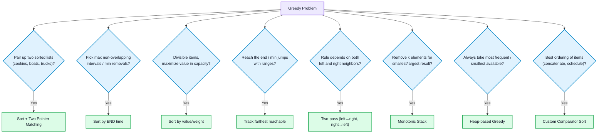
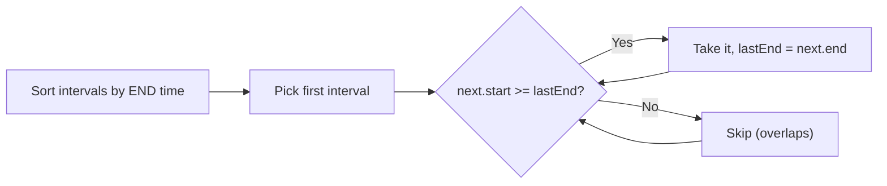
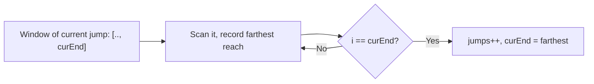

# Greedy Algorithms

## Concept
At every step, pick the choice that looks best **right now** and never reconsider. Greedy is correct only when the problem has the **greedy-choice property**: a locally optimal choice never blocks the global optimum. This must be argued, not assumed.

**Proving greedy (exchange argument):** take any optimal solution that differs from the greedy one at the first step, swap its choice for the greedy choice, and show the result is no worse. Interviews rarely demand the full proof, but you should be able to state why sorting by the chosen key works.

**Greedy vs DP:** if a counter-example exists where the best-looking local choice loses (coins {1,3,4}, target 6: greedy gives 4+1+1, optimum is 3+3), use [[Dynamic Programming]].

## 🧭 Greedy Pattern Decision Flow



---

# PART A — Sort + Match / Simple Greedy

## Pattern 1: Sort + Two-Pointer Matching
**Difficulty:** Easy (Assign Cookies, Boats to Save People, Maximum Units on a Truck)
**When to apply:** two groups to pair up (children/cookies, people/boats), or items to pack by value density.
**Intuition:** sort, then always pair the smallest sufficient resource with the smallest need, so large resources stay available for large needs.
```cpp
int findContentChildren(vector<int>& g, vector<int>& s) {   // Assign Cookies
    sort(g.begin(), g.end()); sort(s.begin(), s.end());
    int i = 0, j = 0;
    while (i < g.size() && j < s.size()) {
        if (s[j] >= g[i]) i++;   // cookie satisfies this child
        j++;                      // move to next cookie either way
    }
    return i;
}
int numRescueBoats(vector<int>& p, int limit) {              // Boats (max 2 per boat)
    sort(p.begin(), p.end());
    int l = 0, r = p.size() - 1, boats = 0;
    while (l <= r) {
        if (p[l] + p[r] <= limit) l++;   // lightest fits with heaviest
        r--; boats++;
    }
    return boats;
}
```
- Time: O(n log n), Space: O(1)
- **Remember:** boats: the heaviest person always takes a boat; the question is only whether the lightest can join.

## Pattern 2: Fractional Knapsack
**Difficulty:** Easy–Medium
**When to apply:** items can be split; maximize value within capacity.
**Intuition:** take items in decreasing **value/weight**; take a fraction of the last one.
```cpp
double fractionalKnapsack(vector<pair<int,int>>& items, int W) {   // {value, weight}
    sort(items.begin(), items.end(), [](auto& a, auto& b) {
        return (double)a.first / a.second > (double)b.first / b.second;
    });
    double total = 0;
    for (auto& [v, w] : items) {
        if (W >= w) { total += v; W -= w; }
        else { total += (double)v * W / w; break; }
    }
    return total;
}
```
- Time: O(n log n), Space: O(1)
- **Remember:** this works only because items are divisible. For 0/1 knapsack greedy fails, use DP.

## Pattern 3: Minimum Coins (canonical denominations)
**Difficulty:** Easy
**When to apply:** denominations like {1,2,5,10,20,50,100,500,2000}, where larger coins never hurt.
```cpp
int minCoins(int amount, vector<int>& coins) {   // coins sorted descending
    int count = 0;
    for (int c : coins) {
        count += amount / c;
        amount %= c;
    }
    return count;
}
```
- Time: O(d), Space: O(1)
- **Remember:** fails for arbitrary denominations ({1,3,4}); that case needs DP.

## Pattern 4: Lemonade Change (greedy simulation)
**Difficulty:** Easy
**When to apply:** give change from a running stock of bills.
**Intuition:** for $20, prefer giving $10+$5 over three $5s, since $5 bills are the most flexible and scarcest.
```cpp
bool lemonadeChange(vector<int>& bills) {
    int five = 0, ten = 0;
    for (int b : bills) {
        if (b == 5) five++;
        else if (b == 10) { if (!five) return false; five--; ten++; }
        else {
            if (ten && five) { ten--; five--; }
            else if (five >= 3) five -= 3;
            else return false;
        }
    }
    return true;
}
```
- Time: O(n), Space: O(1)

## Pattern 5: Valid Parenthesis String (range tracking)
**Difficulty:** Medium
**When to apply:** brackets with wildcard `*` (can be `(`, `)` or empty).
**Intuition:** track the **range** `[lo, hi]` of possible open-bracket counts instead of branching on each `*`.
```cpp
bool checkValidString(string s) {
    int lo = 0, hi = 0;
    for (char c : s) {
        if (c == '(') { lo++; hi++; }
        else if (c == ')') { lo--; hi--; }
        else { lo--; hi++; }      // '*' as ')' or '('
        if (hi < 0) return false;  // too many ')' even if every * is '('
        lo = max(lo, 0);           // can't have negative opens
    }
    return lo == 0;
}
```
- Time: O(n), Space: O(1)
- **Remember:** clamping `lo` at 0 is the trick; it means "extra `*` can act as empty".

---

# PART B — Interval / Scheduling Greedy



## Pattern 6: Activity Selection / N Meetings in One Room
**Difficulty:** Medium
**When to apply:** maximize number of non-overlapping meetings/activities.
**Intuition:** the meeting that **ends earliest** leaves the most room for the rest. Sorting by start time or duration fails.
```cpp
int maxMeetings(vector<int>& start, vector<int>& end) {
    int n = start.size();
    vector<pair<int,int>> m(n);
    for (int i = 0; i < n; i++) m[i] = {end[i], start[i]};
    sort(m.begin(), m.end());                 // by end time
    int count = 1, lastEnd = m[0].first;
    for (int i = 1; i < n; i++)
        if (m[i].second > lastEnd) { count++; lastEnd = m[i].first; }
    return count;
}
```
- Time: O(n log n), Space: O(n)

## Pattern 7: Non-overlapping Intervals (min removals)
**Difficulty:** Medium
**Intuition:** keep the max set of non-overlapping intervals (Pattern 6); removals = `n - kept`.
```cpp
int eraseOverlapIntervals(vector<vector<int>>& iv) {
    sort(iv.begin(), iv.end(), [](auto& a, auto& b) { return a[1] < b[1]; });
    int kept = 1, end = iv[0][1];
    for (int i = 1; i < iv.size(); i++)
        if (iv[i][0] >= end) { kept++; end = iv[i][1]; }
    return iv.size() - kept;
}
```
- Time: O(n log n), Space: O(1)

## Pattern 8: Minimum Arrows to Burst Balloons
**Difficulty:** Medium
**Intuition:** sort by end; shoot at the end of the first balloon; every balloon starting at or before that point also bursts.
```cpp
int findMinArrowShots(vector<vector<int>>& pts) {
    sort(pts.begin(), pts.end(), [](auto& a, auto& b) { return a[1] < b[1]; });
    int arrows = 1; long long pos = pts[0][1];
    for (auto& p : pts)
        if (p[0] > pos) { arrows++; pos = p[1]; }
    return arrows;
}
```
- Time: O(n log n), Space: O(1)
- **Remember:** touching intervals (`start == pos`) still burst together, so the check is `>` not `>=`. Compare with Pattern 7 where touching intervals do not overlap.

## Pattern 9: Minimum Platforms
**Difficulty:** Medium
**When to apply:** min resources (platforms, rooms) so no two overlapping events share one.
**Intuition:** sort arrivals and departures separately; sweep, +1 on arrival, -1 on departure; the peak is the answer.
```cpp
int minPlatforms(vector<int>& arr, vector<int>& dep) {
    sort(arr.begin(), arr.end()); sort(dep.begin(), dep.end());
    int i = 0, j = 0, cur = 0, best = 0, n = arr.size();
    while (i < n) {
        if (arr[i] <= dep[j]) { cur++; i++; }   // train arrives before/at departure
        else { cur--; j++; }
        best = max(best, cur);
    }
    return best;
}
```
- Time: O(n log n), Space: O(1)
- **Remember:** arrival == departure time needs a separate platform, hence `<=`. Sorting arrivals and departures independently is valid because only the count of overlaps matters, not which train is which.

## Pattern 10: Merge Intervals / Insert Interval
**Difficulty:** Medium
**Intuition:** sorted by start, extend the last interval if overlapping else push a new one. Merge Intervals is covered in [[Arrays]] Pattern 10. Insert Interval (already-sorted input) is a three-phase linear scan:
```cpp
vector<vector<int>> insert(vector<vector<int>>& iv, vector<int> nw) {
    vector<vector<int>> res; int i = 0, n = iv.size();
    while (i < n && iv[i][1] < nw[0]) res.push_back(iv[i++]);          // 1. entirely before
    while (i < n && iv[i][0] <= nw[1]) {                                // 2. overlapping: absorb
        nw[0] = min(nw[0], iv[i][0]); nw[1] = max(nw[1], iv[i][1]); i++;
    }
    res.push_back(nw);
    while (i < n) res.push_back(iv[i++]);                               // 3. entirely after
    return res;
}
```
- Time: O(n), Space: O(n)

## Pattern 11: Job Sequencing with Deadlines
**Difficulty:** Medium–Hard
**When to apply:** each job takes 1 unit, has a deadline and profit; maximize profit.
**Intuition:** take jobs in decreasing profit; place each in the **latest free slot** on or before its deadline, which keeps earlier slots open for tighter jobs.
```cpp
pair<int,int> jobSequencing(vector<array<int,3>>& jobs) {   // {id, deadline, profit}
    sort(jobs.begin(), jobs.end(), [](auto& a, auto& b) { return a[2] > b[2]; });
    int maxD = 0;
    for (auto& j : jobs) maxD = max(maxD, j[1]);
    vector<int> slot(maxD + 1, -1);
    int count = 0, profit = 0;
    for (auto& j : jobs)
        for (int d = j[1]; d >= 1; d--)
            if (slot[d] == -1) { slot[d] = j[0]; count++; profit += j[2]; break; }
    return {count, profit};
}
```
- Time: O(n log n + n·D), Space: O(D). Union-Find over slots reduces the inner search to near O(1).

## Pattern 12: Shortest Job First (min average waiting time)
**Difficulty:** Easy
**Intuition:** run shortest jobs first so fewer jobs wait behind long ones.
```cpp
double sjfAvgWait(vector<int>& burst) {
    sort(burst.begin(), burst.end());
    long long wait = 0, total = 0;
    for (int b : burst) { total += wait; wait += b; }
    return (double)total / burst.size();
}
```
- Time: O(n log n), Space: O(1)

---

# PART C — Reachability / Two-Pass / Running-Total Greedy

## Pattern 13: Jump Game I & II
**Difficulty:** Medium
**Intuition:** you never need the exact path, only the **farthest reachable index** so far.
```cpp
bool canJump(vector<int>& nums) {                    // Jump Game I
    int far = 0;
    for (int i = 0; i < nums.size(); i++) {
        if (i > far) return false;                    // stuck before reaching i
        far = max(far, i + nums[i]);
    }
    return true;
}
int jump(vector<int>& nums) {                        // Jump Game II: min jumps
    int jumps = 0, curEnd = 0, far = 0;
    for (int i = 0; i < (int)nums.size() - 1; i++) {
        far = max(far, i + nums[i]);
        if (i == curEnd) { jumps++; curEnd = far; }   // must jump: commit to the best landing
    }
    return jumps;
}
```

- Time: O(n), Space: O(1)
- **Remember:** Jump Game II is implicit BFS by levels: each jump = one level, `curEnd` = level boundary.

## Pattern 14: Candy (two-pass)
**Difficulty:** Hard
**When to apply:** each element's value depends on **both** neighbors (higher rating than a neighbor means more candy).
**Intuition:** satisfy the left constraint in one pass, the right constraint in another, take the max per position.
```cpp
int candy(vector<int>& r) {
    int n = r.size();
    vector<int> c(n, 1);
    for (int i = 1; i < n; i++)  if (r[i] > r[i-1]) c[i] = c[i-1] + 1;      // left → right
    for (int i = n - 2; i >= 0; i--) if (r[i] > r[i+1]) c[i] = max(c[i], c[i+1] + 1); // right → left
    return accumulate(c.begin(), c.end(), 0);
}
```
- Time: O(n), Space: O(n) (O(1) with the slope-counting variant)
- **Remember:** the `max` in the second pass preserves the left-pass guarantee.

## Pattern 15: Gas Station
**Difficulty:** Medium
**Intuition:** if total gas ≥ total cost, a solution exists. If the tank goes negative at `i`, no start in `[start, i]` works, so restart from `i+1`.
```cpp
int canCompleteCircuit(vector<int>& gas, vector<int>& cost) {
    int total = 0, tank = 0, start = 0;
    for (int i = 0; i < gas.size(); i++) {
        int d = gas[i] - cost[i];
        total += d; tank += d;
        if (tank < 0) { start = i + 1; tank = 0; }
    }
    return total >= 0 ? start : -1;
}
```
- Time: O(n), Space: O(1)

## Pattern 16: Partition Labels
**Difficulty:** Medium
**Intuition:** record each character's last index; extend the current partition end to cover the last occurrence of every character seen; cut when `i == end`.
```cpp
vector<int> partitionLabels(string s) {
    int last[26];
    for (int i = 0; i < s.size(); i++) last[s[i] - 'a'] = i;
    vector<int> res; int start = 0, end = 0;
    for (int i = 0; i < s.size(); i++) {
        end = max(end, last[s[i] - 'a']);
        if (i == end) { res.push_back(end - start + 1); start = i + 1; }
    }
    return res;
}
```
- Time: O(n), Space: O(1)

---

# PART D — Greedy with Data Structures / Custom Order

## Pattern 17: Remove K Digits (monotonic stack)
**Difficulty:** Medium
**Intuition:** to get the smallest number, remove a digit whenever it is larger than the digit after it. A stack kept increasing does this in one pass.
```cpp
string removeKdigits(string num, int k) {
    string st;
    for (char c : num) {
        while (k && !st.empty() && st.back() > c) { st.pop_back(); k--; }
        st.push_back(c);
    }
    while (k--) st.pop_back();                       // leftover removals from the end
    int i = 0; while (i < st.size() && st[i] == '0') i++;   // strip leading zeros
    st = st.substr(i);
    return st.empty() ? "0" : st;
}
```
- Time: O(n), Space: O(n)
- **Remember:** the two edge cases are leftover `k` (non-decreasing input) and leading zeros.

## Pattern 18: Task Scheduler / Reorganize String (frequency greedy)
**Difficulty:** Medium
**Intuition:** always schedule the most frequent remaining item, since it constrains the arrangement most.
```cpp
int leastInterval(vector<char>& tasks, int n) {      // Task Scheduler: formula form
    vector<int> f(26, 0);
    for (char t : tasks) f[t - 'A']++;
    int mx = *max_element(f.begin(), f.end());
    int cntMax = count(f.begin(), f.end(), mx);
    return max((int)tasks.size(), (mx - 1) * (n + 1) + cntMax);
}
string reorganizeString(string s) {                  // max-heap alternate
    unordered_map<char,int> f; for (char c : s) f[c]++;
    priority_queue<pair<int,char>> pq;
    for (auto& [c, n] : f) pq.push({n, c});
    string res;
    while (pq.size() > 1) {
        auto [n1, c1] = pq.top(); pq.pop();
        auto [n2, c2] = pq.top(); pq.pop();
        res += c1; res += c2;
        if (--n1) pq.push({n1, c1});
        if (--n2) pq.push({n2, c2});
    }
    if (!pq.empty()) { if (pq.top().first > 1) return ""; res += pq.top().second; }
    return res;
}
```
- Time: O(n) formula / O(n log 26) heap, Space: O(1)
- **Remember:** Task Scheduler's `(mx-1)*(n+1)+cntMax` counts the frame layout; if tasks overflow the frame, the answer is just `tasks.size()`.

## Pattern 19: Huffman Coding (min-heap merge)
**Difficulty:** Hard
**Intuition:** repeatedly merge the two least frequent symbols; rare symbols end up deepest (longest codes). Same idea as "minimum cost to connect ropes".
```cpp
int huffmanCost(vector<int>& freq) {
    priority_queue<int, vector<int>, greater<int>> pq(freq.begin(), freq.end());
    int cost = 0;
    while (pq.size() > 1) {
        int a = pq.top(); pq.pop();
        int b = pq.top(); pq.pop();
        cost += a + b;
        pq.push(a + b);
    }
    return cost;
}
```
- Time: O(n log n), Space: O(n)

## Pattern 20: Custom Comparator Ordering (Largest Number)
**Difficulty:** Medium
**Intuition:** when the answer is a best **ordering**, define a pairwise rule and sort by it. Here `a` goes before `b` if `a+b > b+a` as strings.
```cpp
string largestNumber(vector<int>& nums) {
    vector<string> s;
    for (int x : nums) s.push_back(to_string(x));
    sort(s.begin(), s.end(), [](const string& a, const string& b) { return a + b > b + a; });
    if (s[0] == "0") return "0";                     // all zeros
    string res; for (auto& x : s) res += x;
    return res;
}
```
- Time: O(n log n · L), Space: O(n·L)
- **Remember:** the comparator must be a strict weak ordering; `a+b > b+a` is, which is why this works.

---

## Quick reference

| Trigger | Pattern | Difficulty |
|---|---|---|
| Match two sorted groups | Sort + two pointers | Easy |
| Divisible items, capacity | Fractional knapsack (value/weight) | Easy–Medium |
| Standard currency, min coins | Largest coin first | Easy |
| Max non-overlapping intervals | Sort by end | Medium |
| Min removals / min arrows | Sort by end | Medium |
| Min rooms/platforms | Sort arrivals & departures | Medium |
| Deadlines + profit | Sort by profit, latest free slot | Medium–Hard |
| Reach end / min jumps | Farthest reach | Medium |
| Depends on both neighbors | Two-pass | Hard |
| Circular route, running total | Reset start on negative tank | Medium |
| Smallest number after removing k | Monotonic stack | Medium |
| Most frequent first | Heap / formula | Medium |
| Merge smallest two repeatedly | Min-heap (Huffman) | Hard |
| Best concatenation order | Custom comparator | Medium |

## Complexity summary

| Pattern | Time | Space |
|---|---|---|
| Sort + matching | O(n log n) | O(1) |
| Fractional knapsack | O(n log n) | O(1) |
| Interval scheduling family | O(n log n) | O(1)–O(n) |
| Min platforms | O(n log n) | O(1) |
| Job sequencing | O(n log n + n·D) | O(D) |
| Jump Game I / II | O(n) | O(1) |
| Candy | O(n) | O(n) |
| Gas station | O(n) | O(1) |
| Partition labels | O(n) | O(1) |
| Remove K digits | O(n) | O(n) |
| Huffman / heap greedy | O(n log n) | O(n) |
| Largest number | O(n log n · L) | O(n·L) |

## Common mistakes
- Sorting intervals by **start** (or duration) for activity selection instead of **end** time.
- Applying greedy to 0/1 knapsack or arbitrary coin denominations. Test with a small counter-example before trusting greedy.
- Min platforms: using `<` instead of `<=` when arrival equals departure.
- Balloons vs non-overlapping intervals: touching intervals burst together but do not overlap. The `>` vs `>=` boundary differs between the two.
- Candy: forgetting `max` in the second pass, which breaks the left-pass constraint.
- Remove K digits: not handling leftover `k` and leading zeros.
- Jump Game II: iterating to `n-1` inclusive adds a spurious jump at the last index.
- Fractional knapsack: integer division when computing value/weight ratio.

## When NOT to use greedy
- A counter-example exists where an early good-looking choice blocks a better global answer: use [[Dynamic Programming]].
- You must enumerate all valid configurations, not find one optimum: use [[Backtracking]].

## Related concepts
- [[Dynamic Programming]]: the fallback when greedy-choice property fails.
- [[Arrays]]: Merge Intervals (Pattern 10) shares the sort-then-sweep skeleton.
- [[Sorting Techniques]]: almost every greedy here is "sort by the right key, then one pass".
- [[Backtracking]]: contrast of exhaustive search with committing to one choice.
