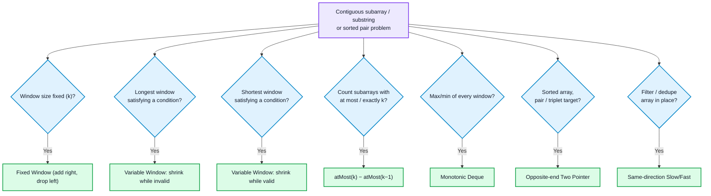
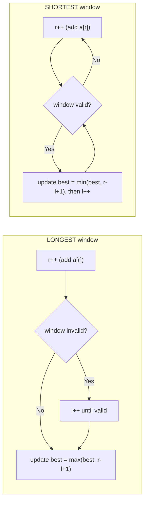
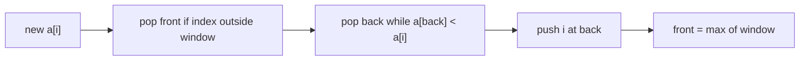

# Sliding Window & Two Pointer

## Concept
Both techniques replace a nested loop with **two indices that only move forward (or toward each other)**, so each element is visited a constant number of times and O(n²) becomes O(n).

- **Sliding window:** two indices `l, r` bound a contiguous range. `r` expands the window, `l` shrinks it when a constraint breaks.
- **Two pointer:** two indices walk an array (usually sorted) from opposite ends or in the same direction, and each comparison lets you discard one candidate for good.

**Why it works:** each pointer moves at most `n` times, so total work is O(n) even though there are two nested-looking loops. The skill is knowing *why discarding is safe* (sortedness, monotonic window sum, or a monotonic condition).

**Window validity needs monotonicity:** growing the window can only make the constraint harder, shrinking can only make it easier. With negative numbers a sum-based window is not monotonic, so use prefix sums + hashing instead (see [[Hashing]] Pattern 4).

## 🧭 Pattern Decision Flow



## The two variable-window templates


**Rule:** for *longest*, update the answer after restoring validity. For *shortest*, update the answer while the window is valid, before shrinking.

---

# PART A — Fixed-Size Window

## Pattern 1: Fixed Window (maximum sum of k elements)
**Difficulty:** Easy
**When to apply:** "subarray of size k", "every window of length k".
**Intuition:** add the new right element, drop the element that fell out on the left. Never recompute the sum.
```cpp
int maxSumK(vector<int>& a, int k) {
    int sum = 0, best = INT_MIN;
    for (int i = 0; i < a.size(); i++) {
        sum += a[i];
        if (i >= k) sum -= a[i - k];           // element leaving the window
        if (i >= k - 1) best = max(best, sum);  // window is full
    }
    return best;
}
```
- Time: O(n), Space: O(1)
- **Remember:** the answer is only valid once `i >= k-1`; updating earlier uses a partial window.

## Pattern 2: Maximum Points from Cards (complement window)
**Difficulty:** Medium
**When to apply:** pick k items from the two *ends* of an array.
**Intuition:** picking k from the ends means picking a prefix of length `i` and a suffix of length `k-i`. Start with the first k as the prefix, then move one card at a time from prefix to suffix.
```cpp
int maxScore(vector<int>& c, int k) {
    int n = c.size(), sum = 0;
    for (int i = 0; i < k; i++) sum += c[i];       // take first k
    int best = sum;
    for (int i = 0; i < k; i++) {
        sum += c[n - 1 - i] - c[k - 1 - i];        // swap one prefix card for one suffix card
        best = max(best, sum);
    }
    return best;
}
```
- Time: O(k), Space: O(1)
- **Remember:** equivalent view: the cards you *leave* form a contiguous window of size `n-k`; minimizing its sum maximizes your score.

## Pattern 3: Sliding Window Maximum (monotonic deque)
**Difficulty:** Hard
**When to apply:** need the max (or min) of every window of size k.
**Intuition:** keep a deque of indices whose values are in **decreasing** order. The front is always the current window's max. A new element removes every smaller element from the back, since they can never be a max again while it is in the window.
```cpp
vector<int> maxSlidingWindow(vector<int>& a, int k) {
    deque<int> dq;                                  // indices, values decreasing
    vector<int> res;
    for (int i = 0; i < a.size(); i++) {
        if (!dq.empty() && dq.front() <= i - k) dq.pop_front();   // out of window
        while (!dq.empty() && a[dq.back()] < a[i]) dq.pop_back(); // dominated
        dq.push_back(i);
        if (i >= k - 1) res.push_back(a[dq.front()]);
    }
    return res;
}
```

- Time: O(n) (each index pushed and popped once), Space: O(k)
- **Remember:** store **indices**, not values, so you can tell when the front has expired.

---

# PART B — Variable Window: Longest Valid

## Pattern 4: Longest Substring Without Repeating Characters
**Difficulty:** Medium
**Intuition:** keep each character's last position; when `s[r]` was seen inside the window, jump `l` past that position.
```cpp
int lengthOfLongestSubstring(string s) {
    vector<int> last(256, -1);
    int l = 0, best = 0;
    for (int r = 0; r < s.size(); r++) {
        if (last[s[r]] >= l) l = last[s[r]] + 1;   // duplicate inside window
        last[s[r]] = r;
        best = max(best, r - l + 1);
    }
    return best;
}
```
- Time: O(n), Space: O(1) (fixed charset)
- **Remember:** the `>= l` check matters; an old occurrence left of `l` is outside the window and must be ignored.

## Pattern 5: Max Consecutive Ones III (at most k zeros)
**Difficulty:** Medium
**Intuition:** "longest subarray with at most k zeros". Count zeros in the window; shrink while the count exceeds k.
```cpp
int longestOnes(vector<int>& a, int k) {
    int l = 0, zeros = 0, best = 0;
    for (int r = 0; r < a.size(); r++) {
        if (a[r] == 0) zeros++;
        while (zeros > k) if (a[l++] == 0) zeros--;
        best = max(best, r - l + 1);
    }
    return best;
}
```
- Time: O(n), Space: O(1)

## Pattern 6: At Most K Distinct (Fruit Into Baskets)
**Difficulty:** Medium
**Intuition:** keep a frequency map for the window; shrink while distinct count exceeds k.
```cpp
int totalFruit(vector<int>& f) {                  // k = 2
    unordered_map<int,int> cnt;
    int l = 0, best = 0;
    for (int r = 0; r < f.size(); r++) {
        cnt[f[r]]++;
        while (cnt.size() > 2) {
            if (--cnt[f[l]] == 0) cnt.erase(f[l]);   // erase at zero or size() lies
            l++;
        }
        best = max(best, r - l + 1);
    }
    return best;
}
```
- Time: O(n), Space: O(k)
- **Remember:** erase keys when their count hits 0, otherwise `size()` still counts them.

## Pattern 7: Longest Repeating Character Replacement
**Difficulty:** Medium
**Intuition:** a window is valid if `length - (count of most frequent char) <= k` (everything else can be replaced). The max-frequency value never needs to decrease: the window only grows when a new max is found, so the stale value is safe.
```cpp
int characterReplacement(string s, int k) {
    vector<int> cnt(26, 0);
    int l = 0, maxf = 0, best = 0;
    for (int r = 0; r < s.size(); r++) {
        maxf = max(maxf, ++cnt[s[r] - 'A']);
        if ((r - l + 1) - maxf > k) cnt[s[l++] - 'A']--;   // slide, don't shrink
        best = max(best, r - l + 1);
    }
    return best;
}
```
- Time: O(n), Space: O(1)
- **Remember:** this uses `if`, not `while`. The window slides at constant size when invalid; it only ever grows when a better max appears.

---

# PART C — Counting Subarrays

## Pattern 8: atMost(k) − atMost(k−1) trick
**Difficulty:** Medium–Hard
**When to apply:** count subarrays with **exactly** k (sum, odd numbers, distinct values). "Exactly" is not monotonic, but "at most" is.
**Intuition:** `exactly(k) = atMost(k) - atMost(k-1)`. For each right end `r`, the number of valid subarrays ending at `r` is `r - l + 1`.
```cpp
int atMostSum(vector<int>& a, int k) {             // non-negative values
    if (k < 0) return 0;
    int l = 0, sum = 0, cnt = 0;
    for (int r = 0; r < a.size(); r++) {
        sum += a[r];
        while (sum > k) sum -= a[l++];
        cnt += r - l + 1;                           // all subarrays ending at r
    }
    return cnt;
}
int numSubarraysWithSum(vector<int>& a, int goal) {  // Binary Subarrays With Sum
    return atMostSum(a, goal) - atMostSum(a, goal - 1);
}
```
Same skeleton, different "cost":
- **Count Nice Subarrays (k odd numbers):** map each element to `x % 2`, then reuse `numSubarraysWithSum`.
- **Subarrays with K Different Integers:** replace `sum` with a frequency map and distinct count.
```cpp
int atMostDistinct(vector<int>& a, int k) {
    unordered_map<int,int> cnt;
    int l = 0, res = 0;
    for (int r = 0; r < a.size(); r++) {
        cnt[a[r]]++;
        while (cnt.size() > k) { if (--cnt[a[l]] == 0) cnt.erase(a[l]); l++; }
        res += r - l + 1;
    }
    return res;
}
// answer = atMostDistinct(a, k) - atMostDistinct(a, k - 1)
```
- Time: O(n), Space: O(1) / O(k)
- **Remember:** guard `k < 0` (when `goal = 0`, `goal-1 = -1`). Works only for non-negative values; with negatives use prefix sum + hashmap.

## Pattern 9: Substrings Containing All Three Characters
**Difficulty:** Medium
**Intuition:** at each right end `r`, the leftmost valid start is `min(last a, last b, last c)`. Every start from 0 to that index gives a valid substring, so add `min + 1`.
```cpp
int numberOfSubstrings(string s) {
    int last[3] = {-1, -1, -1}, cnt = 0;
    for (int i = 0; i < s.size(); i++) {
        last[s[i] - 'a'] = i;
        if (last[0] >= 0 && last[1] >= 0 && last[2] >= 0)
            cnt += 1 + min({last[0], last[1], last[2]});
    }
    return cnt;
}
```
- Time: O(n), Space: O(1)

---

# PART D — Variable Window: Shortest Valid

## Pattern 10: Minimum Size Subarray Sum
**Difficulty:** Medium
**Intuition:** expand until `sum >= target`, then shrink as far as it stays valid, recording the length each time.
```cpp
int minSubArrayLen(int target, vector<int>& a) {
    int l = 0, sum = 0, best = INT_MAX;
    for (int r = 0; r < a.size(); r++) {
        sum += a[r];
        while (sum >= target) {
            best = min(best, r - l + 1);
            sum -= a[l++];
        }
    }
    return best == INT_MAX ? 0 : best;
}
```
- Time: O(n), Space: O(1)
- **Remember:** positive numbers only; this is the "shortest" template (update while valid).

## Pattern 11: Minimum Window Substring
**Difficulty:** Hard
**Intuition:** `need[c]` tracks how many of each character is still required; `missing` counts total unmet characters. When `missing == 0` the window is valid, so shrink from the left to find the shortest one.
```cpp
string minWindow(string s, string t) {
    vector<int> need(128, 0);
    for (char c : t) need[c]++;
    int missing = t.size(), l = 0, bestL = 0, bestLen = INT_MAX;
    for (int r = 0; r < s.size(); r++) {
        if (need[s[r]]-- > 0) missing--;            // useful character
        while (missing == 0) {
            if (r - l + 1 < bestLen) { bestLen = r - l + 1; bestL = l; }
            if (++need[s[l]] > 0) missing++;        // removing a required character
            l++;
        }
    }
    return bestLen == INT_MAX ? "" : s.substr(bestL, bestLen);
}
```
- Time: O(n + m), Space: O(1)
- **Remember:** `need` goes negative for surplus characters, which is how the code distinguishes "needed" from "extra" without a second map.

---

# PART E — Two Pointer

## Pattern 12: Opposite Ends (Two Sum II, Container With Most Water)
**Difficulty:** Easy–Medium
**Intuition:** in a sorted array, if the pair sum is too big, the right element can pair with nothing larger on the left, so discard it. For Container With Most Water, the shorter wall limits the area, so move the shorter side.
```cpp
vector<int> twoSum(vector<int>& a, int target) {    // sorted input
    int l = 0, r = a.size() - 1;
    while (l < r) {
        int s = a[l] + a[r];
        if (s == target) return {l + 1, r + 1};
        s < target ? l++ : r--;
    }
    return {};
}
int maxArea(vector<int>& h) {
    int l = 0, r = h.size() - 1, best = 0;
    while (l < r) {
        best = max(best, min(h[l], h[r]) * (r - l));
        h[l] < h[r] ? l++ : r--;                     // move the limiting wall
    }
    return best;
}
```
- Time: O(n), Space: O(1)

## Pattern 13: 3Sum / 4Sum (sort + fix + two pointer)
**Difficulty:** Medium
**Intuition:** sort, fix one element, solve two-sum on the rest. Skip duplicates at every level to avoid repeated triplets. 4Sum adds one more fixed loop; k-Sum generalizes recursively.
```cpp
vector<vector<int>> threeSum(vector<int>& a) {
    sort(a.begin(), a.end());
    vector<vector<int>> res;
    int n = a.size();
    for (int i = 0; i < n - 2; i++) {
        if (i > 0 && a[i] == a[i-1]) continue;       // skip duplicate anchor
        int l = i + 1, r = n - 1;
        while (l < r) {
            long long s = (long long)a[i] + a[l] + a[r];
            if (s < 0) l++;
            else if (s > 0) r--;
            else {
                res.push_back({a[i], a[l], a[r]});
                l++; r--;
                while (l < r && a[l] == a[l-1]) l++;   // skip duplicates after a hit
                while (l < r && a[r] == a[r+1]) r--;
            }
        }
    }
    return res;
}
```
- Time: O(n²) for 3Sum, O(n³) for 4Sum, Space: O(1) extra
- **Remember:** use `long long` for 4Sum sums. Duplicate skipping is the part interviewers check.

## Pattern 14: Trapping Rain Water
**Difficulty:** Hard
**Intuition:** water above a bar = `min(maxLeft, maxRight) - height`. Whichever side has the smaller current max is the limiting side, so process that side and move its pointer. No need to know the other side's exact max.
```cpp
int trap(vector<int>& h) {
    int l = 0, r = h.size() - 1, lMax = 0, rMax = 0, water = 0;
    while (l < r) {
        if (h[l] < h[r]) {
            lMax = max(lMax, h[l]);
            water += lMax - h[l++];
        } else {
            rMax = max(rMax, h[r]);
            water += rMax - h[r--];
        }
    }
    return water;
}
```
- Time: O(n), Space: O(1) (the prefix/suffix-max array version is O(n) space)

## Pattern 15: Same Direction (Slow/Fast, in-place filter)
**Difficulty:** Easy
**Intuition:** `fast` scans, `slow` marks where the next kept element goes.
```cpp
int removeDuplicates(vector<int>& a) {              // sorted
    if (a.empty()) return 0;
    int slow = 1;
    for (int fast = 1; fast < a.size(); fast++)
        if (a[fast] != a[fast - 1]) a[slow++] = a[fast];
    return slow;
}
void moveZeroes(vector<int>& a) {
    int slow = 0;
    for (int fast = 0; fast < a.size(); fast++)
        if (a[fast] != 0) swap(a[slow++], a[fast]);
}
```
- Time: O(n), Space: O(1)
- **Remember:** Fast/slow on a linked list (cycle, middle) is a different use of the same idea; see [[Linked List]] Patterns 3 and 4.

---

## Quick reference

| Trigger | Pattern | Difficulty |
|---|---|---|
| "subarray of size k" | Fixed window | Easy |
| Pick k from both ends | Complement window | Medium |
| Max of each window | Monotonic deque | Hard |
| Longest with no repeats / at most k bad | Variable window (longest) | Medium |
| Longest with at most k distinct | Window + frequency map | Medium |
| Longest after k replacements | maxFreq trick | Medium |
| Count subarrays with exactly k | atMost(k) − atMost(k−1) | Medium–Hard |
| Count substrings containing all chars | Last-seen minimum | Medium |
| Shortest subarray with sum ≥ target | Variable window (shortest) | Medium |
| Shortest substring covering a pattern | need[] + missing counter | Hard |
| Sorted array pair/triplet | Opposite-end two pointer | Easy–Medium |
| Water / area between bars | Move the limiting side | Medium–Hard |
| In-place dedupe / filter | Slow/fast same direction | Easy |

## Complexity summary

| Pattern | Time | Space |
|---|---|---|
| Fixed window | O(n) | O(1) |
| Max points from cards | O(k) | O(1) |
| Sliding window maximum | O(n) | O(k) |
| Longest window (no repeat / ≤k zeros) | O(n) | O(1) |
| At most K distinct | O(n) | O(k) |
| Char replacement | O(n) | O(1) |
| atMost(k) counting | O(n) | O(1) / O(k) |
| Min size subarray sum | O(n) | O(1) |
| Min window substring | O(n + m) | O(1) |
| Two Sum II / Container | O(n) | O(1) |
| 3Sum / 4Sum | O(n²) / O(n³) | O(1) |
| Trapping rain water | O(n) | O(1) |
| Remove duplicates / move zeroes | O(n) | O(1) |

## Common mistakes
- Using a sum-based window when the array has **negative numbers**; the sum is no longer monotonic, so shrinking does not restore validity. Use prefix sums + hashmap.
- Updating the answer at the wrong moment: after shrinking for *longest*, but **while valid, before shrinking** for *shortest*.
- Not erasing a key when its count reaches 0, so `map.size()` over-counts distinct values.
- Fixed window: recording the answer before the window has `k` elements.
- `atMost(k-1)` with `k = 0` producing `-1`; guard `if (k < 0) return 0`.
- 3Sum: forgetting to skip duplicates for the anchor *and* after a hit, which produces repeated triplets.
- Sliding window maximum: storing values instead of indices, so expired elements cannot be detected.
- Applying two pointers to an **unsorted** array where sortedness was the reason discarding was safe.
- Character replacement: replacing `if` with `while` or recomputing `maxf`, which breaks the "never shrink" invariant.

## When NOT to use it
- Negative numbers with a sum condition: use prefix sum + hashing ([[Hashing]]).
- Non-contiguous selection (subsequences, subsets): use [[Dynamic Programming]] or [[Recursion & Backtracking]].
- Need all pairs or all subarrays enumerated rather than counted or optimized.

## Related concepts
- [[Arrays]]: Patterns 1 and 2 are the short versions of this note.
- [[Strings]]: Pattern 2 (substring window) and frequency counting.
- [[Hashing]]: Pattern 4 (prefix sum + hashmap) is the replacement when negatives appear; Pattern 6 is window + hashmap.
- [[Linked List]]: fast/slow pointers for middle and cycle detection.
- [[Binary Search]]: "binary search on answer" is the other common way to turn a monotonic condition into O(n log n).
- [[Greedy Algorithms]]: shortest-window and two-pointer proofs use the same "discarding is safe" argument.
