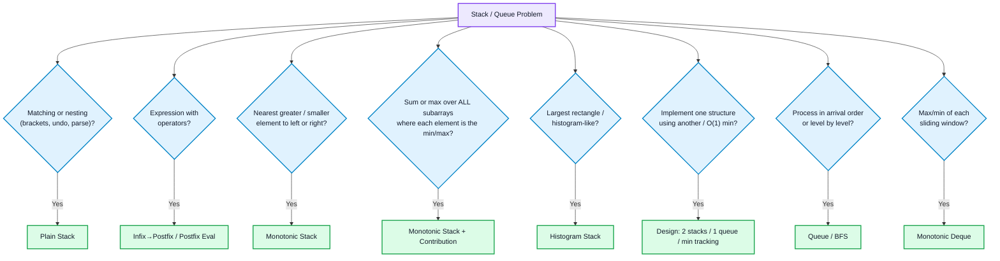
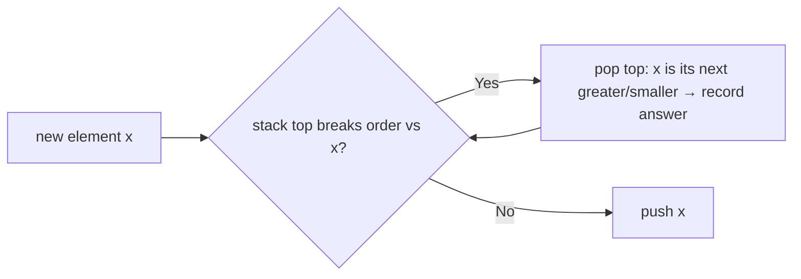
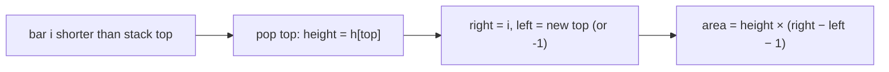

# Stack & Queues

## Concept
- **Stack (LIFO):** last in, first out. Think of a pile of plates; only the top is accessible.
- **Queue (FIFO):** first in, first out. Think of a line at a counter.
- **Deque:** insert and remove at both ends.

**Why they matter for DSA:** a stack remembers "what is still unresolved, most recent first" (open brackets, pending operators, elements waiting for a bigger neighbour). A queue processes things in arrival order (BFS, scheduling). The single most valuable idea here is the **monotonic stack**, which turns many O(n²) "nearest greater/smaller" problems into O(n).

**C++ STL:** `stack<T>` (`push`, `pop`, `top`, `empty`, `size`), `queue<T>` (`push`, `pop`, `front`, `back`), `deque<T>`. `pop()` returns nothing, so read `top()`/`front()` first. A `vector<T>` used with `push_back`/`back`/`pop_back` is often a faster stack.

## 🧭 Pattern Decision Flow



---

# PART A — Design & Basic Stack Problems

## Pattern 1: Valid Parentheses (matching)
**Difficulty:** Easy
**When to apply:** nested pairs that must close in the reverse order they opened.
**Intuition:** push openers; on a closer, the top must be its matching opener.
```cpp
bool isValid(string s) {
    stack<char> st;
    for (char c : s) {
        if (c == '(' || c == '{' || c == '[') st.push(c);
        else {
            if (st.empty()) return false;
            char t = st.top(); st.pop();
            if ((c == ')' && t != '(') || (c == '}' && t != '{') || (c == ']' && t != '[')) return false;
        }
    }
    return st.empty();                       // leftover openers = invalid
}
```
- Time: O(n), Space: O(n)
- **Remember:** check `empty()` before reading `top()`, and again at the end.

## Pattern 2: Stack using Queues / Queue using Stacks
**Difficulty:** Easy–Medium
**Intuition (stack with one queue):** after each push, rotate the queue `size-1` times so the newest element sits at the front.
**Intuition (queue with two stacks):** `in` receives pushes; `out` serves pops. Refill `out` from `in` **only when `out` is empty**, which reverses order once and makes every element move at most twice (amortized O(1)).
```cpp
class MyStack {                                   // push O(n), pop O(1)
    queue<int> q;
public:
    void push(int x) {
        q.push(x);
        for (int i = 0; i < (int)q.size() - 1; i++) { q.push(q.front()); q.pop(); }
    }
    int pop() { int v = q.front(); q.pop(); return v; }
    int top() { return q.front(); }
    bool empty() { return q.empty(); }
};

class MyQueue {                                   // amortized O(1)
    stack<int> in, out;
    void move() { if (out.empty()) while (!in.empty()) { out.push(in.top()); in.pop(); } }
public:
    void push(int x) { in.push(x); }
    int pop() { move(); int v = out.top(); out.pop(); return v; }
    int peek() { move(); return out.top(); }
    bool empty() { return in.empty() && out.empty(); }
};
```
- **Remember:** moving `in` → `out` while `out` is non-empty breaks FIFO order.

## Pattern 3: Min Stack (O(1) getMin)
**Difficulty:** Medium
**Intuition:** store, with every element, the minimum of the stack *at the time it was pushed*.
```cpp
class MinStack {
    stack<pair<int,int>> st;                       // {value, min so far}
public:
    void push(int x) {
        int mn = st.empty() ? x : min(x, st.top().second);
        st.push({x, mn});
    }
    void pop() { st.pop(); }
    int top() { return st.top().first; }
    int getMin() { return st.top().second; }
};
```
- Time: O(1) per op, Space: O(n)
- **Remember:** a single running `min` variable fails after popping the minimum. The O(1)-extra-space version stores `2*x - min` and decodes on pop; know it exists, but use the pair version unless asked.

## Pattern 4: Circular Queue / Deque
**Difficulty:** Medium
**Intuition:** a fixed array with `head` and `count`; indices wrap with `% capacity`. Tracking `count` avoids the classic full-vs-empty ambiguity of `head == tail`.
```cpp
class MyCircularQueue {
    vector<int> a; int head = 0, cnt = 0;
public:
    MyCircularQueue(int k) : a(k) {}
    bool enQueue(int x) { if (cnt == a.size()) return false; a[(head + cnt) % a.size()] = x; cnt++; return true; }
    bool deQueue() { if (!cnt) return false; head = (head + 1) % a.size(); cnt--; return true; }
    int Front() { return cnt ? a[head] : -1; }
    int Rear() { return cnt ? a[(head + cnt - 1) % a.size()] : -1; }
    bool isEmpty() { return cnt == 0; }
    bool isFull() { return cnt == a.size(); }
};
```
- Time: O(1) per op, Space: O(k)

---

# PART B — Expression Evaluation

## Pattern 5: Infix → Postfix and Postfix Evaluation
**Difficulty:** Medium–Hard
**When to apply:** parse arithmetic with precedence and brackets, or evaluate Reverse Polish Notation.
**Intuition (conversion):** operands go straight to output. For an operator, pop stack operators of **higher or equal precedence** to the output first, then push it. `(` is pushed; `)` pops until `(`. Prefix works the same on the reversed string.
```cpp
int prec(char c) { return c == '^' ? 3 : (c == '*' || c == '/') ? 2 : (c == '+' || c == '-') ? 1 : 0; }

string infixToPostfix(string s) {                  // single-character operands
    stack<char> st; string out;
    for (char c : s) {
        if (isalnum(c)) out += c;
        else if (c == '(') st.push(c);
        else if (c == ')') { while (st.top() != '(') { out += st.top(); st.pop(); } st.pop(); }
        else {
            while (!st.empty() && (prec(st.top()) > prec(c) || (prec(st.top()) == prec(c) && c != '^')))
                { out += st.top(); st.pop(); }     // '^' is right-associative
            st.push(c);
        }
    }
    while (!st.empty()) { out += st.top(); st.pop(); }
    return out;
}

int evalRPN(vector<string>& t) {
    stack<long long> st;
    for (auto& x : t) {
        if (x == "+" || x == "-" || x == "*" || x == "/") {
            long long b = st.top(); st.pop();
            long long a = st.top(); st.pop();     // second operand pops first
            st.push(x == "+" ? a + b : x == "-" ? a - b : x == "*" ? a * b : a / b);
        } else st.push(stoll(x));
    }
    return st.top();
}
```
- Time: O(n), Space: O(n)
- **Remember:** for `-` and `/`, the operand popped **first** is the right-hand side. Swapping them is the most common RPN bug.

---

# PART C — Monotonic Stack (the key pattern)

**Idea:** keep the stack in sorted order (increasing or decreasing). When a new element breaks the order, pop elements; each pop **resolves** the popped element ("its next greater/smaller is the current one"). Every index is pushed and popped once, so total O(n).



| You want | Stack order (top → bottom) | Pop while |
|---|---|---|
| Next **greater** to the right | decreasing values | `a[top] < x` |
| Next **smaller** to the right | increasing values | `a[top] > x` |
| Previous greater / smaller | scan left→right, answer = top *before* pushing | same conditions |

## Pattern 6: Next Greater Element (I, II circular)
**Difficulty:** Medium
**Intuition:** scan from the right keeping a stack of candidates; pop everything not greater than `a[i]`; what remains on top is the answer. For circular arrays, loop `2n-1` down to 0 and index with `i % n`.
```cpp
vector<int> nextGreaterCircular(vector<int>& a) {
    int n = a.size();
    vector<int> res(n, -1);
    stack<int> st;                                    // values, decreasing from bottom to top
    for (int i = 2 * n - 1; i >= 0; i--) {
        while (!st.empty() && st.top() <= a[i % n]) st.pop();
        if (i < n && !st.empty()) res[i] = st.top();
        st.push(a[i % n]);
    }
    return res;
}
```
For Next Greater Element **I** (subset query), compute `next[value]` over `nums2` into a map, then look up each `nums1` value. For **next smaller**, flip the comparison. For indices instead of values, push indices.
- Time: O(n), Space: O(n)
- **Remember:** pop on `<=` for *strictly* greater; pop on `<` if equal counts as greater. Only write `res[i]` for `i < n` in the circular version.

## Pattern 7: Daily Temperatures / Stock Span
**Difficulty:** Medium
**Intuition (waiting days):** stack of indices with decreasing temperatures; when a warmer day arrives, every colder index on the stack is resolved with distance `i - idx`.
**Intuition (span):** previous-greater index; span = `i - prevGreater`.
```cpp
vector<int> dailyTemperatures(vector<int>& t) {
    int n = t.size();
    vector<int> res(n, 0);
    stack<int> st;                                    // indices, temperatures decreasing
    for (int i = 0; i < n; i++) {
        while (!st.empty() && t[st.top()] < t[i]) {
            res[st.top()] = i - st.top();
            st.pop();
        }
        st.push(i);
    }
    return res;
}
vector<int> stockSpan(vector<int>& p) {
    vector<int> span(p.size());
    stack<int> st;
    for (int i = 0; i < p.size(); i++) {
        while (!st.empty() && p[st.top()] <= p[i]) st.pop();
        span[i] = st.empty() ? i + 1 : i - st.top();
        st.push(i);
    }
    return span;
}
```
- Time: O(n), Space: O(n)

## Pattern 8: Sum of Subarray Minimums / Ranges (contribution technique)
**Difficulty:** Hard
**When to apply:** "sum of min (or max) over **all** subarrays".
**Intuition:** instead of enumerating subarrays, count in how many subarrays each `a[i]` is the minimum. If `L` = number of choices for the left end and `R` = number of choices for the right end, element `i` contributes `a[i] * L * R`. Find `L` and `R` with two monotonic-stack passes.
```cpp
int sumSubarrayMins(vector<int>& a) {
    const int MOD = 1e9 + 7;
    int n = a.size();
    vector<long long> L(n), R(n);
    stack<int> st;
    for (int i = 0; i < n; i++) {                     // previous element <= a[i]
        while (!st.empty() && a[st.top()] > a[i]) st.pop();
        L[i] = st.empty() ? i + 1 : i - st.top();
        st.push(i);
    }
    while (!st.empty()) st.pop();
    for (int i = n - 1; i >= 0; i--) {                // next element strictly < a[i]
        while (!st.empty() && a[st.top()] >= a[i]) st.pop();
        R[i] = st.empty() ? n - i : st.top() - i;
        st.push(i);
    }
    long long ans = 0;
    for (int i = 0; i < n; i++) ans = (ans + a[i] * L[i] % MOD * R[i]) % MOD;
    return ans;
}
```
**Sum of Subarray Ranges** = (sum of subarray maximums) − (sum of subarray minimums). Run the same routine with comparisons flipped for the maximums.
- Time: O(n), Space: O(n)
- **Remember:** one side must be **strict** and the other **non-strict** (`>` on one pass, `>=` on the other), otherwise equal values double-count a subarray. Check with `[2,2]`: answer is 6.

## Pattern 9: Asteroid Collision
**Difficulty:** Medium
**Intuition:** a collision only happens when the stack top moves right (`> 0`) and the incoming asteroid moves left (`< 0`). Resolve against the top repeatedly.
```cpp
vector<int> asteroidCollision(vector<int>& a) {
    vector<int> st;
    for (int x : a) {
        bool alive = true;
        while (alive && x < 0 && !st.empty() && st.back() > 0) {
            if (st.back() < -x) st.pop_back();            // top explodes, keep checking
            else { if (st.back() == -x) st.pop_back(); alive = false; }   // equal: both die; larger top: x dies
        }
        if (alive) st.push_back(x);
    }
    return st;
}
```
- Time: O(n), Space: O(n)

## Pattern 10: Largest Rectangle in Histogram
**Difficulty:** Hard
**Intuition:** for each bar, the widest rectangle using it as the shortest bar extends to the nearest smaller bar on each side. Keep a stack of **increasing** heights. When a shorter bar `i` arrives, each popped bar's right limit is `i` and its left limit is the new stack top. A sentinel height 0 at the end flushes the stack.
```cpp
int largestRectangleArea(vector<int>& h) {
    stack<int> st;
    int best = 0, n = h.size();
    for (int i = 0; i <= n; i++) {
        int cur = (i == n) ? 0 : h[i];
        while (!st.empty() && h[st.top()] >= cur) {
            int height = h[st.top()]; st.pop();
            int left = st.empty() ? -1 : st.top();
            best = max(best, height * (i - left - 1));
        }
        st.push(i);
    }
    return best;
}
```

- Time: O(n), Space: O(n)
- **Remember:** width is `i - left - 1`, not `i - left`. The sentinel pass is required or bars still on the stack are never counted.

## Pattern 11: Maximal Rectangle (binary matrix)
**Difficulty:** Hard
**Intuition:** treat each row as the base of a histogram; `heights[j]` = consecutive 1s ending at this row in column `j`. Run Pattern 10 per row.
```cpp
int maximalRectangle(vector<vector<char>>& M) {
    if (M.empty()) return 0;
    int n = M[0].size(), best = 0;
    vector<int> h(n, 0);
    for (auto& row : M) {
        for (int j = 0; j < n; j++) h[j] = row[j] == '1' ? h[j] + 1 : 0;   // reset on 0
        best = max(best, largestRectangleArea(h));
    }
    return best;
}
```
- Time: O(rows · cols), Space: O(cols)

---

# PART D — Other Stack/Queue Problems

## Pattern 12: Celebrity Problem (elimination)
**Difficulty:** Medium
**Intuition:** compare two people `a`, `b` with `knows(a,b)`. If `a` knows `b`, `a` cannot be the celebrity; otherwise `b` cannot be. Each question eliminates one person, leaving one candidate; verify it.
```cpp
int celebrity(vector<vector<int>>& M, int n) {      // M[i][j] = 1 if i knows j
    int a = 0, b = n - 1;
    while (a < b) { if (M[a][b]) a++; else b--; }
    for (int i = 0; i < n; i++)
        if (i != a && (M[a][i] || !M[i][a])) return -1;   // celebrity knows nobody, everyone knows celebrity
    return a;
}
```
- Time: O(n), Space: O(1)

## Pattern 13: Where the same ideas live elsewhere
- **Sliding Window Maximum** (monotonic **deque**): [[Sliding Window & Two Pointer]] Pattern 3.
- **Remove K Digits** (monotonic stack): [[Greedy Algorithms]] Pattern 17.
- **Trapping Rain Water** (stack version) and two-pointer version: [[Sliding Window & Two Pointer]] Pattern 14.
- **LRU Cache** (hashmap + doubly linked list, queue-like recency order): [[Linked List]] Pattern 14.
- **BFS / level-order** (queue): see [[Matrix]] Pattern 8; trees and graphs will use the same queue loop.
- **Min cost / scheduling with a queue of events**: see heap-based problems in the upcoming Heaps note.

---

## Quick reference

| Trigger | Pattern | Difficulty |
|---|---|---|
| Brackets / nested validity | Plain stack | Easy |
| Build stack from queues or queue from stacks | Design (lazy transfer) | Easy–Medium |
| O(1) minimum | Min stack (store min with each element) | Medium |
| Fixed-size queue with wrap-around | Circular queue (`head`, `count`) | Medium |
| Operator precedence / RPN | Infix→postfix, postfix eval | Medium–Hard |
| Next/previous greater or smaller | Monotonic stack | Medium |
| Days until warmer, stock span | Monotonic stack (indices) | Medium |
| Sum over all subarrays of min/max | Contribution counting | Hard |
| Collisions that cancel | Stack simulation | Medium |
| Largest rectangle (histogram / matrix) | Increasing stack + sentinel | Hard |
| Find the person everyone knows | Pairwise elimination | Medium |

## Complexity summary

| Pattern | Time | Space |
|---|---|---|
| Valid parentheses | O(n) | O(n) |
| Stack ↔ queue design | O(1) amortized per op (O(n) for the costly op of the one-queue stack) | O(n) |
| Min stack | O(1) per op | O(n) |
| Circular queue | O(1) per op | O(k) |
| Infix→postfix / RPN | O(n) | O(n) |
| Next greater / smaller | O(n) | O(n) |
| Daily temperatures / stock span | O(n) | O(n) |
| Sum of subarray minimums | O(n) | O(n) |
| Asteroid collision | O(n) | O(n) |
| Largest rectangle in histogram | O(n) | O(n) |
| Maximal rectangle | O(rows·cols) | O(cols) |
| Celebrity problem | O(n) | O(1) |

## Common mistakes
- Calling `top()`/`pop()` on an empty stack. Always guard with `empty()`.
- Assuming `pop()` returns the element (it returns `void` in C++).
- Monotonic stack: wrong pop condition (`<` vs `<=`) for equal values, giving off-by-duplicates answers.
- Pushing values when you need **indices** (you cannot compute distances or widths from values).
- Queue via two stacks: transferring while `out` is non-empty breaks order.
- Min stack: tracking one global min that becomes wrong after the minimum is popped.
- RPN / expression: swapping operand order for `-` and `/`; forgetting `^` is right-associative.
- Histogram: forgetting the sentinel flush and using width `i - left` instead of `i - left - 1`.
- Contribution counting: using the same strictness on both sides, which double-counts equal elements.
- Circular next greater: writing answers for indices `>= n`, or looping only `n` times.

## When NOT to use a stack/queue
- You need arbitrary random access or sorted order: use an array, `set`, or heap.
- The "nearest greater" is needed in a window with deletions from the middle: a balanced structure or segment tree is better.
- Recursion is clearer and depth is small: the call stack is already a stack (see [[Recursion & Backtracking]]).

## Related concepts
- [[Recursion & Backtracking]]: reversing/sorting a stack recursively; recursion uses the call stack implicitly.
- [[Greedy Algorithms]]: Remove K Digits and the custom-comparator patterns use a stack greedily.
- [[Sliding Window & Two Pointer]]: monotonic **deque** for window maximum, and the stack-free two-pointer water problem.
- [[Linked List]]: LRU Cache, and stack/queue implementations on linked nodes.
- [[Arrays]]: most monotonic-stack problems are array scans that replace nested loops.
