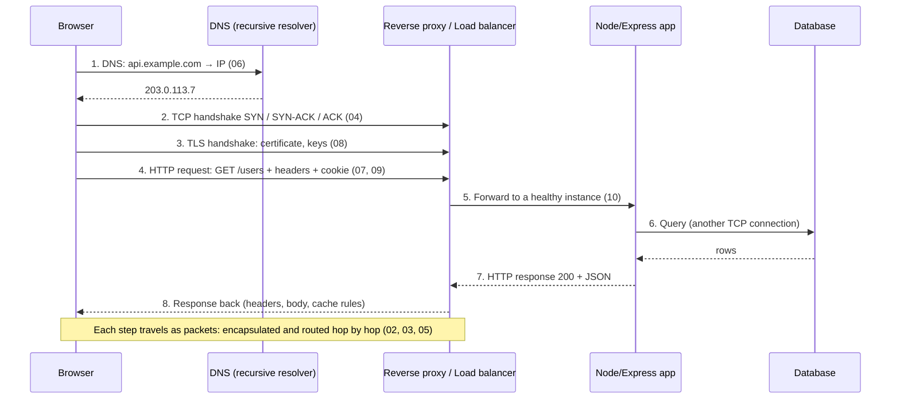
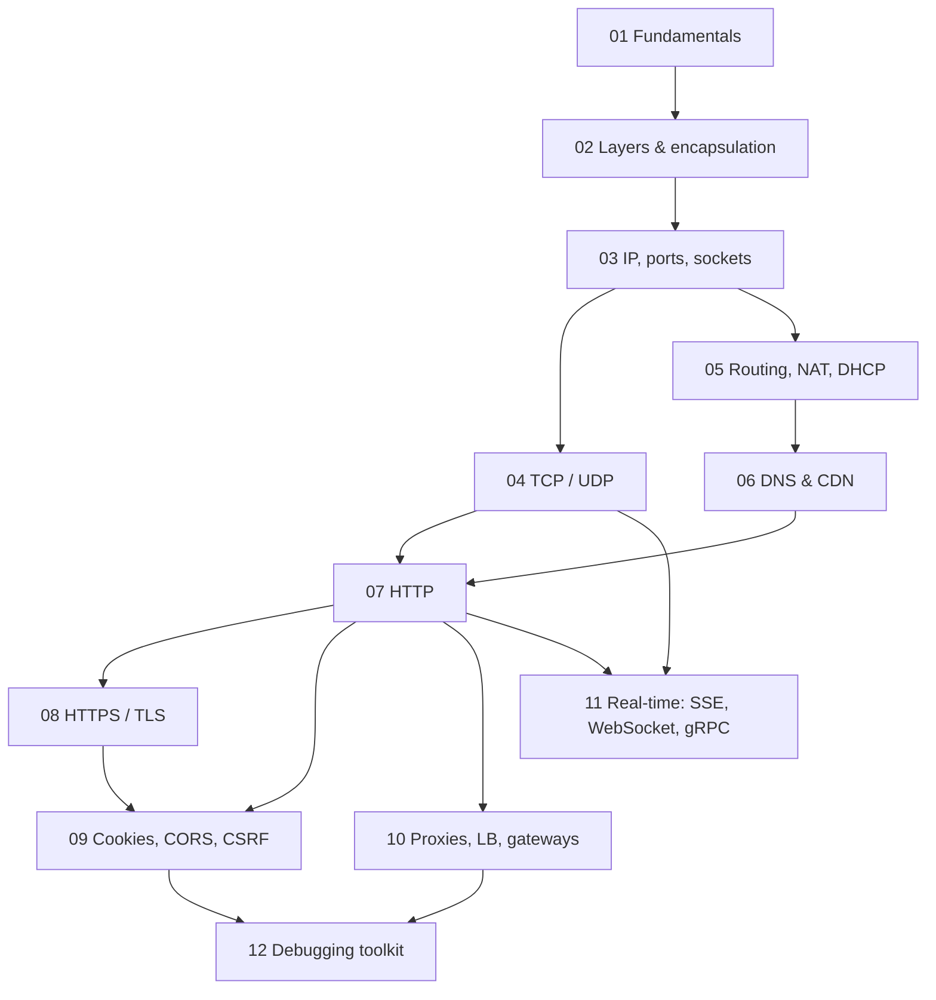

# 🌐 Networking: Map of Content

> How data travels from a client to a backend server, how connections are set up and secured, and how to debug them when they fail. Part of [[Computer Science MOC]].

## Learning path

| # | Note | Curriculum topics covered | Status |
|---|---|---|---|
| 01 | [[01 - Networking Fundamentals]] | 1 What is networking · 2 Client-server | ⬜ |
| 02 | [[02 - OSI and TCP-IP Models]] | 3 OSI · 4 TCP/IP · 5 Encapsulation/decapsulation | ⬜ |
| 03 | [[03 - IP Addresses, Ports and Subnetting]] | 6 IPv4/IPv6 · 7 Public vs private · 8 Ports & sockets · 9 Subnetting | ⬜ |
| 04 | [[04 - TCP and UDP]] | 10–16: TCP, UDP, handshake, termination, reliability, flow & congestion control, TCP vs UDP | ⬜ |
| 05 | [[05 - Link and Network Layer]] | 17 MAC · 18 ARP · 19 ICMP/ping · 20 Routers & switches · 21 Routing · 22 NAT · 23 DHCP | ⬜ |
| 06 | [[06 - DNS and CDN]] | 24–28: DNS, resolution, records, recursive vs authoritative, CDN | ⬜ |
| 07 | [[07 - HTTP Deep Dive]] | 29–33 request/response, methods, status codes, headers · 35 HTTP/3 & QUIC · 36 Keep-alive & pooling · 37 Statelessness (34 HTTP/1.1 vs 2 → [[HTTP Versions & the QUERY Method]]) | ⬜ |
| 08 | [[08 - HTTPS, TLS and Certificates]] | 38–42: HTTPS, SSL vs TLS, handshake, certificates, public/private keys | ⬜ |
| 09 | [[09 - Cookies, Sessions and Browser Security]] | 43–48: cookies, sessions, cookies vs localStorage, CORS, SOP, CSRF | ⬜ |
| 10 | [[10 - Proxies, Load Balancers and API Gateways]] | 49 Reverse proxy · 50 Load balancing · 54 API gateway · 55 Forward proxy | ⬜ |
| 11 | [[11 - Real-Time Communication and SSE]] | 52 SSE · (51 WebSockets → [[WebSocket]]) · (53 gRPC → [[gRPC]]) | ⬜ |
| 12 | [[12 - Practical Networking Toolkit]] | 56–60: curl, dig/nslookup, Wireshark, ping/traceroute, ss/netstat | ⬜ |

Update ⬜ → ✅ once you can explain the note aloud without looking and have done its exercises.

## Big picture: what happens when you open `https://api.example.com/users`

Every number is a note in this folder. If a request fails, the failure is at exactly one of these steps; [[12 - Practical Networking Toolkit]] gives one tool per step.

## Concept map

## Priorities for backend work

Weeks of effort should go to **TCP, DNS, HTTP, TLS, cookies/CORS, proxies**, and the **debugging tools**. Learn subnetting and routing well enough to read a VPC/security-group config, but don't go deep into network administration before you've built and deployed APIs.

## How to study each note

1. Read once, then close it and **explain the concept aloud** (or write 5 lines from memory).
2. Do the **exercises/commands**: networking sticks only when you see real packets and responses.
3. Answer the *Check yourself* questions.
4. Connect it to something you've built: e.g. trace one request in your Express project end to end.

## Where networking appears elsewhere in the vault

- [[00 - Node and Express MOC]]: HTTP server, methods, headers, middleware, cookies, auth in Node
- [[API]], [[REST APIs]], [[GraphQL]], [[gRPC]], [[WebSocket]], [[JWT]], [[Authentication and Authorization]]
- [[HTTP Versions & the QUERY Method]]: HTTP/1.1 vs HTTP/2, QUERY method
- [[System Design MOC]]: load balancing, caching, CDN, scaling
- [[Linux]]: the shell environment for every tool in note 12
- [[Encapsulation.excalidraw|Encapsulation diagram]]: Excalidraw, stored in `Computer Science/Excalidraw/`
