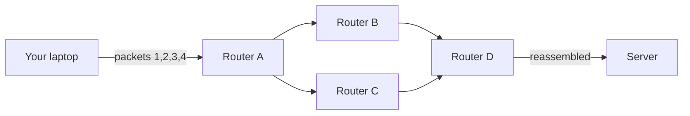
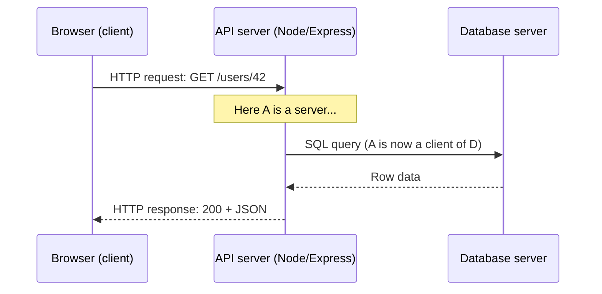

# 🌐 Networking Fundamentals

> Part of [[00 - Networking MOC]] · Next: [[02 - OSI and TCP-IP Models]]

## What is computer networking?

A **computer network** is a group of devices (computers, phones, servers, routers) connected so they can **exchange data**. **Computer networking** is the set of rules, hardware, and software that makes that exchange possible.

The **Internet** is not one network. It is a **network of networks**: millions of smaller networks (homes, colleges, companies, ISPs) that agree to exchange traffic using the same shared rules, called **protocols**.

**Protocol** = an agreed set of rules for communication, like a language and etiquette. Two machines can only talk if they follow the same protocol. Examples: HTTP (web pages and APIs), DNS (name lookup), TCP (reliable delivery).

## Why does it matter for a backend developer?

Every backend system is a networked system. Your API is a program waiting for data to arrive over a network, and everything it does (reading a database, calling Stripe, serving a React app) is more network communication. Most "weird production bugs" are network problems in disguise: timeouts, connection refused, DNS failures, CORS errors, 502s. Knowing what happens between `fetch()` and your Express handler lets you debug these quickly.

## Key vocabulary

| Term | Meaning | Example |
|---|---|---|
| **Host / node** | Any device on a network | Laptop, server, phone, router |
| **Packet** | A small chunk of data sent across the network | 1 of ~1000 chunks of an image |
| **Protocol** | Rules for communication | HTTP, TCP, DNS |
| **Bandwidth** | Maximum data that can be sent per second (how wide the pipe is) | 100 Mbps |
| **Latency** | Time for data to travel from A to B (how long the pipe is) | 40 ms |
| **Throughput** | Actual data rate you achieve in practice | 60 Mbps |
| **RTT** (round-trip time) | Time for a message to go there and the reply to come back | `ping` shows this |
| **LAN** | Local Area Network: one building or home | Your Wi-Fi |
| **WAN** | Wide Area Network: spans cities or countries | The Internet, ISP backbones |

**Bandwidth vs latency** (commonly confused): a highway with 8 lanes has high bandwidth, but if it is 1000 km long, the trip is still slow (high latency). Downloading a big file is limited by bandwidth. Loading a page that needs 50 small requests is usually limited by latency, because each request pays the round trip. This is why reducing the *number* of round trips (keep-alive, HTTP/2, CDNs) matters so much in backend work.

## How data actually travels: packet switching

Data is not sent as one continuous stream. It is split into **packets**, each labeled with source and destination addresses. Routers forward each packet independently, possibly along different paths, and the receiver reassembles them.

Why this design? Sharing. Many users interleave packets on the same links, so no one reserves a whole line (unlike an old phone call). If one path fails, packets can take another.

Packets may arrive late, out of order, duplicated, or not at all. Handling that is the transport layer's job (see [[04 - TCP and UDP]]).

## Client-server architecture

The dominant model for web software:

- **Client**: the program that **starts** communication and asks for something (browser, mobile app, `curl`, another backend service).
- **Server**: the program that **waits** for requests, does the work, and responds.

Important points beginners often miss:

1. **Client and server are roles of programs, not types of machines.** Your laptop can run an Express server. A server in the cloud can be a client when it calls a payment API.
2. A server is usually a **long-running process listening on a port** (see [[03 - IP Addresses, Ports and Subnetting]]). `app.listen(3000)` is exactly that.
3. **One server serves many clients at the same time**, which is why servers need concurrency (Node's event loop, thread pools; see [[05 - Node.js Event Loop Phases & libuv Thread Pool]]).
4. Communication follows **request → response**. The client talks first. (Real-time features such as [[WebSocket]] and [[11 - Real-Time Communication and SSE|SSE]] relax this so the server can push.)

Notice that the API server is a **server** to the browser and a **client** to the database. Backends are chains of client-server relationships.

### Client-server vs peer-to-peer (P2P)

In **P2P** (BitTorrent, some video calls), every node can act as both client and server and exchange data directly. Client-server is simpler to secure, update, and control centrally, but the server is a bottleneck and a single point of failure unless you scale it (see [[10 - Proxies, Load Balancers and API Gateways]]).

### Tiers

| Architecture | Idea | Example |
|---|---|---|
| 2-tier | Client talks directly to database | Old desktop apps |
| 3-tier | Client → application server → database | Almost every web app (React → Express → PostgreSQL) |
| n-tier / microservices | Several services call each other | Large systems; see [[System Design MOC]] |

Putting the application server between client and DB lets you enforce authentication, validation, and business rules in one trusted place. Never let a browser talk straight to your database.

## Common mistakes

- Thinking "server" means a physical machine or a special OS. It is just software that listens.
- Confusing `localhost` / `127.0.0.1` (this machine only) with an address other devices can reach. A server bound only to localhost cannot be reached from your phone or from outside a Docker container (details in [[03 - IP Addresses, Ports and Subnetting]]).
- Blaming "slow internet" without separating **latency** from **bandwidth**.
- Assuming packets arrive in order and complete. The network gives no such guarantee on its own.

## Related concepts

- [[02 - OSI and TCP-IP Models]]: how the many protocols are organized into layers
- [[REST APIs]], [[API]]: the contract clients and servers speak at the application level
- [[06 - Building an HTTP Server with the http Module]]: build a server yourself
