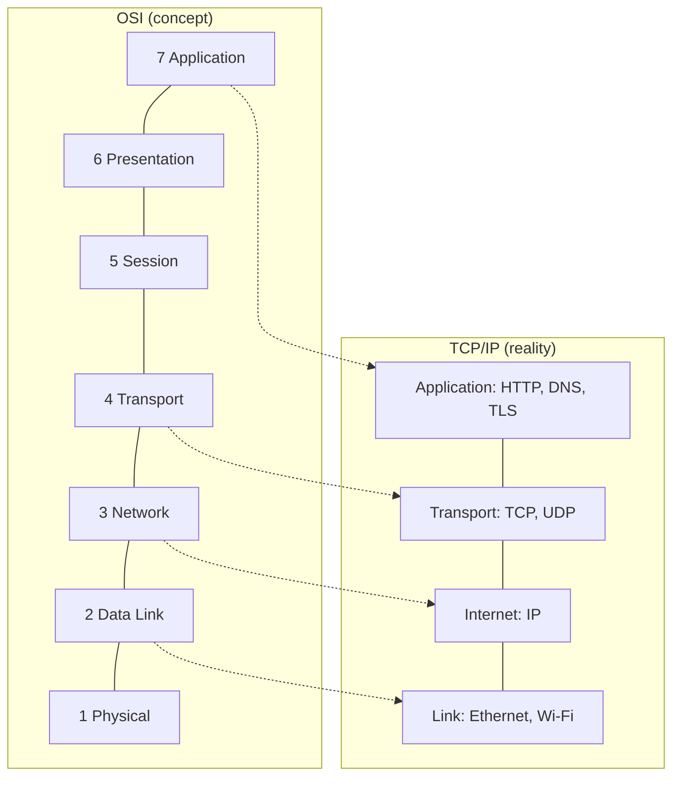
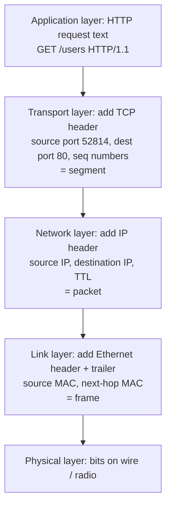

# 🧱 OSI and TCP/IP Models (Layers & Encapsulation)

> Part of [[00 - Networking MOC]] · Previous: [[01 - Networking Fundamentals]] · Next: [[03 - IP Addresses, Ports and Subnetting]]

## Why layers exist

Sending data across the world involves many different jobs: turning bits into electrical or radio signals, finding a path through many networks, making delivery reliable, encrypting, and finally understanding "this is a request for /users". If one giant protocol did everything, changing any part would break everything.

So networking splits the work into **layers**. Each layer:

- does **one job**,
- offers a simple service to the layer **above**,
- uses the services of the layer **below**,
- can be **replaced independently**. HTTP does not care whether the bits travel over Wi-Fi, Ethernet, or fibre; Wi-Fi does not care whether it carries HTTP or video.

Layered models are *reference models* for thinking and debugging. Real protocols do not always fit neatly.

## The OSI model (7 layers)

OSI (Open Systems Interconnection) is a conceptual model. Mnemonic from layer 7 down: **A**ll **P**eople **S**eem **T**o **N**eed **D**ata **P**rocessing.

| # | Layer | Job | Data unit (PDU) | Examples |
|---|---|---|---|---|
| 7 | **Application** | Protocols apps use directly | Data / message | HTTP, DNS, SMTP, FTP, SSH |
| 6 | **Presentation** | Format, encoding, encryption, compression | Data | TLS (arguably), JSON/UTF-8 encoding, gzip |
| 5 | **Session** | Open, maintain, close dialogues | Data | Session handling, RPC sessions |
| 4 | **Transport** | Process-to-process delivery, ports, reliability | **Segment** (TCP) / **Datagram** (UDP) | TCP, UDP |
| 3 | **Network** | Logical addressing and routing across networks | **Packet** | IP, ICMP, routers |
| 2 | **Data Link** | Delivery between directly connected devices, MAC addresses | **Frame** | Ethernet, Wi-Fi, ARP, switches |
| 1 | **Physical** | Raw bits on a medium | **Bits** | Cables, radio, fibre, NIC |

In practice layers 5, 6, 7 blur together in the real Internet, because applications handle those jobs themselves.

## The TCP/IP model (4 layers)

The model the Internet actually runs on. It is simpler and maps onto OSI:

| TCP/IP layer | OSI layers | What lives here |
|---|---|---|
| **Application** | 7, 6, 5 | HTTP, DNS, TLS, SMTP, SSH, your Express app |
| **Transport** | 4 | TCP, UDP (ports) |
| **Internet** | 3 | IP, ICMP (addresses, routing) |
| **Link** (Network Access) | 2, 1 | Ethernet, Wi-Fi, ARP, NIC drivers |

Some textbooks use a 5-layer hybrid that splits Link into Data Link + Physical. Know the 4-layer version for real systems and the 7-layer one because interviews and tooling vocabulary ("L4 load balancer", "L7 proxy") use it.

## Encapsulation and decapsulation

This is *how* the layers cooperate, and it is the core idea of this note.

**Encapsulation** (sender): moving down the stack, each layer takes what it received from above and **wraps it with its own header** (and sometimes a trailer). That header carries the info that layer's peer needs.

**Decapsulation** (receiver): moving up the stack, each layer reads and **removes its own header**, then passes the payload up.

Think of posting a letter: you write a letter (data), put it in an envelope with the receiving address (IP header), place that envelope in a courier bag with a route label (Ethernet header). Each handler reads only its own label.

![[Encapsulation.excalidraw]]

### Walkthrough: `GET /users` over HTTP

What each header contributes:

| Layer | Header answers | Typical size |
|---|---|---|
| TCP | Which *application* (port)? Which byte of the stream (sequence number)? | 20 bytes minimum |
| IP | Which *machine* (IP address)? How many hops left (TTL)? | 20 bytes minimum (IPv4) |
| Ethernet | Which *next device on this local link* (MAC)? | 14-byte header + 4-byte trailer (FCS checksum) |

**MTU** (Maximum Transmission Unit) is the largest frame payload a link allows, typically **1500 bytes** on Ethernet. After IP and TCP headers (40 bytes), about **1460 bytes** of application data fit per packet (**MSS**, Maximum Segment Size). So a 1 MB response is split into roughly 700 segments, then reassembled in order by TCP at the receiver.

### The key insight: what changes at each hop

When a packet crosses several routers:

- **IP addresses stay the same** end to end (source and destination machines), except when NAT rewrites them (see [[05 - Link and Network Layer]]).
- **MAC addresses change at every hop**, since a MAC only identifies the next device on the *current* link.
- **TTL decreases** by 1 at each router.

This explains why MAC addresses are useless outside your LAN, and why routers operate at layer 3.

### Decapsulation at the receiver

The NIC checks the frame's destination MAC and checksum, strips the Ethernet header, and passes the IP packet up. IP checks the destination address and protocol field (6 = TCP, 17 = UDP) and strips its header. TCP reorders segments, checks sequence numbers, and uses the **destination port** to hand the data to the right process (your Node server on port 80/3000). The application finally reads clean HTTP text.

## Where is TLS in all this?

TLS (HTTPS) sits between the application and transport layers: it encrypts HTTP data **before** it goes to TCP. Because the model is a guide, not a law, you will see it called layer 6 or "layer 4.5". See [[08 - HTTPS, TLS and Certificates]].

## Why it matters for backend work

- **"L4 vs L7"**: an L4 load balancer routes by IP and port only (fast, cannot see URLs). An L7 load balancer or reverse proxy reads HTTP (routes `/api` and `/images` differently, can terminate TLS). See [[10 - Proxies, Load Balancers and API Gateways]].
- **Debugging by layer**: work bottom-up. Is the link up? Can you `ping` (L3)? Is the port open (L4)? Does TLS succeed? Does HTTP return the right status (L7)? The toolkit in [[12 - Practical Networking Toolkit]] follows this ladder.
- **Firewalls** are configured per layer: L3/L4 rules (IP, port) vs L7 rules (WAF inspecting HTTP).
- **Wireshark** shows each layer's header expanded, which is the best way to *see* encapsulation.

## Common mistakes and misconceptions

- Treating OSI as how the Internet is actually built. The Internet is TCP/IP; OSI is a teaching/debugging vocabulary.
- Saying "HTTP is a transport protocol". HTTP is application layer; TCP/QUIC transport it.
- Thinking IP addresses change per hop (they do not; MAC addresses do).
- Mixing up PDU names: **segment** (L4 TCP), **datagram** (L4 UDP), **packet** (L3), **frame** (L2).

## Check yourself

1. At which layer do ports live? At which do MAC addresses live?
2. A packet passes 5 routers. Which addresses change, and which stay?
3. Why is HTTP/3 called a transport change and not an application change?

## Related concepts

- [[04 - TCP and UDP]] (Transport) · [[03 - IP Addresses, Ports and Subnetting]] (Network) · [[05 - Link and Network Layer]] (Link/Network devices)
- [[HTTP Versions & the QUERY Method]]: HTTP/2 vs HTTP/1.1 at the application/transport boundary
