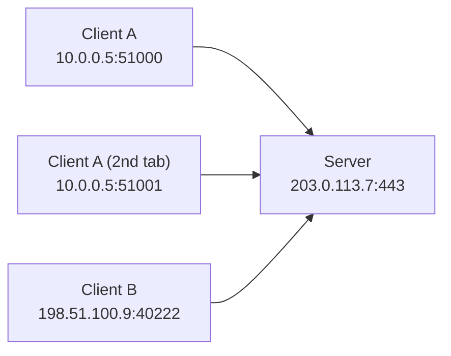

# 🔢 IP Addresses, Ports, Sockets and Subnetting

> Part of [[00 - Networking MOC]] · Previous: [[02 - OSI and TCP-IP Models]] · Next: [[04 - TCP and UDP]]

## IP address: the address of a machine

An **IP address** identifies a device's network interface so packets can be routed to it. It works at the Network layer. Analogy: the IP is the **building address**; the port (later in this note) is the **apartment number**.

### IPv4

- **32 bits**, written as four decimal numbers (octets) from 0 to 255: `192.168.1.10`.
- Each octet is 8 bits, so `192.168.1.10` is `11000000.10101000.00000001.00001010`.
- Total space: 2³² ≈ **4.3 billion** addresses. That sounds like a lot, but the world has far more devices. This **exhaustion** is why NAT ([[05 - Link and Network Layer]]) and IPv6 exist.

### IPv6

- **128 bits**, written as eight groups of 4 hex digits: `2001:0db8:0000:0000:0000:ff00:0042:8329`.
- Shortening rules: drop leading zeros in a group, and replace **one** run of all-zero groups with `::` → `2001:db8::ff00:42:8329`.
- Space: 2¹²⁸ ≈ 3.4×10³⁸, enough that every device can have a globally unique address and NAT is not needed.
- No broadcast; uses multicast and NDP (instead of ARP). Loopback is `::1`.

| | IPv4 | IPv6 |
|---|---|---|
| Size | 32 bits | 128 bits |
| Example | `203.0.113.7` | `2001:db8::7` |
| Header | variable (20+ bytes) | fixed 40 bytes |
| NAT needed? | Usually | No |
| DNS record | `A` | `AAAA` |

Most real systems are **dual-stack** (run both). In URLs an IPv6 literal needs brackets: `http://[::1]:3000/`.

## Network part and host part (CIDR notation)

An IPv4 address has two parts: which **network** it belongs to, and which **host** inside that network. The **subnet mask** says where the split is.

**CIDR notation** `a.b.c.d/N` means the first **N bits** are the network part.

```
192.168.1.10/24
Network bits (24):  192.168.1
Host bits (8):      .10
Subnet mask: 255.255.255.0  (24 ones then 8 zeros)
```

Devices decide "is the destination on my own network?" by applying the mask to both addresses. Same network → send directly (via ARP). Different network → send to the **default gateway** (router). See [[05 - Link and Network Layer]].

## Subnetting basics

**Subnetting** = splitting a larger network into smaller ones by borrowing host bits for the network part.

**Why?** Organize networks (office, servers, guests), improve security (isolate databases from public-facing servers), limit broadcast traffic, and allocate addresses without waste. In cloud (AWS VPC) you do this constantly: public subnets for load balancers, private subnets for app servers and DBs.

**Formulas** for a `/N` IPv4 network:

- Total addresses = 2^(32 − N)
- Usable hosts = 2^(32 − N) − 2 (first address = **network address**, last = **broadcast address**)

| CIDR | Mask | Total addresses | Usable hosts |
|---|---|---|---|
| /8 | 255.0.0.0 | 16,777,216 | 16,777,214 |
| /16 | 255.255.0.0 | 65,536 | 65,534 |
| /24 | 255.255.255.0 | 256 | 254 |
| /26 | 255.255.255.192 | 64 | 62 |
| /28 | 255.255.255.240 | 16 | 14 |
| /30 | 255.255.255.252 | 4 | 2 |
| /32 | 255.255.255.255 | 1 | a single host |

### Worked example: split `192.168.1.0/24` into 4 subnets

Need 4 subnets → borrow 2 bits (2² = 4) → new prefix **/26** (24 + 2). Each has 64 addresses (62 usable):

| Subnet | Network address | Usable range | Broadcast |
|---|---|---|---|
| 1 | 192.168.1.0/26 | .1 – .62 | .63 |
| 2 | 192.168.1.64/26 | .65 – .126 | .127 |
| 3 | 192.168.1.128/26 | .129 – .190 | .191 |
| 4 | 192.168.1.192/26 | .193 – .254 | .255 |

Quick check "is `192.168.1.100` in `192.168.1.64/26`?" The block runs .64 to .127 → yes.

AWS note: cloud providers reserve a few extra addresses per subnet, so usable counts are slightly lower there.

## Public vs private IP

| | Public IP | Private IP |
|---|---|---|
| Reachable from the Internet? | Yes, globally unique | No, only inside a local network |
| Who assigns | ISP / cloud provider (via registries) | You / your router (DHCP) |
| Reused? | Never duplicated on the Internet | Same ranges reused in millions of networks |
| Example | `203.0.113.7` | `192.168.1.10` |

**Private ranges (RFC 1918):**

| Range | CIDR | Typical use |
|---|---|---|
| 10.0.0.0 – 10.255.255.255 | 10.0.0.0/8 | Large orgs, cloud VPCs |
| 172.16.0.0 – 172.31.255.255 | 172.16.0.0/12 | Medium networks, Docker default bridge (172.17.x.x) |
| 192.168.0.0 – 192.168.255.255 | 192.168.0.0/16 | Home/office routers |

**Other special addresses:**

- `127.0.0.0/8` (usually `127.0.0.1`): **loopback**, traffic never leaves your machine. Name: `localhost`.
- `0.0.0.0`: "all interfaces" when *binding*, or "unspecified" when used as a source.
- `169.254.0.0/16`: **link-local**, self-assigned when DHCP fails. Seeing it means "network config failed".
- `255.255.255.255`: limited broadcast.
- `100.64.0.0/10`: **CGNAT** space used by ISPs; if your router's WAN IP is in this range, you are behind carrier NAT and cannot receive inbound connections directly.

**How private devices reach the Internet:** the router performs **NAT**, swapping the private source IP for its single public IP. Consequence for backend: a server meant to accept Internet traffic needs a public IP (or a public load balancer/port forward in front of it). Your laptop's `192.168.x.x` is not reachable from the Internet. Details in [[05 - Link and Network Layer]].

## Ports

An IP gets data to the right **machine**. A **port** gets it to the right **program** on that machine. A port is a **16-bit number: 0 – 65535**, always paired with a protocol (TCP port 80 and UDP port 80 are different).

| Range | Name | Notes |
|---|---|---|
| 0 – 1023 | **Well-known** | Standard services; binding usually needs root/admin |
| 1024 – 49151 | **Registered** | Applications (Postgres 5432) |
| 49152 – 65535 | **Dynamic / ephemeral** | Temporary client-side ports (Linux default ephemeral range is 32768–60999) |

**Common ports to memorize:**

| Port | Service | Port | Service |
|---|---|---|---|
| 22 | SSH | 3306 | MySQL |
| 25 / 587 | SMTP | 5432 | PostgreSQL |
| 53 | DNS | 6379 | Redis |
| 80 | HTTP | 27017 | MongoDB |
| 443 | HTTPS | 3000, 5000, 8000, 8080 | Common dev servers |

## Sockets

A **socket** is the endpoint of a network connection: the OS object your program uses to send/receive. It is identified by **IP address + port (+ protocol)**, e.g. `203.0.113.7:443`.

A running connection is uniquely identified by the **4-tuple**:

```
(client IP, client port, server IP, server port)
```

This is how **one server port serves thousands of clients**: each client connects from a different ephemeral port, so each 4-tuple differs.



### Server socket lifecycle (what `app.listen()` does)

1. `socket()`: create it
2. `bind()`: attach to an IP and port
3. `listen()`: start accepting connections
4. `accept()`: take each incoming connection (each gets its own new socket)
5. read/write, then `close()`

Clients do `socket()` → `connect()` → read/write → `close()`. The OS assigns the client an ephemeral port automatically.

### Binding addresses: a classic source of bugs

```js
server.listen(3000, '127.0.0.1'); // only this machine can connect
server.listen(3000, '0.0.0.0');   // all IPv4 interfaces: LAN/Internet can connect
server.listen(3000);              // Node default: all interfaces (:: dual-stack)
```

- Server in **Docker** bound to `127.0.0.1` is unreachable from outside the container. Bind to `0.0.0.0`.
- Binding a dev server to `0.0.0.0` on public Wi-Fi exposes it to others on the network.

## Common errors

| Error | Meaning | Fix |
|---|---|---|
| `EADDRINUSE` | Another process already listens on that port | `ss -tulpn \| grep :3000`, kill it or change port ([[12 - Practical Networking Toolkit]]) |
| `EACCES` on port 80/443 | Ports < 1024 need privilege | Use a high port behind a reverse proxy |
| `ECONNREFUSED` | Nothing listening on that IP:port (or wrong bind address) | Start the server / check host & port |
| `ETIMEDOUT` | Packets dropped (firewall, wrong IP, host down) | Check firewall/security groups, route |

## Common mistakes

- Treating `localhost` as reachable from other machines.
- Forgetting that cloud **security groups/firewalls** must allow the port (server listens, yet connections time out).
- Hard-coding private IPs that change (DHCP) instead of using DNS names/service discovery.
- Forgetting that `/24` gives 254 usable hosts, not 256.

## Related concepts

- [[05 - Link and Network Layer]]: NAT, DHCP, routing, ARP
- [[04 - TCP and UDP]]: ports belong to the transport layer
- [[06 - DNS and CDN]]: how names turn into these addresses
- [[Linux]]: `ip`, `ss` commands · [[06 - Building an HTTP Server with the http Module]]
