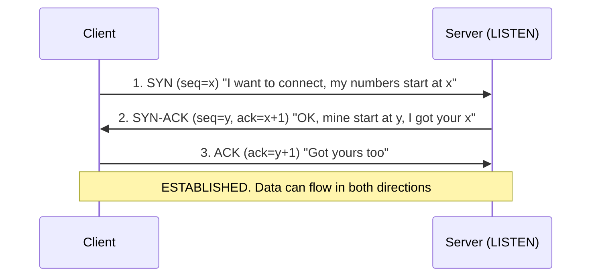
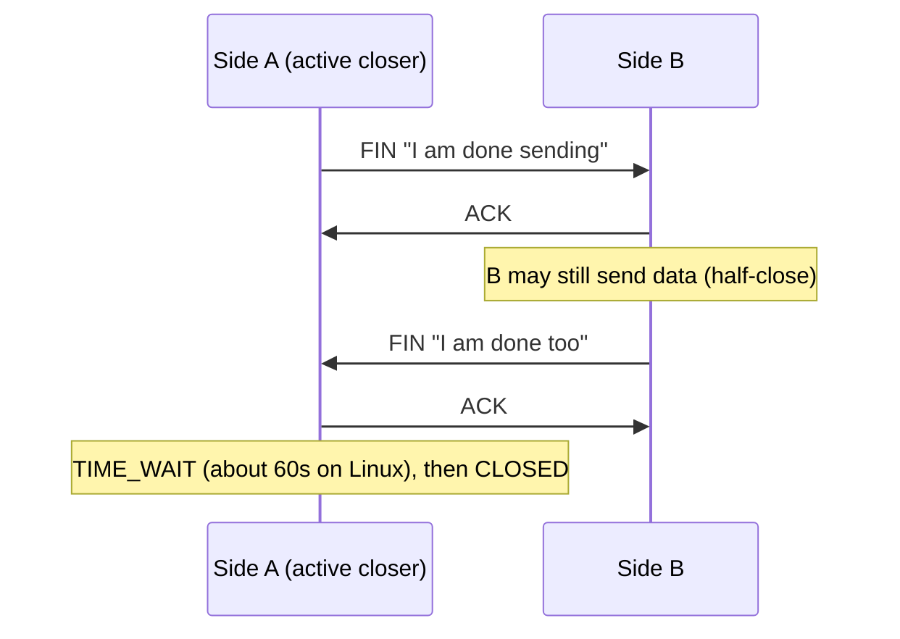
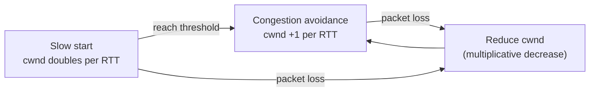

# 🔁 TCP and UDP (Transport Layer)

> Part of [[00 - Networking MOC]] · Previous: [[03 - IP Addresses, Ports and Subnetting]] · Next: [[05 - Link and Network Layer]]

## What is the transport layer for?

IP ([[03 - IP Addresses, Ports and Subnetting]]) delivers packets between **machines**, on a best-effort basis: packets can be lost, duplicated, reordered, or delayed, and IP does not care. The **transport layer** adds two things on top:

1. **Ports**: delivery to the right *process* on a machine.
2. **Optional reliability**: TCP adds it, UDP does not.

The two main protocols are **TCP** and **UDP**.

## TCP (Transmission Control Protocol)

TCP gives applications the illusion of a **reliable, ordered, two-way stream of bytes**, even though the network underneath is unreliable.

Properties:

- **Connection-oriented**: a connection is set up first (handshake) and torn down afterwards.
- **Reliable**: lost data is detected and retransmitted.
- **Ordered**: bytes arrive in the order sent.
- **Full duplex**: both sides send at the same time.
- **Flow controlled** and **congestion controlled** (below).
- **Byte stream, not messages**: TCP does *not* preserve boundaries. If you `send()` "HELLO" and then "WORLD", the receiver may read "HELLOWORLD" or "HEL" then "LOWORLD". Applications add their own framing (HTTP uses `Content-Length` or chunked encoding; other protocols use delimiters or length prefixes).

### TCP header (key fields)

| Field | Purpose |
|---|---|
| Source / destination port | Identify the two processes |
| **Sequence number** | Position of this segment's first byte in the stream |
| **Acknowledgment number** | "I have received everything up to byte N−1; send N next" |
| **Flags**: SYN, ACK, FIN, RST, PSH, URG | Control: connect, acknowledge, close, reset, push |
| **Window size** | How many more bytes the receiver can accept (flow control) |
| Checksum | Detect corruption |

### Three-way handshake (connection setup)

Before sending any data, client and server must agree on starting sequence numbers and confirm both directions work.



**Why three steps and not two?** Both sides need to (a) tell the other their initial sequence number and (b) have it acknowledged. SYN and SYN-ACK already do half of that each, and the final ACK completes the second half. It also protects against old duplicate SYNs from earlier connections creating false connections.

**Cost:** the handshake takes **one round trip (RTT)** before the first byte of data can be sent. Add TLS on top and it is 1-2 more RTTs ([[08 - HTTPS, TLS and Certificates]]). This is the main reason connection reuse (keep-alive, pooling; see [[07 - HTTP Deep Dive]]) matters.

**SYN flood attack:** the attacker sends many SYNs and never completes the handshake, filling the server's half-open connection queue. Mitigations: SYN cookies, rate limiting, upstream protection (CDN/WAF).

### Connection termination (four-way)

Each direction is closed independently, so closing takes four segments:



(Often B's ACK and FIN merge into one segment, giving three segments.)

**RST (reset)** is the abrupt alternative: "this connection is invalid, drop it." Sent when a packet arrives for a port nobody listens on (you see `ECONNREFUSED`), or when a process crashes or forces close (`ECONNRESET` on the peer).

### Connection states you will meet in `ss` / `netstat`

| State | Meaning |
|---|---|
| `LISTEN` | Server waiting for connections |
| `SYN_SENT` / `SYN_RECV` | Handshake in progress |
| `ESTABLISHED` | Normal open connection |
| `FIN_WAIT_1/2`, `CLOSE_WAIT`, `LAST_ACK` | Closing in progress |
| `TIME_WAIT` | Side that closed first waits ~2×MSL before freeing the 4-tuple |

**`TIME_WAIT` exists** so that delayed packets from the old connection cannot be mistaken for a new one, and so the final ACK can be re-sent if lost. Backend relevance: a service making thousands of short outbound connections per second accumulates TIME_WAIT sockets and can **run out of ephemeral ports**. Fix by reusing connections (keep-alive, connection pools), not by hacking kernel flags.

**Pile of `CLOSE_WAIT`** = the *other* side closed, but **your application never called `close()`**. That is a socket leak bug in your code.

### Reliability: how TCP recovers from loss

1. Every byte has a sequence number; the receiver sends **cumulative ACKs**.
2. The sender keeps a copy of unacknowledged data and runs a **retransmission timer (RTO)** based on measured RTT. No ACK in time → retransmit.
3. **Fast retransmit:** if the sender gets **3 duplicate ACKs** (receiver keeps saying "still need byte N"), it resends immediately without waiting for the timeout.
4. The receiver reorders out-of-order segments and discards duplicates; a checksum detects corruption.

Result: the application sees a clean stream, but loss shows up as **latency spikes**, not errors. This is **head-of-line blocking**: if one segment is lost, later bytes wait in the buffer until it is retransmitted.

### Flow control: don't overwhelm the receiver

Every ACK carries the receiver's **window** (`rwnd`): free buffer space. The sender never has more unacknowledged data in flight than that. If the receiving app reads slowly, the window shrinks, even to zero ("stop sending"). It is a **sliding window**. This protects the **receiver**.

### Congestion control: don't overwhelm the network

Flow control cannot see the network in between. The sender keeps its own **congestion window** (`cwnd`) and the amount in flight is limited by `min(rwnd, cwnd)`.

- **Slow start:** begin with a small `cwnd` and roughly double it each RTT.
- **Congestion avoidance:** after a threshold, grow linearly (+1 segment per RTT).
- **On loss** (taken as a congestion signal): cut `cwnd` sharply (often halve), then grow again. This **AIMD** (additive increase, multiplicative decrease) pattern lets many flows share links fairly.
- Modern algorithms: **CUBIC** (Linux default), **BBR** (Google; models bandwidth and RTT instead of reacting only to loss).



Backend relevance: **new connections are slow at first** because they start in slow start. A long-lived, warmed-up connection transfers data faster than many fresh ones. Another argument for connection reuse.

| | Flow control | Congestion control |
|---|---|---|
| Protects | The receiver | The network |
| Controlled by | Receiver's advertised window (`rwnd`) | Sender's estimate (`cwnd`) |
| Signal | Window size in ACK | Packet loss / delay |

## UDP (User Datagram Protocol)

UDP is deliberately minimal: it adds **ports and a checksum** to IP, and nothing else.

- **Connectionless**: no handshake; just send a datagram.
- **No delivery guarantee, no ordering, no retransmission, no congestion control.**
- **Message-oriented**: each `send` is one datagram; boundaries are preserved.
- **Tiny header: 8 bytes** (source port, destination port, length, checksum).
- Supports broadcast/multicast.

**Why use something unreliable?** When speed and low latency beat perfect delivery, or when you want to build your own reliability policy:

- **DNS** queries (one small question, one small answer; retry is trivial)
- **Real-time audio/video, games**: a late packet is worthless; skip it rather than wait
- **DHCP**, NTP, many IoT protocols
- **QUIC / HTTP/3**: builds reliability, encryption, and multiplexing *on top of UDP* in user space ([[07 - HTTP Deep Dive]])

UDP does not forbid reliability; it leaves that decision to the application.

## TCP vs UDP

| | TCP | UDP |
|---|---|---|
| Connection | Handshake first | None |
| Reliability | Guaranteed (retransmit) | None (best effort) |
| Ordering | Yes | No |
| Data model | Byte stream | Discrete datagrams |
| Speed / overhead | Slower start, 20+ byte header | Fast, 8-byte header |
| Flow & congestion control | Yes | No |
| Typical use | HTTP/1.1, HTTP/2, databases, SSH, email | DNS, streaming, games, QUIC/HTTP/3 |

Default rule: **TCP unless you have a specific reason**.

## In Node.js

```js
// TCP server using the net module: shows that TCP is a stream, not messages
const net = require('net');

const server = net.createServer((socket) => {
  socket.on('data', (chunk) => {
    // 'chunk' may contain half a message, or several messages joined together!
    console.log('got bytes:', chunk.toString());
  });
  socket.on('end', () => console.log('client sent FIN'));
  socket.on('error', (err) => console.error('socket error', err.code)); // ECONNRESET etc.
});

server.listen(4000, () => console.log('listening on :4000'));
```

```js
// UDP uses dgram: each message arrives as one datagram (or is lost)
const dgram = require('dgram');
const udp = dgram.createSocket('udp4');
udp.on('message', (msg, rinfo) => console.log(msg.toString(), 'from', rinfo.address, rinfo.port));
udp.bind(4001);
```

Your Express/HTTP server is built on a TCP server like the first one; the `http` module parses the byte stream into requests ([[06 - Building an HTTP Server with the http Module]]).

## Common mistakes

- Assuming one `send` = one `data` event on TCP. Always frame your messages.
- Ignoring `error` events on sockets → crashes on `ECONNRESET`.
- Leaking connections (never closing) → `CLOSE_WAIT` pile-ups and file-descriptor exhaustion.
- Opening a new TCP (and TLS) connection per request instead of pooling.
- Assuming "TCP is reliable" means "my message was *processed*". It only means the bytes reached the peer's OS. Application-level acknowledgments still matter.
- Thinking UDP is "bad". It is the right tool for many jobs.

## Check yourself

1. Why does the handshake need three messages?
2. A service shows 40,000 sockets in `TIME_WAIT`. What is the likely cause and fix?
3. Difference between flow control and congestion control?
4. Why can HTTP/3 afford to use UDP?

## Related concepts

- [[02 - OSI and TCP-IP Models]] · [[03 - IP Addresses, Ports and Subnetting]] · [[07 - HTTP Deep Dive]]
- [[WebSocket]]: persistent TCP connection after an HTTP upgrade
