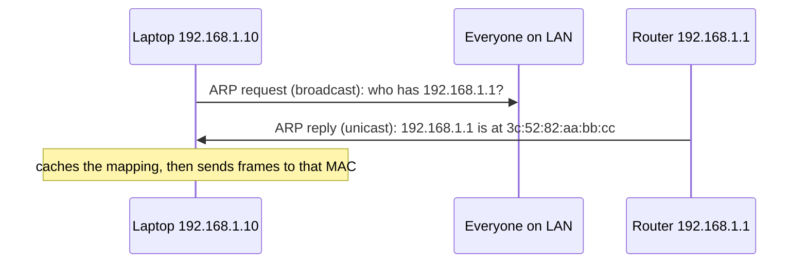
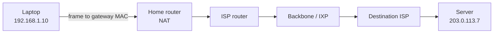
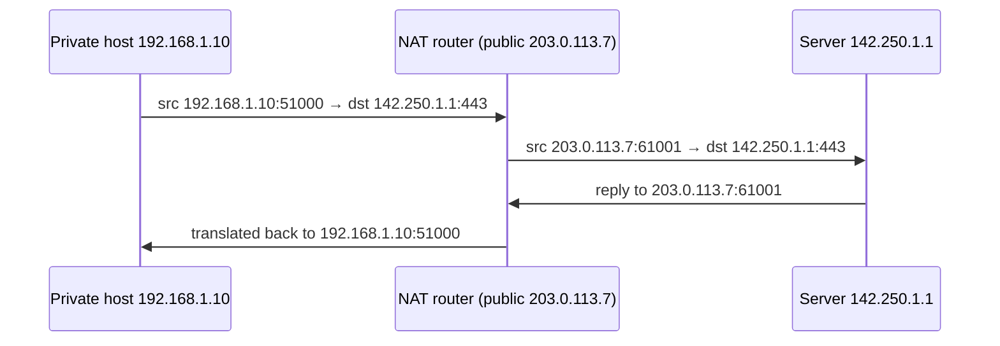
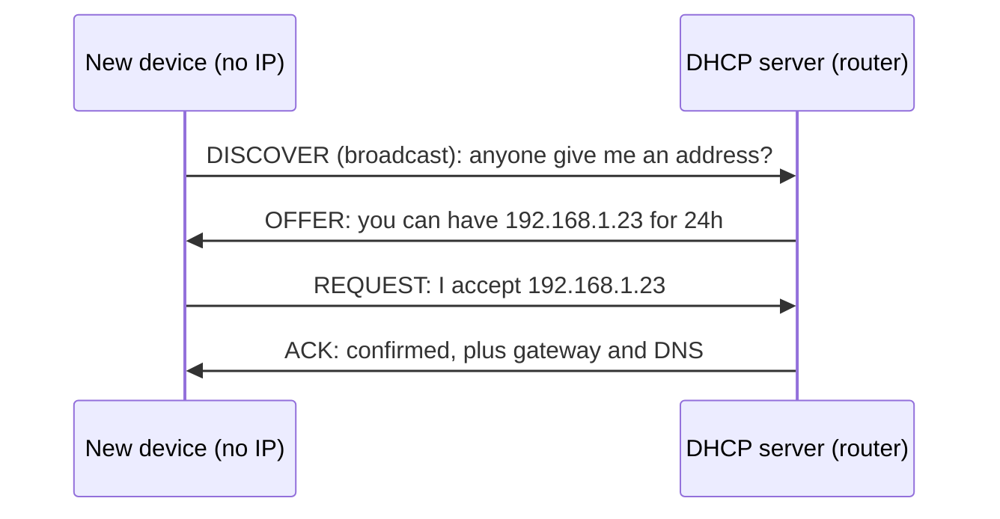

# 🛣️ Link and Network Layer: MAC, ARP, ICMP, Routers, NAT, DHCP

> Part of [[00 - Networking MOC]] · Previous: [[04 - TCP and UDP]] · Next: [[06 - DNS and CDN]]

This note answers: **how does a packet physically get from your laptop to a server across the world?** TCP/UDP assume IP "just works". Here is how it works.

## Two kinds of address, two scopes

| | MAC address | IP address |
|---|---|---|
| Layer | 2 (Data Link) | 3 (Network) |
| Identifies | A network interface (NIC) | A host's position in a network |
| Scope | **Only the local link/LAN** | **End to end across the Internet** |
| Changes? | Fixed per NIC (can be spoofed) | Changes with network |
| Analogy | Your name (who you are) | Your postal address (where you are) |

### MAC address

48 bits written as 6 hex bytes: `a4:83:e7:2b:19:5c`. The first 3 bytes (**OUI**) identify the manufacturer. Assigned at manufacture ("burned in") but software can override it (privacy randomization on phones is common). It is used only to deliver frames to the **next device on the same local network**. Routers throw away the old MAC and use a new one for the next hop ([[02 - OSI and TCP-IP Models]]).

## ARP: finding the MAC for an IP

Your OS knows the destination IP (say the gateway `192.168.1.1`), but an Ethernet/Wi-Fi frame needs a **MAC**. **ARP (Address Resolution Protocol)** bridges that gap on a local network:

1. Host broadcasts: *"Who has 192.168.1.1? Tell 192.168.1.10."* (to `ff:ff:ff:ff:ff:ff`, everyone on the LAN hears it)
2. The owner replies (unicast) with its MAC.
3. The asker stores the pair in its **ARP cache** (`ip neigh` on Linux, `arp -a` on Windows/macOS) so it need not ask again for a few minutes.



**Important detail:** for a destination **outside** your subnet (e.g. `142.250.x.x`), you ARP for the **default gateway's** MAC, not the remote server's. The frame goes to the router; the IP packet inside still carries the final destination.

Security: ARP has no authentication, so attackers can forge replies (**ARP spoofing**) to intercept LAN traffic. This is one reason to use HTTPS even on "private" Wi-Fi. IPv6 replaces ARP with NDP.

## ICMP and ping

**ICMP (Internet Control Message Protocol)** is IP's built-in messaging for **errors and diagnostics**. It travels inside IP packets but is neither TCP nor UDP, so **it has no ports**.

| ICMP message | Used for |
|---|---|
| Echo request / Echo reply | **`ping`**: is the host reachable, how long is the RTT? |
| Time Exceeded (TTL = 0) | **`traceroute`**: each router that drops an expired packet reveals itself |
| Destination Unreachable | "No route", "port unreachable", "fragmentation needed" |
| Fragmentation Needed | Path MTU discovery (finding the largest packet that fits the path) |

**TTL (Time To Live)**: a counter in the IP header, decremented by every router. At 0 the packet is dropped (ICMP Time Exceeded sent back). This prevents packets from looping forever. `traceroute` exploits it by sending packets with TTL = 1, 2, 3… and collecting the replies.

Pitfall: many servers and firewalls **block ICMP**, so **a failed `ping` does not prove the server is down.** Test the actual port instead (`curl`, `nc -zv`; [[12 - Practical Networking Toolkit]]).

## Switches vs routers

| | **Switch** (L2) | **Router** (L3) |
|---|---|---|
| Connects | Devices **within one network** | **Different networks** together |
| Decides by | **MAC address** (learns a MAC table from traffic) | **IP address** (routing table) |
| Scope | LAN | LAN ↔ ISP ↔ Internet |
| Broadcasts | Forwards within the network | Does **not** forward broadcasts |
| Analogy | Mail clerk inside one office building | Postal sorting center between cities |

A **hub** (obsolete) repeated everything to every port; a switch sends frames only to the port where the destination MAC lives. Your home "router" is actually several devices in one box: router + switch + Wi-Fi access point + NAT + DHCP server + firewall.

## Routing basics

A **routing table** maps destination networks to a **next hop**. Each router consults it **independently** for every packet, using **longest prefix match** (the most specific matching route wins).

Example routing table on a laptop:

```
Destination        Gateway        Interface
192.168.1.0/24     (direct)       wlan0     ← local network: deliver directly
0.0.0.0/0          192.168.1.1    wlan0     ← default route: everything else goes to the router
```

`ip route` shows it on Linux. A packet for `8.8.8.8` matches only `0.0.0.0/0`, so it goes to `192.168.1.1`, which looks at its own table and forwards to the ISP's router, and so on.



**How do routers learn routes?**
- **Static:** configured manually (small networks, default routes).
- **Dynamic:** routers exchange information. **OSPF** (inside one organization), **BGP** (between ISPs and large networks, called **Autonomous Systems**). BGP is the protocol that glues the Internet together; BGP mistakes have caused real outages (e.g., misrouted traffic taking down major sites).

You will not configure BGP as a backend developer, but the idea **"each hop decides only the next hop"** explains why paths vary and why `traceroute` is useful.

## NAT (Network Address Translation)

**Problem:** IPv4 addresses ran out; homes and offices have many devices but one public IP.

**Solution:** devices use **private IPs** ([[03 - IP Addresses, Ports and Subnetting]]). The router rewrites the **source IP (and port)** of outgoing packets to its single public IP, remembering the mapping in a **NAT table**. Replies are translated back. The common form is **PAT / NAPT**, which uses **ports** to tell connections apart.

```
Outgoing:
  192.168.1.10:51000 → 142.250.1.1:443   becomes   203.0.113.7:61001 → 142.250.1.1:443
  192.168.1.11:51000 → 142.250.1.1:443   becomes   203.0.113.7:61002 → 142.250.1.1:443

NAT table:
  203.0.113.7:61001  ↔  192.168.1.10:51000
  203.0.113.7:61002  ↔  192.168.1.11:51000
```



**Consequences for developers:**

- **Outbound is easy; inbound is blocked.** An unsolicited packet from the Internet has no NAT entry, so it is dropped. To host a server at home you need **port forwarding** (static mapping) or a tunnel (ngrok, Cloudflare Tunnel).
- **CGNAT:** many ISPs put *you* behind another NAT, so port forwarding is impossible.
- **Servers see the NAT's public IP**, not the user's device. Many different users can share one public IP (rate limiting purely by IP can wrongly block entire offices).
- NAT entries **time out** when idle, so long-idle connections (WebSockets, DB connections) can silently die. Fix with keep-alive/heartbeats ([[11 - Real-Time Communication and SSE]]).
- NAT breaks the "end-to-end" principle; IPv6 removes the need for it.

## DHCP (Dynamic Host Configuration Protocol)

Typing in an IP, mask, gateway, and DNS on every device would be painful. **DHCP** automatically hands out network settings when a device joins.

A DHCP **lease** includes: IP address, subnet mask, **default gateway**, **DNS server(s)**, lease duration.

The **DORA** exchange (UDP ports 67 server / 68 client; the client has no IP yet, so it broadcasts):



Leases are **renewed** before expiry. If DHCP fails the OS may self-assign `169.254.x.x`.

**Backend relevance:**
- A dev machine's IP can change; never hard-code it. Use DHCP **reservations** (fixed IP by MAC) or DNS names.
- **Servers** need stable addresses: static/reserved private IPs, plus **Elastic/static public IPs** in cloud, usually referenced by DNS ([[06 - DNS and CDN]]).
- Docker/Kubernetes run their own internal DHCP-like IP assignment.

## Common mistakes

- Expecting a MAC address to be visible to a remote server (it never leaves the LAN).
- Concluding "server is down" from a failed `ping` (ICMP often filtered).
- Assuming a `192.168.x.x` / `10.x.x.x` address works across the Internet.
- Forgetting NAT idle timeouts when debugging "random" dropped long-lived connections.
- Using a public IP for rate limiting without considering shared NAT; or trusting `X-Forwarded-For` blindly ([[10 - Proxies, Load Balancers and API Gateways]]).

## Check yourself

1. Why do routers rewrite the destination MAC but not the destination IP?
2. How does `traceroute` discover each hop?
3. Why can a home laptop open `google.com` but nobody can open a server running on that laptop?
4. What are the four DHCP messages and why does the first one use broadcast?

## Related concepts

- [[02 - OSI and TCP-IP Models]] · [[03 - IP Addresses, Ports and Subnetting]] · [[04 - TCP and UDP]]
- [[12 - Practical Networking Toolkit]]: `ping`, `traceroute`, `ip route`, `ip neigh`
- [[Linux]]: networking commands
