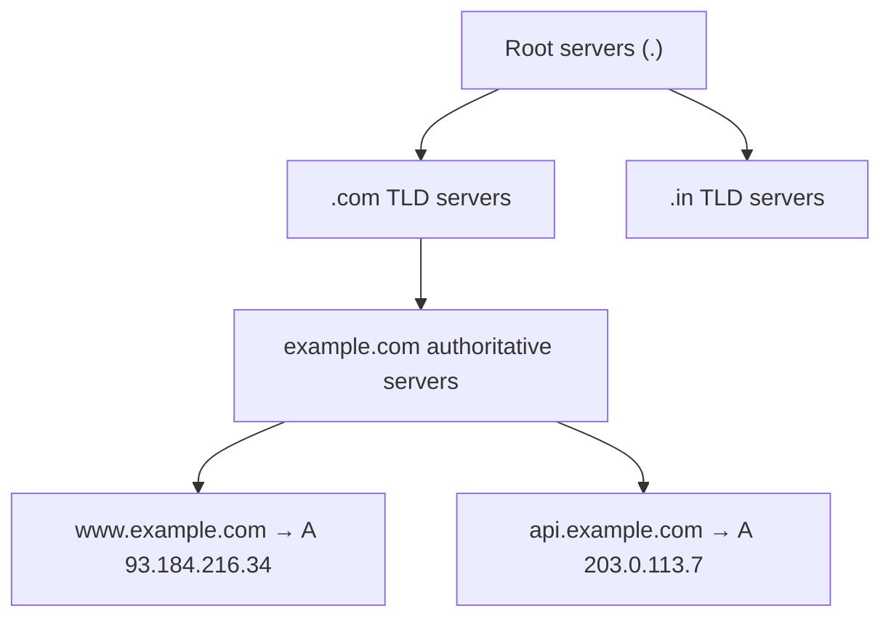
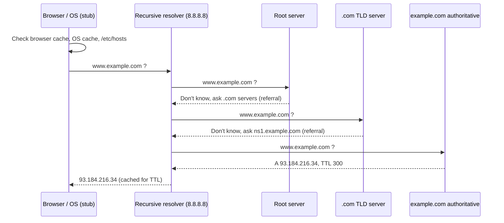
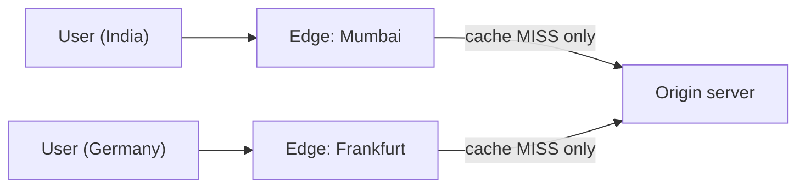

# 📖 DNS and CDN

> Part of [[00 - Networking MOC]] · Previous: [[05 - Link and Network Layer]] · Next: [[07 - HTTP Deep Dive]]

## What is DNS?

Computers route by IP address, humans remember names. **DNS (Domain Name System)** is the Internet's distributed "phone book": it translates names like `api.example.com` into IPs like `93.184.216.34`.

**Why it is built the way it is:** one central list would be a bottleneck and single point of failure. DNS is a **hierarchical, distributed, cached database**, with no single server knowing everything.

Why DNS matters beyond lookup: it lets you **change servers without changing the name** (migrate, scale, fail over), run multiple servers under one name, and direct users to the nearest region. Almost every request your backend makes begins with a DNS lookup, and DNS problems cause confusing outages ("works on my machine", "site down for some users").

## The hierarchy

Read a domain **right to left**:

```
        www . example . com .
                           └─ root (the trailing dot, usually hidden)
                     └─ TLD (top-level domain: .com, .in, .org)
             └─ second-level domain (you buy this)
        └─ subdomain (you create these freely)
```



## Who's who in DNS

| Role | What it does | Examples |
|---|---|---|
| **Stub resolver** | Tiny client in your OS/browser; asks one configured resolver | `getaddrinfo`, browser |
| **Recursive resolver** (recursor) | Does the whole lookup *for you* and **caches** answers | ISP DNS, `8.8.8.8` (Google), `1.1.1.1` (Cloudflare) |
| **Root servers** | Know where each TLD's servers are (13 logical addresses, hundreds of anycast machines) | `a.root-servers.net` … `m` |
| **TLD servers** | Know the authoritative servers for each domain under the TLD | `.com`, `.in` registries |
| **Authoritative servers** | Hold the **real records** for a domain; the source of truth | Cloudflare DNS, Route 53, GoDaddy DNS |

### Recursive vs authoritative (frequently asked)

- **Recursive resolver:** a *worker* for clients. Takes "what is `www.example.com`?", chases referrals through root → TLD → authoritative, returns the final answer, caches it. It does not own any domain's data.
- **Authoritative server:** *owns* data for specific zones and answers only about them. It gives final answers or referrals, and never goes searching on your behalf.

## The resolution process (step by step)

Looking up `www.example.com` with cold caches:



Then the browser opens a TCP connection to that IP ([[04 - TCP and UDP]]). Typical transport is **UDP port 53** (fast, small); **TCP 53** for large responses and zone transfers; encrypted variants **DoH** (DNS over HTTPS) and **DoT** (over TLS) hide queries from the network.

### Caching and TTL

Every record carries a **TTL (Time To Live, seconds)**: how long caches may reuse it. Caching happens at several levels: browser → OS → router → recursive resolver. Negative results ("no such domain") are cached too.

- **High TTL** (hours/days): fewer lookups, faster, but changes spread slowly.
- **Low TTL** (60–300 s): changes propagate fast, more DNS load.
- "**DNS propagation**" is really just old cached answers expiring. **Before a planned migration, lower the TTL a day ahead**, then switch the record, then raise it again.

## DNS record types

| Type | Maps | Example | Notes |
|---|---|---|---|
| **A** | name → **IPv4** | `api.example.com. A 203.0.113.7` | Most common |
| **AAAA** | name → **IPv6** | `api.example.com. AAAA 2001:db8::7` | "quad-A" |
| **CNAME** | name → **another name** (alias) | `www.example.com. CNAME example.com.` | Resolver continues resolving the target |
| **MX** | domain → **mail servers** (with priority; lower = preferred) | `example.com. MX 10 mail.example.com.` | Email routing |
| **TXT** | name → free text | `"v=spf1 include:_spf.google.com ~all"` | SPF/DKIM/DMARC, domain verification (Google, Let's Encrypt DNS challenge) |
| **NS** | zone → **its authoritative name servers** | `example.com. NS ns1.cloudflare.com.` | Delegation |
| **SOA** | zone metadata (primary NS, serial, refresh timers) | | One per zone |
| **PTR** | **IP → name** (reverse DNS) | | Email reputation, logs |
| **SRV** | service → host + port | | Service discovery |

**CNAME rules and traps:**

- A name with a CNAME **cannot also hold other records** (A, MX, TXT…). Therefore **you cannot put a CNAME at the zone apex** (`example.com`, which must also have NS/SOA/MX). Providers offer **ALIAS/ANAME/CNAME flattening** to work around this.
- A CNAME points to a *name*, so if the target's IP changes (e.g. a load balancer's), you need no change. That is why cloud services give you hostnames, not fixed IPs.

Example zone:

```
example.com.        A      203.0.113.7
www.example.com.    CNAME  example.com.
api.example.com.    A      203.0.113.20
example.com.        MX 10  mail.example.com.
example.com.        TXT    "v=spf1 -all"
```

### Useful DNS tricks for backend

- **Round-robin DNS:** several A records under one name; clients get them in rotating order. Crude load distribution, no health checking by itself.
- **GeoDNS / latency routing:** answer depends on where the resolver is (Route 53, Cloudflare).
- **Subdomain per environment:** `staging.example.com`, `api.example.com`.
- **`/etc/hosts`:** local override checked **before** DNS. Handy for testing (`127.0.0.1 myapp.local`).

## DNS in Node.js

- `dns.lookup()` (used by `http`/`net` by default) calls the OS resolver (`getaddrinfo`) on the **libuv thread pool**, so heavy DNS use can compete with `fs`/`crypto` for threads ([[05 - Node.js Event Loop Phases & libuv Thread Pool]]).
- `dns.resolve*()` talks to DNS servers directly over the network.
- Node does **not cache** DNS results by default, so every new connection to a hostname may trigger a lookup. Connection reuse (keep-alive) avoids this.
- A pooled DB or HTTP connection keeps using the **old IP** until it reconnects, so after a DNS failover, long-lived connections may still point to the dead server.

## CDN (Content Delivery Network)

**Problem:** your origin server is in one place (say Mumbai). A user in Frankfurt pays 150+ ms latency per round trip, and your server handles every request for the same logo and JS bundle.

**CDN:** a global network of **edge servers** (points of presence, PoPs) that **cache copies** of your content close to users.



**How requests reach the nearest edge:** you point your domain at the CDN (a **CNAME** to the CDN's hostname, or the CDN runs your DNS). DNS or **anycast** routing then returns an edge close to the user.

**Request flow:**
1. User requests `https://cdn.example.com/app.js`.
2. Edge has it (**cache HIT**) → serves immediately, origin untouched.
3. Edge lacks it (**MISS**) → fetches from origin, **stores it for the TTL**, returns it. Later users get HITs.

**What a CDN gives you:**
- **Lower latency** (shorter distance, fewer long round trips; edges also keep warm connections to origin)
- **Lower origin load and bandwidth cost**
- **Resilience and DDoS absorption** (traffic spread across many edges)
- **TLS termination** at the edge, HTTP/2/3 support, compression, image optimization
- Edge compute (Workers, Lambda@Edge)

**Controlling cache behaviour** (HTTP headers, see [[07 - HTTP Deep Dive]]):
- `Cache-Control: public, max-age=31536000, immutable`: cache a year (use with **fingerprinted filenames** like `app.3f9a1c.js`)
- `Cache-Control: no-store`: never cache (sensitive data)
- **Purge/invalidate** to remove stale content; or version your URLs so you never need to.
- `Vary` header: cache separate variants (e.g. by `Accept-Encoding`).

**What to cache:** static assets (JS, CSS, images, fonts, videos), public API responses that rarely change. **Be careful** with per-user or authenticated responses; caching them publicly can leak one user's data to another.

Examples: Cloudflare, AWS CloudFront, Akamai, Fastly, Vercel/Netlify edge networks.

## Common mistakes

- Putting a **CNAME at the root domain**.
- Changing a record and expecting instant worldwide effect (TTL!).
- Forgetting the **trailing dot** in zone files (`example.com` vs `example.com.`).
- Debugging with a cached DNS answer: test with `dig @8.8.8.8` and `dig +trace` ([[12 - Practical Networking Toolkit]]).
- Caching authenticated API responses at the CDN.
- Not versioning static assets → users keep seeing old JS after a deploy.
- Hard-coding IPs instead of names; breaks scaling and failover.

## Check yourself

1. Walk through what happens, in order, when you type `https://www.example.com` (DNS part only).
2. Why can't `example.com` be a CNAME?
3. Difference between a recursive resolver and an authoritative server?
4. How does a CDN decide which edge serves you, and what is a cache miss?

## Related concepts

- [[03 - IP Addresses, Ports and Subnetting]] · [[07 - HTTP Deep Dive]] (caching headers) · [[08 - HTTPS, TLS and Certificates]]
- [[10 - Proxies, Load Balancers and API Gateways]]: CDNs are reverse proxies at global scale
- [[System Design MOC]]
