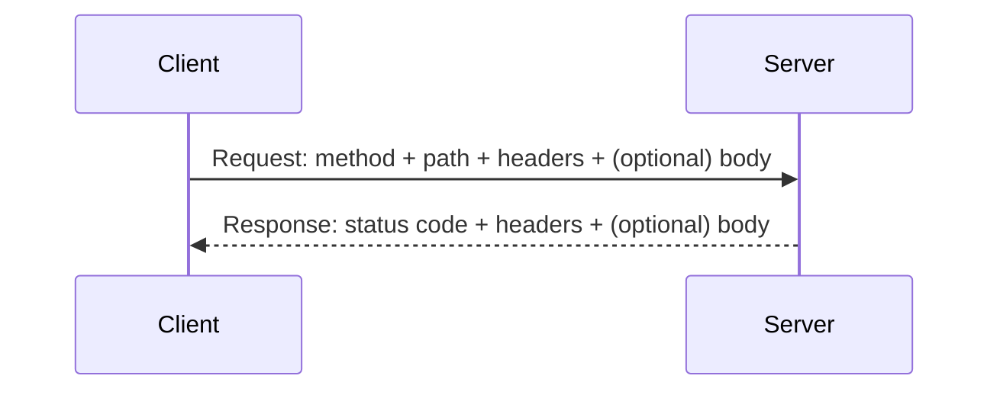
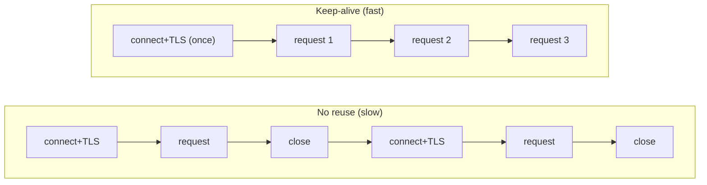

# 📨 HTTP Deep Dive

> Part of [[00 - Networking MOC]] · Previous: [[06 - DNS and CDN]] · Next: [[08 - HTTPS, TLS and Certificates]]
> Related existing notes: [[HTTP Versions & the QUERY Method]] (HTTP/1.1 vs HTTP/2 + QUERY) · [[REST APIs]] · [[15 - HTTP Headers in Express.js]] · [[08 - HTTP Methods & Method-Based Routing in Node.js]]

## What is HTTP?

**HTTP (HyperText Transfer Protocol)** is the application-layer protocol of the web: the language browsers, mobile apps, and services use to ask a server for something and get a response. It is **request → response**, **text-based** (HTTP/1.x) and **stateless**. It runs on top of TCP (HTTP/1.1, HTTP/2) or QUIC over UDP (HTTP/3). HTTPS is simply HTTP carried inside TLS ([[08 - HTTPS, TLS and Certificates]]).

Why backend developers must master it: every API you build is an HTTP contract. Methods, status codes, headers, and caching rules are the vocabulary of that contract.

## Anatomy of a request and a response



**Raw HTTP/1.1 request:**

```http
POST /api/users HTTP/1.1
Host: api.example.com
Content-Type: application/json
Content-Length: 41
Authorization: Bearer eyJhbGciOi...
Accept: application/json

{"name":"Aryan","email":"a@example.com"}
```

1. **Request line:** `METHOD  PATH  VERSION`
2. **Headers:** `Name: value` lines (metadata)
3. **Blank line:** separates headers from body
4. **Body:** optional payload (JSON, form data, file)

**Raw response:**

```http
HTTP/1.1 201 Created
Content-Type: application/json
Content-Length: 58
Location: /api/users/42
Set-Cookie: sid=abc123; HttpOnly; Secure

{"id":42,"name":"Aryan","email":"a@example.com"}
```

1. **Status line:** `VERSION  CODE  REASON`
2. **Headers**, blank line, **body**

URL pieces (`scheme://host:port/path?query#fragment`): see [[07 - URL Structure & Parsing in Node.js]]. Note the fragment (`#...`) is **never sent to the server**.

## HTTP methods

The method says **what the client wants to do** with the resource.

| Method | Purpose | Has body? | Safe? | Idempotent? |
|---|---|---|---|---|
| **GET** | Read a resource | No | ✅ | ✅ |
| **POST** | Create / trigger a processing action | Yes | ❌ | ❌ |
| **PUT** | **Replace** a resource entirely (or create at known URL) | Yes | ❌ | ✅ |
| **PATCH** | **Partially update** a resource | Yes | ❌ | Not guaranteed |
| **DELETE** | Remove a resource | Usually no | ❌ | ✅ |
| **HEAD** | Like GET, headers only (no body) | No | ✅ | ✅ |
| **OPTIONS** | Ask what is allowed; used for **CORS preflight** | No | ✅ | ✅ |

- **Safe** = does not change server state (read-only). Safe methods can be cached, prefetched, and retried freely.
- **Idempotent** = doing it once or ten times leaves the server in the **same state**. `DELETE /users/42` ten times → still deleted. `POST /orders` ten times → ten orders (not idempotent!). This is why **retrying a failed POST is dangerous**, and why payment APIs use **idempotency keys**.

**PUT vs PATCH:** to change only the email of a user, `PATCH {"email": "new@x.com"}` sends just the change. `PUT` should send the **whole** user object; omitted fields may be reset.

**Common mistake:** using GET for actions that change data (`GET /delete?id=5`). Crawlers, prefetchers, and link previews will trigger them.

More on REST design: [[REST APIs]]. HTTP also has the newly standardized `QUERY` method (safe, idempotent, *with* a body); see [[HTTP Versions & the QUERY Method]].

## Status codes

Three digits; the **first digit is the class**.

| Class | Meaning | Key codes |
|---|---|---|
| **1xx** Informational | Keep going | `101 Switching Protocols` (WebSocket upgrade) |
| **2xx** Success | It worked | `200 OK`, `201 Created`, `202 Accepted` (queued), `204 No Content` |
| **3xx** Redirection | Look elsewhere | `301 Moved Permanently`, `302 Found`, `304 Not Modified` (use your cache), `307/308` (redirect preserving method) |
| **4xx** Client error | **You** sent something wrong | `400 Bad Request`, `401 Unauthorized`, `403 Forbidden`, `404 Not Found`, `405 Method Not Allowed`, `409 Conflict`, `415 Unsupported Media Type`, `422 Unprocessable Content`, `429 Too Many Requests` |
| **5xx** Server error | **The server** failed | `500 Internal Server Error`, `502 Bad Gateway`, `503 Service Unavailable`, `504 Gateway Timeout` |

Distinctions interviewers love:

- **401 vs 403:** `401` = "I don't know who you are" (missing/invalid credentials, *unauthenticated*). `403` = "I know who you are, and you're not allowed" (*unauthorized*). See [[Authentication and Authorization]].
- **400 vs 422:** `400` = malformed request (bad JSON syntax). `422` = well-formed but semantically invalid (email field fails validation). Many APIs just use 400 for both; be consistent.
- **301 vs 302:** permanent (browsers/search engines cache it) vs temporary. `307/308` keep the original method (POST stays POST); 301/302 historically let clients switch to GET.
- **502 vs 503 vs 504:** all come from proxies/gateways ([[10 - Proxies, Load Balancers and API Gateways]]). `502` = upstream gave an invalid response or died. `503` = overloaded or down for maintenance. `504` = upstream took too long (timeout).
- **200 with an error in the body** is an anti-pattern; use the right status so clients, caches, and monitors work.

## Headers

Headers are key-value metadata on requests and responses. Case-insensitive names.

| Header | Direction | Purpose |
|---|---|---|
| `Host` | Request | Which site (needed for **virtual hosting**: many sites on one IP); mandatory in HTTP/1.1 |
| `User-Agent` | Request | Client identity |
| `Accept` | Request | Formats the client can handle (`application/json`) |
| `Content-Type` | Both | Format of the **body** (`application/json`, `multipart/form-data`) |
| `Content-Length` | Both | Body size in bytes (lets TCP's byte stream be framed) |
| `Authorization` | Request | Credentials (`Bearer <JWT>`; see [[JWT]]) |
| `Cookie` / `Set-Cookie` | Request / Response | State via cookies ([[09 - Cookies, Sessions and Browser Security]]) |
| `Cache-Control` | Both | Caching rules (`max-age`, `no-store`, `public`, `private`) |
| `ETag` / `If-None-Match` | Response / Request | Validate cache: "still the same?" → `304` |
| `Location` | Response | Redirect target / created resource URL |
| `Origin`, `Access-Control-*` | Request / Response | CORS |
| `Connection`, `Keep-Alive` | Both | Connection reuse |
| `Content-Encoding` | Response | `gzip`, `br` compression |
| `X-Forwarded-For`, `X-Forwarded-Proto` | Request (set by proxies) | Original client IP / protocol |
| `Retry-After` | Response | When to retry (429/503) |

Header handling in Express: [[15 - HTTP Headers in Express.js]].

## Statelessness

**HTTP is stateless:** each request must contain everything the server needs; the server keeps no memory of earlier requests *at the protocol level*. The server does not know that request #2 came from the same person as request #1.

**Why design it this way?** Simplicity and **horizontal scaling**: any server in a pool can handle any request, so you can add or remove servers freely behind a load balancer ([[10 - Proxies, Load Balancers and API Gateways]]).

**But apps need "logged in" state.** The solution is to **carry state with each request**, not in the connection:
- **Cookies + server-side sessions** (a session ID travels in `Cookie`)
- **Tokens** (a JWT in `Authorization`)

See [[09 - Cookies, Sessions and Browser Security]].

Don't confuse *stateless protocol* with *stateless application*: the HTTP layer forgets, but your database remembers. TCP underneath *is* stateful per connection, but HTTP semantics don't depend on it.

## Keep-alive and connection pooling

**The problem:** HTTP/1.0 opened a new TCP connection per request, then closed it. Each new connection costs a TCP handshake (1 RTT), plus TLS (1-2 RTTs), plus TCP slow start ([[04 - TCP and UDP]]). For a page with 50 resources, that overhead dominates.

**Keep-alive (persistent connections):** keep the TCP (and TLS) connection open and send **many requests over it**, one after another. Default in HTTP/1.1 (`Connection: keep-alive`); HTTP/2 and HTTP/3 always reuse a connection.

**Connection pooling:** a client keeps a **pool** of open connections to a host and borrows one for each request instead of creating new ones. Same idea as database connection pools (Postgres, Mongo drivers).



**In Node.js:**
- Outbound calls use an `http.Agent`. With `keepAlive: true` sockets are reused (newer Node versions enable this for the global agent by default; older ones did not; set it explicitly when unsure).
- Inbound: Node's HTTP server closes idle keep-alive connections after `server.keepAliveTimeout` (**5 seconds by default**).

**Real production gotcha:** if your load balancer's idle timeout (e.g. AWS ALB default 60 s) is *longer* than Node's 5 s, the LB may reuse a connection Node just closed → random **502** errors. Fix: set `server.keepAliveTimeout` **above** the LB idle timeout (and `headersTimeout` slightly above that).

## HTTP versions at a glance

| Version | Year | Key idea | Transport |
|---|---|---|---|
| HTTP/0.9–1.0 | 1991–96 | One request per connection | TCP |
| **HTTP/1.1** | 1997 | Persistent connections, `Host` header, chunked transfer, pipelining (rarely used) | TCP |
| **HTTP/2** | 2015 | **Binary framing, multiplexing** many requests on one connection, HPACK header compression | TCP |
| **HTTP/3** | 2022 | Same semantics, over **QUIC** | **UDP** |

HTTP/1.1 vs HTTP/2 in detail: [[HTTP Versions & the QUERY Method]]. The important point: **methods, status codes, and headers are the same in every version**; only how the bytes travel changes. Your handler code does not change.

### HTTP/3 and QUIC

**Remaining problem with HTTP/2:** all streams share **one TCP connection**. If one TCP packet is lost, TCP holds back *all* later bytes until retransmission, so **every** multiplexed stream stalls (**TCP head-of-line blocking**). Worse on lossy mobile networks.

**QUIC** (a transport protocol built on **UDP**, implemented in user space) fixes this:

- **Independent streams:** loss in one stream doesn't block others.
- **Built-in TLS 1.3:** encryption is mandatory and integrated, so transport + crypto handshake happen together: **1 RTT** for a new connection, and **0-RTT** to resume (with replay-attack caveats for non-idempotent requests).
- **Connection IDs:** a connection survives network changes (Wi-Fi → mobile data) without re-handshaking.
- Faster evolution: no waiting for OS/middlebox TCP upgrades.

How browsers learn a server supports HTTP/3: an `Alt-Svc` response header (or DNS HTTPS record) advertises it; the browser tries QUIC and **falls back to HTTP/2** if UDP is blocked. In practice you enable HTTP/3 on your CDN, reverse proxy, or load balancer ([[10 - Proxies, Load Balancers and API Gateways]]), not inside your Express app.

## Common mistakes

- Returning `200` for errors; wrong codes (using `404` for validation failures, `500` for client mistakes).
- Using `GET` with side effects, or `POST` for everything.
- Treating `PUT` and `PATCH` as interchangeable.
- Ignoring idempotency when retrying requests (duplicate payments/orders).
- Creating a new HTTP client / connection per request instead of reusing a pooled agent.
- Forgetting `Content-Type` → server cannot parse the body (`req.body` is `undefined` in Express; see [[12 - express.urlencoded, express.json & req.body]]).
- Confusing 401 and 403.
- Believing HTTPS "hides everything": URL host, IP, and timing are still visible; paths and bodies are encrypted.

## Check yourself

1. Which methods are idempotent, and why does it matter for retries?
2. What's the difference between `502` and `504`?
3. Why is HTTP stateless, and how do logins still work?
4. What problem does QUIC solve that HTTP/2 over TCP cannot?
5. Why can a Node server behind a load balancer return random 502s?

## Related concepts

- [[04 - TCP and UDP]] · [[08 - HTTPS, TLS and Certificates]] · [[09 - Cookies, Sessions and Browser Security]]
- [[REST APIs]] · [[API]] · [[06 - Building an HTTP Server with the http Module]] · [[11 - Middleware in Express.js (Fundamentals)]]
