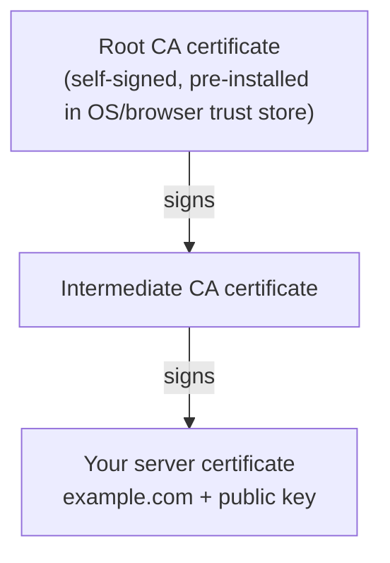
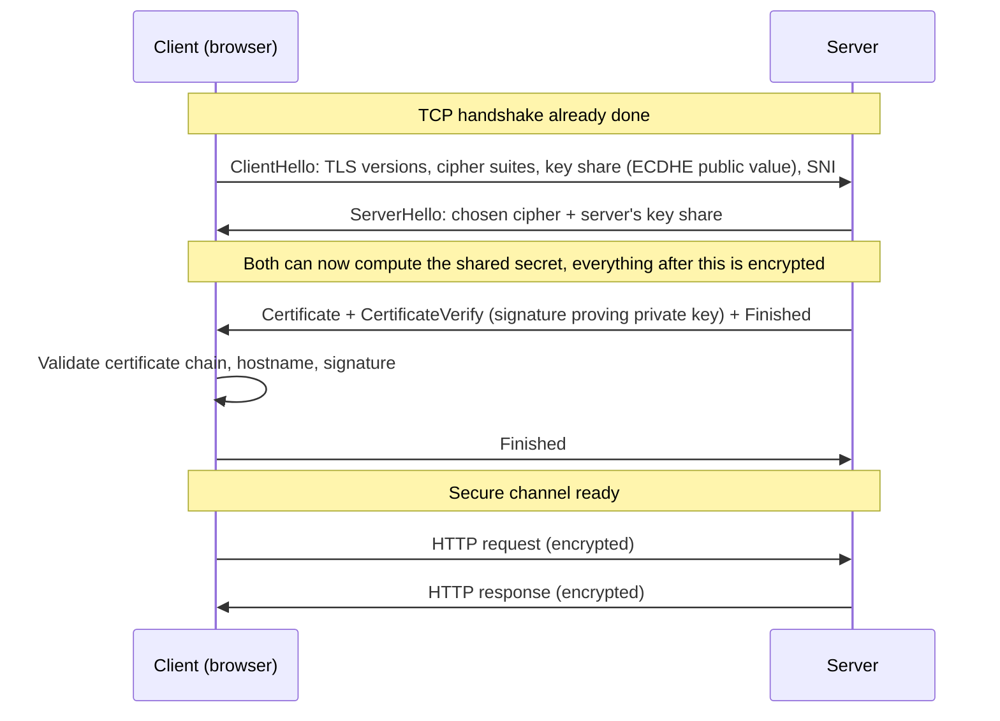

# 🔒 HTTPS, TLS and Certificates

> Part of [[00 - Networking MOC]] · Previous: [[07 - HTTP Deep Dive]] · Next: [[09 - Cookies, Sessions and Browser Security]]

## Why do we need HTTPS?

Plain HTTP sends everything as readable text. Anyone between you and the server (café Wi-Fi owner, ISP, a compromised router) can:

1. **Eavesdrop:** read passwords, cookies, tokens, API responses.
2. **Tamper:** modify the page or response in transit (inject ads or malware).
3. **Impersonate:** pretend to be your bank (spoofed DNS or network).

**HTTPS = HTTP over TLS.** TLS (Transport Layer Security) wraps the connection and provides three guarantees:

| Guarantee | Meaning | Provided by |
|---|---|---|
| **Confidentiality** | Nobody else can read the data | Symmetric encryption |
| **Integrity** | Data cannot be altered undetected | MAC / authenticated encryption |
| **Authentication** | You are really talking to `example.com` | Certificates + digital signatures |

HTTPS is the default for any real backend; browsers flag HTTP sites "Not secure", and features like Service Workers, geolocation, and `Secure` cookies require HTTPS. It sits between HTTP and TCP ([[02 - OSI and TCP-IP Models]]): the HTTP text is encrypted first, then handed to TCP.

## SSL vs TLS

**SSL** (Secure Sockets Layer) was the original protocol (SSL 1.0 never released, 2.0 and 3.0 in the 1990s). SSL 2.0/3.0 are broken and **prohibited**. Its successor, **TLS**, has versions 1.0, 1.1 (both deprecated), **1.2**, and **1.3** (current best). Nobody should use "SSL" anymore. People still say "SSL certificate" out of habit; it really means a certificate used with TLS. Today: **support TLS 1.2 and 1.3, disable everything older**.

## The cryptography you need (public and private keys)

### Symmetric encryption

**One shared secret key** encrypts and decrypts (AES-256-GCM, ChaCha20-Poly1305). **Fast**, ideal for bulk data. **Problem:** how do two strangers agree on the key without anyone else learning it?

### Asymmetric (public-key) encryption

A **key pair**: a **public key** (share with everyone) and a **private key** (never leaves its owner). Math links them so that:

- **Encryption:** data locked with the **public** key can only be unlocked by the **private** key.
- **Digital signatures:** data signed with the **private** key can be verified by anyone using the **public** key, which proves *who* signed it and that it was not altered.

Algorithms: RSA, ECDSA/Ed25519 (signatures), ECDH (key agreement). **Slow**, so used only for a few small steps.

### How TLS combines both

1. Use **asymmetric** crypto (and certificates) to **authenticate the server** and **agree on a shared secret** safely.
2. Switch to fast **symmetric** encryption with a **session key** derived from that secret for all HTTP data.

**Forward secrecy:** modern TLS uses **ephemeral Diffie-Hellman (ECDHE)** key exchange: fresh temporary keys per session. Even if the server's private key leaks *later*, past recorded traffic stays unreadable. TLS 1.3 requires it.

Analogy: asymmetric crypto is a padlock you can hand out openly (public key) while only you hold the unlock key; you use it once to safely share a secret code (session key), and then both sides just talk in that fast code.

## Digital certificates (how you know the public key is real)

**New problem:** if the server just says "here's my public key", an attacker can offer *their own* key (man-in-the-middle). We need a trusted third party to vouch for the binding between **domain name ↔ public key**.

A **digital certificate** (X.509) contains:

- **Subject / SAN:** the domain(s) it is valid for (`example.com`, `*.example.com`)
- The server's **public key**
- **Issuer:** the **Certificate Authority (CA)** that vouches for it
- **Validity period** (not before / not after; now ≤ 90 days for Let's Encrypt, with the industry trend toward shorter lifetimes)
- The **CA's digital signature** over all of the above

### Chain of trust



The server sends the **leaf + intermediate(s)**. The client verifies each signature up the chain until it reaches a **root it already trusts** (stored in the OS/browser trust store). Roots stay offline and sign intermediates, which do the day-to-day issuing.

### What the client checks

1. Signature chain leads to a trusted root.
2. Current date is within the validity period.
3. The **hostname matches** a SAN entry.
4. Not revoked (OCSP / CRL / short lifetimes).
5. The server proves it holds the **private key** (it signs part of the handshake).

If any check fails the browser shows a warning; `curl` and Node throw errors like `CERT_HAS_EXPIRED`, `UNABLE_TO_VERIFY_LEAF_SIGNATURE`.

### Types and tools

| Kind | Notes |
|---|---|
| **DV** (Domain Validated) | Proves you control the domain; automated; what Let's Encrypt issues; fine for almost everyone |
| OV / EV | Extra organization checks; little practical difference to users today |
| **Self-signed** | No CA vouching → warnings; OK for local dev/internal tools (use `mkcert` for trusted local certs) |
| **Wildcard** | `*.example.com` covers one subdomain level |

**Let's Encrypt + ACME** gives free, auto-renewing certificates (via Certbot, Caddy, or your cloud's managed certificates: AWS ACM, Cloudflare). Automate renewal; expired certificates are one of the most common production outages.

### SNI (Server Name Indication)

One IP often hosts many HTTPS sites. The client sends the hostname **inside the ClientHello** so the server can pick the right certificate. (Without SNI, the server wouldn't know which certificate to present before decryption starts.)

## The TLS handshake

Goal: agree on the TLS version and cipher suite, **authenticate the server**, and **derive shared session keys**, all before any HTTP is sent. It happens *after* the TCP handshake ([[04 - TCP and UDP]]).

### TLS 1.3 (1 round trip)



Summary of the idea: both sides exchange **temporary public values**, independently compute the **same secret** (Diffie-Hellman), the server proves its identity by presenting a certificate and **signing** the handshake with its private key, and both derive session keys for symmetric encryption.

### TLS 1.2 vs 1.3

| | TLS 1.2 | TLS 1.3 |
|---|---|---|
| Handshake round trips | 2 | **1** (0-RTT possible on resumption) |
| Cipher suites | Many, including weak legacy ones | Few, all strong (AEAD) |
| Forward secrecy | Optional | **Mandatory** |
| Certificate visible to eavesdroppers? | Yes | Encrypted |

**Session resumption** lets a returning client skip most of the handshake using a ticket. **0-RTT** data can be replayed by an attacker, so only allow it for idempotent requests.

Total latency before the first HTTP byte on a fresh HTTPS connection: TCP (1 RTT) + TLS 1.3 (1 RTT) = 2 RTTs. Hence connection reuse ([[07 - HTTP Deep Dive]]). HTTP/3/QUIC merges transport and TLS handshakes into one.

## What HTTPS does and does not hide

| Hidden from network observers | Still visible |
|---|---|
| URL path and query string | Destination IP address |
| Headers, cookies, body | Hostname via **SNI** (unless ECH is used) and DNS query (unless DoH/DoT) |
| Response content | Timing and size of traffic |

## HTTPS in backend practice

### TLS termination

Typically your Node app speaks plain HTTP on a private port and a **reverse proxy / load balancer / CDN** handles TLS (**TLS termination**): it holds certificates, renews them, and forwards traffic to the app ([[10 - Proxies, Load Balancers and API Gateways]]). The app then reads `X-Forwarded-Proto` to know the original scheme (`app.set('trust proxy', 1)` in Express, which affects `req.secure` and secure cookies).

You *can* run TLS in Node directly:

```js
const https = require('https');
const fs = require('fs');

https.createServer(
  { key: fs.readFileSync('privkey.pem'), cert: fs.readFileSync('fullchain.pem') },
  app
).listen(443);
```

Use `fullchain.pem` (leaf **plus** intermediates) as the cert; supplying only the leaf causes "unable to verify" errors on some clients.

### HSTS

`Strict-Transport-Security: max-age=31536000; includeSubDomains` tells browsers to **always use HTTPS** for your domain, defeating downgrade/stripping attacks. Enable it only once HTTPS works everywhere.

### mTLS (mutual TLS)

Normally only the server proves identity. In **mTLS** the *client* also presents a certificate. Used for service-to-service authentication in microservices and zero-trust setups.

## Common errors and mistakes

| Symptom | Likely cause |
|---|---|
| `CERT_HAS_EXPIRED` | Certificate not renewed (automate it!) |
| Hostname/altname mismatch | Cert doesn't list the domain you're hitting (e.g. using the IP, or missing `www`) |
| `UNABLE_TO_VERIFY_LEAF_SIGNATURE` | Missing **intermediate** certificate in the server config |
| Works in browser, fails in `curl`/Node | Incomplete chain (browsers can sometimes fetch missing intermediates) or outdated trust store |
| Cert errors everywhere on one device | Device **clock is wrong** |
| **Mixed content** | HTTPS page loads HTTP resources; browser blocks them |

- **Never set `NODE_TLS_REJECT_UNAUTHORIZED=0` or `rejectUnauthorized: false` in production.** It silently disables authentication, making HTTPS pointless.
- Don't commit private keys to Git ([[11 - SSH Keys & GitHub Authentication]] shows key hygiene).
- Don't confuse encryption in transit (HTTPS) with encryption at rest or with application security (SQL injection still works over HTTPS).

## Check yourself

1. Why does TLS use both asymmetric and symmetric crypto?
2. What does a certificate prove, and who vouches for it?
3. What is forward secrecy and which handshake feature gives it?
4. What does the browser verify before trusting a certificate?
5. Where is TLS usually terminated in production, and what header tells the app the original protocol?

## Related concepts

- [[07 - HTTP Deep Dive]] · [[04 - TCP and UDP]] · [[06 - DNS and CDN]]
- [[JWT]] (signed tokens use similar signature ideas) · [[Authentication and Authorization]]
- [[17 - Authentication Fundamentals & Password Hashing (bcrypt)]]: hashing vs encryption
