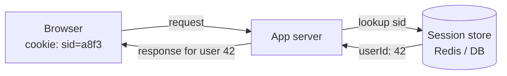
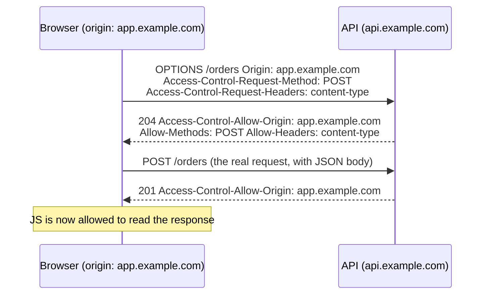
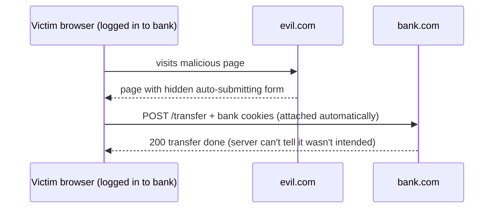

# 🍪 Cookies, Sessions and Browser Security (CORS, SOP, CSRF)

> Part of [[00 - Networking MOC]] · Previous: [[08 - HTTPS, TLS and Certificates]] · Next: [[10 - Proxies, Load Balancers and API Gateways]]
> Implementation notes in Express: [[21 - Cookies in Express]] · [[20 - Building Authentication from Scratch]] · [[JWT]] · [[Authentication and Authorization]]

## The problem: HTTP forgets you

HTTP is stateless ([[07 - HTTP Deep Dive]]). After you log in, request #2 looks identical to a stranger's. The server needs a way to recognize "this is the same browser as before". The answer: have the browser **send a small piece of identifying data automatically with every request**. That is a **cookie**.

## Cookies

A **cookie** is a small name=value piece of data that the **server asks the browser to store** and the **browser sends back automatically** on later requests to that site.

```mermaid
sequenceDiagram
    participant B as Browser
    participant S as Server
    B->>S: POST /login (email + password)
    S->>B: 200 OK + Set-Cookie: sid=a8f3c2...; HttpOnly; Secure; SameSite=Lax
    Note over B: Browser stores the cookie
    B->>S: GET /profile + Cookie: sid=a8f3c2...
    S->>B: 200 OK (profile of the user behind sid)
```

Server sets it with a response header; browser returns it with a request header:

```http
Set-Cookie: sid=a8f3c2d9; Max-Age=86400; Path=/; Secure; HttpOnly; SameSite=Lax
Cookie: sid=a8f3c2d9
```

### Cookie attributes (security-critical)

| Attribute | Effect | Why it matters |
|---|---|---|
| `Max-Age` / `Expires` | Lifetime; without it → **session cookie** deleted when the browser closes | Controls how long a login lasts |
| `Domain` | Which hosts receive it (default: only the exact host; setting it includes subdomains) | Don't over-share |
| `Path` | URL prefix it applies to | |
| **`Secure`** | Sent **only over HTTPS** | Prevents sniffing on plain HTTP |
| **`HttpOnly`** | **JavaScript cannot read it** (`document.cookie` hides it) | Limits damage from XSS stealing session IDs |
| **`SameSite`** | `Strict`: never sent on cross-site requests. `Lax`: sent on top-level navigations (clicking a link) but not on cross-site POST/iframe/fetch. `None`: always sent (requires `Secure`) | Main defence against CSRF; modern browsers default to `Lax` |
| `__Host-` prefix | Forces `Secure`, `Path=/`, no `Domain` | Hardening |

Limits: ~4 KB per cookie. Cookies are sent with **every** matching request, including images, so keep them small.

Cookies are **not** inherently about login; they also store preferences, carts, and analytics IDs. **Third-party cookies** (set by a domain different from the page you are on) are increasingly blocked by browsers for tracking reasons.

## Sessions

A **session** is **server-side stored state about a user's visit**. The common pattern:

1. User logs in; server creates a session record: `{ sessionId: "a8f3...", userId: 42, createdAt, ... }` in a **session store**.
2. The server sends **only the random session ID** in a cookie. No user data in the cookie.
3. Every later request carries the ID; the server **looks up** the record to know who it is.
4. Logout = **delete the record** (effective immediately).



**Session stores:** in-memory (dev only; lost on restart, not shared between servers), **Redis** (standard: fast, expiry built in), or a database. With multiple servers behind a load balancer, they must **share** one store, or use sticky sessions ([[10 - Proxies, Load Balancers and API Gateways]]).

**Security rules:** generate IDs with a cryptographically secure random generator (long and unguessable); **regenerate the ID on login** (prevents *session fixation*); set expiry and idle timeout; set `HttpOnly`, `Secure`, `SameSite`.

### Sessions vs tokens (JWT)

| | Server-side session | JWT / token |
|---|---|---|
| State lives | On the server (store) | In the token itself (client holds it) |
| Revocation | Easy: delete the session | Hard until it expires (needs a denylist or short life + refresh tokens) |
| Scaling | Needs shared store | Stateless verification (just check the signature) |
| Size per request | Tiny ID | Larger token |
| Typical transport | Cookie | `Authorization: Bearer` header **or** a cookie |

Neither is "better": sessions are simpler and safer for classic web apps; tokens suit APIs consumed by many clients. Details: [[JWT]], [[Authentication and Authorization]].

## Cookies vs localStorage vs sessionStorage

| | Cookie | localStorage | sessionStorage |
|---|---|---|---|
| Sent to server automatically? | **Yes**, with every matching request | No (you add it to requests in JS) | No |
| Readable by JavaScript? | Not if `HttpOnly` | **Always** | **Always** |
| Capacity | ~4 KB | ~5 MB | ~5 MB |
| Lifetime | Configurable | Until cleared | Until the **tab** closes |
| Scope | Per domain/path (+ subdomains) | Per origin | Per origin **and tab** |
| XSS risk | Low if HttpOnly | **Token can be stolen** by any injected script | Same |
| CSRF risk | **Yes** (auto-sent) → mitigate with `SameSite`/tokens | No (not auto-sent) | No |

**Where should an auth token live?** Trade-off, not a free lunch: `localStorage` is immune to CSRF but fully exposed to XSS; an `HttpOnly + Secure + SameSite` cookie resists XSS theft but needs CSRF protection. Most security guidance prefers **HttpOnly cookies** for browser apps. Use `localStorage` for non-sensitive preferences (theme, UI state).

## Same-Origin Policy (SOP)

An **origin** = **scheme + host + port**. Two URLs are the same origin only if **all three** match.

Compared with `https://app.example.com`:

| URL | Same origin? | Why |
|---|---|---|
| `https://app.example.com/page2` | ✅ | Only path differs |
| `http://app.example.com` | ❌ | Different scheme |
| `https://api.example.com` | ❌ | Different host (subdomain) |
| `https://app.example.com:8443` | ❌ | Different port |

**SOP is a browser rule:** a page from origin A **cannot read** data (responses, DOM, storage) from origin B. Why? Imagine evil.com running `fetch('https://yourbank.com/account')`; your browser would attach your bank cookies. Without SOP, evil.com could **read** your balance.

**Crucial nuance:** SOP restricts **reading** cross-origin responses, not **sending** requests. Cross-site ``, `<script>`, `<form>` submissions and simple `fetch` calls are still *sent* (and may have effects on the server). That gap is exactly what CSRF exploits.

## CORS (Cross-Origin Resource Sharing)

Real apps *need* cross-origin calls: React on `localhost:5173` calling Express on `localhost:3000` (different ports = different origins!), or `app.example.com` calling `api.example.com`. **CORS** is the standard that lets a **server opt in**: it tells the browser "this origin may read my responses" via response headers.

| Response header | Meaning |
|---|---|
| `Access-Control-Allow-Origin` | Which origin may read (`https://app.example.com`, or `*` for anyone) |
| `Access-Control-Allow-Methods` | Allowed methods (for preflight) |
| `Access-Control-Allow-Headers` | Allowed request headers (e.g. `Authorization, Content-Type`) |
| `Access-Control-Allow-Credentials: true` | Cookies/credentials allowed |
| `Access-Control-Max-Age` | How long the browser may cache the preflight result |

### Simple requests vs preflight

- **Simple request:** `GET`/`HEAD`/`POST` with only basic headers and content types (`text/plain`, form-encoded, multipart). Browser sends it directly, then checks `Allow-Origin` on the response before letting JS read it.
- **Preflighted request:** anything else (`PUT`, `DELETE`, `PATCH`, custom headers like `Authorization`, **`Content-Type: application/json`**). The browser first sends an **`OPTIONS`** request asking permission; only if the server approves does it send the real request.



### Credentials rule

For cookies to be sent cross-origin: the client sets `fetch(url, { credentials: 'include' })` **and** the server returns `Access-Control-Allow-Credentials: true` with a **specific** `Allow-Origin` (**not `*`**).

### Express

```js
const cors = require('cors');
app.use(cors({
  origin: 'https://app.example.com',   // or an allow-list / function
  credentials: true,
  methods: ['GET', 'POST', 'PUT', 'PATCH', 'DELETE'],
  allowedHeaders: ['Content-Type', 'Authorization'],
}));
```

Place it **before** your routes (it's middleware; see [[11 - Middleware in Express.js (Fundamentals)]]) so `OPTIONS` preflights are answered.

### CORS truths and traps

- **CORS is enforced by the browser, not the server.** `curl`, Postman, and server-to-server calls ignore it. It protects *users' browsers*, not your API; it is **not** an authentication or authorization mechanism.
- A CORS error does **not** mean the request never reached the server. For simple requests the server already processed it (side effects happen!); the browser only blocks JS from **reading** the response.
- `Allow-Origin: *` + credentials = rejected by browsers.
- Don't blindly echo the request's `Origin` header back as allowed; that defeats the point. Use an allow-list.
- Often the error is caused by a **proxy or error page** that omitted the headers (e.g. a 500/502 without CORS headers shows up as "CORS error").
- Dev trick: use a dev-server proxy (Vite/CRA) to make API calls same-origin, avoiding CORS locally.

## CSRF (Cross-Site Request Forgery)

**Attack:** the victim is logged in to `bank.com` (session cookie stored). They visit `evil.com`, which contains a hidden form auto-submitting to `bank.com/transfer`:

```html
<form action="https://bank.com/transfer" method="POST" id="f">
  <input name="to" value="attacker"><input name="amount" value="10000">
</form>
<script>document.getElementById('f').submit()</script>
```

The browser **automatically attaches bank.com's cookies** to that request. The bank sees a valid session and executes the transfer. Evil.com never read anything; it only needed the browser to *send* the request. SOP/CORS don't stop this.



**Defences (use several):**

1. **`SameSite` cookies** (`Lax` or `Strict`): the browser won't send the cookie on cross-site POSTs. The modern baseline.
2. **CSRF tokens:** a random per-session token embedded in forms/meta tag and required in a header/body; evil.com cannot read it (SOP!). Variants: synchronizer token, double-submit cookie.
3. **Check `Origin` / `Referer`** headers on state-changing requests.
4. **Require custom headers or JSON content types** on APIs (triggers a preflight that evil.com fails).
5. Never change state on `GET`.

**CSRF applies when authentication is automatic (cookies)**. APIs using `Authorization: Bearer` set in JS are not CSRF-vulnerable (but are exposed to XSS if the token sits in `localStorage`).

**CSRF vs XSS:** CSRF = attacker makes *your browser* send a request using *your* credentials. XSS = attacker runs *their script inside your page* (can read non-HttpOnly data, make same-origin requests). XSS defeats most CSRF defences, so prevent XSS (escape output, Content-Security-Policy, HttpOnly cookies).

## Common mistakes

- Putting sensitive data (roles, personal info) directly in a cookie value instead of a session ID.
- Missing `HttpOnly` / `Secure` / `SameSite` on session cookies.
- Fixing CORS with `origin: '*'` + `credentials: true` (fails) or by reflecting any origin (insecure).
- Believing CORS protects the API from attackers.
- Forgetting that `localhost:3000` and `localhost:5173` are different origins.
- Storing sessions in server memory in a multi-instance deployment.
- Not regenerating the session ID after login; not invalidating on logout.

## Check yourself

1. What does `HttpOnly` protect against, and what does `SameSite` protect against?
2. Explain why SOP lets evil.com *send* a request to your bank but not *read* the response.
3. When does the browser send a preflight `OPTIONS` request?
4. Why does a CORS error not prove the request was blocked from reaching the server?
5. Sessions vs JWT: which is easier to revoke and why?

## Related concepts

- [[07 - HTTP Deep Dive]] (headers, statelessness) · [[08 - HTTPS, TLS and Certificates]] (`Secure` cookies)
- [[21 - Cookies in Express]] · [[17 - Authentication Fundamentals & Password Hashing (bcrypt)]] · [[18 - JWT (JSON Web Tokens)]] · [[JWT]]
- [[10 - Proxies, Load Balancers and API Gateways]]: sticky sessions, `trust proxy`
