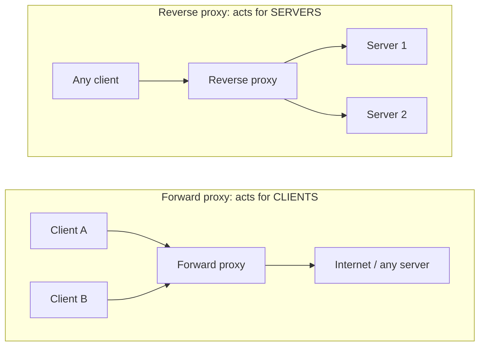
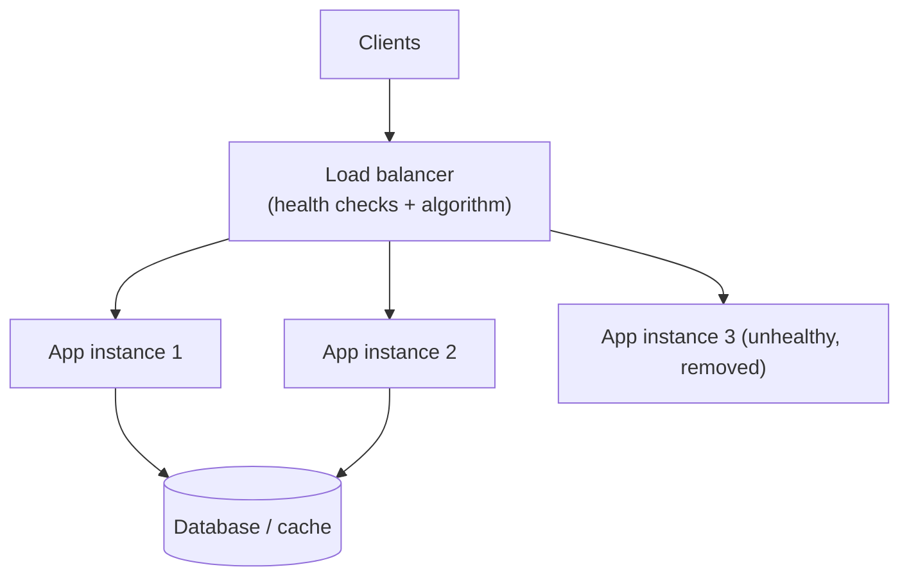
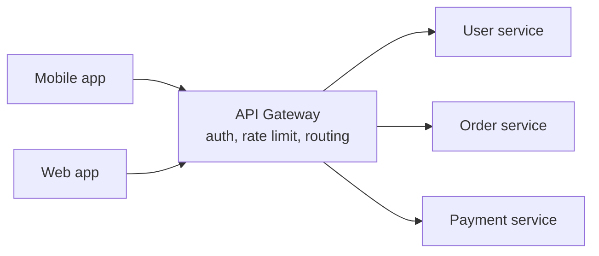

# 🚦 Proxies, Load Balancers and API Gateways

> Part of [[00 - Networking MOC]] · Previous: [[09 - Cookies, Sessions and Browser Security]] · Next: [[11 - Real-Time Communication and SSE]]

## The core idea: a middleman

A **proxy** is a server that sits **between** a client and another server and forwards traffic on someone's behalf. The big distinction is **whose side it is on**.



## Forward proxy

Configured **by or for the client**; the destination server sees the **proxy's** IP, not the client's.

**Uses:** corporate/school content filtering and monitoring, shared caching, hiding client identity (VPN-like anonymity), bypassing geo-blocks, controlling outbound traffic from servers (an "egress proxy" so backends reach the Internet only through an audited gateway). Examples: Squid, corporate proxies. A **VPN** is related but works at the network level.

## Reverse proxy

Sits in front of your **servers**; clients talk to the proxy believing it *is* the server. The backend servers are hidden.

**What a reverse proxy does:**

- **TLS termination:** handles certificates and encryption so apps stay simple ([[08 - HTTPS, TLS and Certificates]])
- **Routing:** `/api` → Node service, `/` → static files, `/admin` → another service
- **Load balancing** across several instances (below)
- **Caching and compression** (gzip/brotli), static file serving
- **Security:** hides internal topology, rate limiting, request size limits, basic WAF, DDoS shielding
- **Protocol bridging:** speak HTTP/2 or HTTP/3 to clients and plain HTTP/1.1 to apps ([[07 - HTTP Deep Dive]])
- **Zero-downtime deploys** (shift traffic gradually)

Common software: **Nginx**, **HAProxy**, **Caddy** (auto HTTPS), **Traefik**, **Envoy**. Cloud: AWS ALB, Cloudflare. A CDN ([[06 - DNS and CDN]]) is essentially a reverse proxy network spread worldwide.

**Why not expose Node directly?** Node is great at running application logic, but Nginx is battle-tested for slow clients, TLS, static files, and connection handling; it protects the app from slowloris-style attacks and lets you restart or scale apps behind it.

### Minimal Nginx reverse proxy

```nginx
server {
    listen 443 ssl http2;
    server_name api.example.com;
    ssl_certificate     /etc/letsencrypt/live/api.example.com/fullchain.pem;
    ssl_certificate_key /etc/letsencrypt/live/api.example.com/privkey.pem;

    location / {
        proxy_pass http://127.0.0.1:3000;            # your Express app
        proxy_set_header Host              $host;
        proxy_set_header X-Real-IP         $remote_addr;
        proxy_set_header X-Forwarded-For   $proxy_add_x_forwarded_for;
        proxy_set_header X-Forwarded-Proto $scheme;
    }
}
```

### Client IP behind a proxy

Your app's TCP peer is now the **proxy**, so `req.socket.remoteAddress` is the proxy's IP. The proxy passes the real one in **`X-Forwarded-For`** (a comma-separated chain: `client, proxy1, proxy2`) and the original scheme in `X-Forwarded-Proto`.

```js
app.set('trust proxy', 1); // trust exactly one proxy hop
// now req.ip and req.protocol/req.secure reflect X-Forwarded-* values
```

**Security caution:** these headers can be **forged by clients**. Only trust them when they were set by *your* proxy; configure the exact number/addresses of trusted hops, and never use `trust proxy: true` blindly. This matters for rate limiting, audit logs, and `Secure` cookies.

## Load balancing

**Problem:** one server has finite CPU/memory and can fail. **Solution:** run multiple identical instances (**horizontal scaling**) and put a **load balancer (LB)** in front that distributes requests, giving **scalability**, **availability** (survive instance failures), and **zero-downtime deploys**.



### L4 vs L7 load balancers

| | **L4** (transport) | **L7** (application) |
|---|---|---|
| Sees | IP + port (TCP/UDP) | Full HTTP: URL, headers, cookies |
| Decides by | Connection | Request |
| Speed | Very fast, simple | More CPU, much more flexible |
| Can do | Balance raw TCP, DB connections | Path/host routing, TLS termination, header rewriting, per-request balancing |
| Examples | AWS NLB, HAProxy (tcp mode) | AWS ALB, Nginx, Envoy |

(See layer vocabulary in [[02 - OSI and TCP-IP Models]].)

### Algorithms

| Algorithm | Idea | Good for |
|---|---|---|
| **Round robin** | Take turns: 1, 2, 3, 1, 2… | Equal servers, similar requests |
| **Weighted round robin** | Bigger servers get more | Mixed hardware |
| **Least connections** | Send to the server with fewest active connections | Long or uneven requests |
| **IP hash** | Hash client IP → same server | Cheap stickiness |
| **Consistent hashing** | Hash key (user, cache key) → stable server even as servers change | Caches, sharded data (see [[System Design MOC]]) |
| **Random / power of two choices** | Pick 2 random, choose the lighter | Large clusters |

### Health checks

The LB regularly probes each instance (`GET /health` expecting 200). **Active** checks poll; **passive** checks watch real traffic for errors. Unhealthy instances are removed until they recover. Make your `/health` endpoint cheap and meaningful (it can verify DB connectivity, but beware cascading failures from over-strict checks).

### Sticky sessions vs stateless services

If a user's session lives in **one server's memory**, the next request must hit the same server. **Sticky sessions** (cookie or IP-hash affinity) force that. It works but undermines balancing and breaks when that server dies. **Better:** keep servers **stateless** by storing sessions in Redis/DB ([[09 - Cookies, Sessions and Browser Security]]). Exception: WebSockets are inherently tied to one server connection ([[WebSocket]] shows the Redis pub/sub fan-out pattern).

### Other practical points

- The **LB itself can be a single point of failure**; run it redundantly (cloud LBs do this for you; DNS or anycast spread traffic across LB nodes).
- **Connection draining:** on deploy, stop sending *new* requests to an instance, let in-flight requests finish, then remove it.
- Align **idle timeouts** between LB, proxy, and Node's `keepAliveTimeout` to avoid random 502s ([[07 - HTTP Deep Dive]]).

## API Gateway

An **API gateway** is a reverse proxy specialized as the **single entry point** to many backend services (typical in microservices). Clients call one URL; the gateway routes each request to the right service and handles **cross-cutting concerns** once instead of in every service:

- **Routing** (`/users/*` → user service, `/orders/*` → order service)
- **Authentication/authorization** (verify JWT/API key at the edge; see [[Authentication and Authorization]])
- **Rate limiting, quotas, throttling**
- Request/response **transformation**, protocol translation (REST ⇄ gRPC; see [[gRPC]])
- **Aggregation** (combine responses from several services into one)
- Logging, metrics, tracing, caching, API versioning, TLS



Examples: Kong, AWS API Gateway, Apigee, Azure API Management, Traefik/Envoy-based gateways.

**Trade-offs:** adds a hop (latency) and is a critical component (must be highly available); can become a bloated "god" layer if business logic leaks in; extra operational complexity, so it is overkill for a single small monolith.

### Reverse proxy vs load balancer vs API gateway

These overlap heavily; products often do all three. The difference is **intent**:

| | Reverse proxy | Load balancer | API gateway |
|---|---|---|---|
| Primary job | Front servers: TLS, caching, hiding | Spread traffic across instances of **one** service | Single front door for **many services** with API policies |
| Layer | L7 (usually) | L4 or L7 | L7 |
| Knows about APIs/clients? | Not really | No | **Yes** (keys, plans, auth, versions) |
| Example | Nginx in front of Node | AWS NLB/ALB | Kong, AWS API Gateway |

## Common mistakes

- Trusting `X-Forwarded-For` without configuring `trust proxy` correctly (IP spoofing, bad rate limits) or *not* setting it (every user appears as the proxy IP).
- Storing session state in a single instance's memory behind an LB.
- Mismatched timeouts between LB, proxy, and Node (random 502/504).
- Forgetting WebSocket upgrade headers in Nginx (`Upgrade`, `Connection`) so real-time connections fail.
- Letting the LB or gateway become a single point of failure.
- Health checks that hit the database so hard they cause outages, or that always return 200 even when the app is broken.
- Putting business logic into the gateway.

## Check yourself

1. Forward vs reverse proxy: who knows about whom?
2. L4 vs L7 load balancing: what can each see and do?
3. How does your Express app learn the real client IP behind Nginx, and what's the risk?
4. Why are sticky sessions a code smell, and what replaces them?
5. When would you add an API gateway instead of just Nginx?

## Related concepts

- [[06 - DNS and CDN]] · [[08 - HTTPS, TLS and Certificates]] · [[07 - HTTP Deep Dive]] · [[11 - Real-Time Communication and SSE]]
- [[System Design MOC]]: scaling, caching, microservices · [[Linux]]: running Nginx as a service
