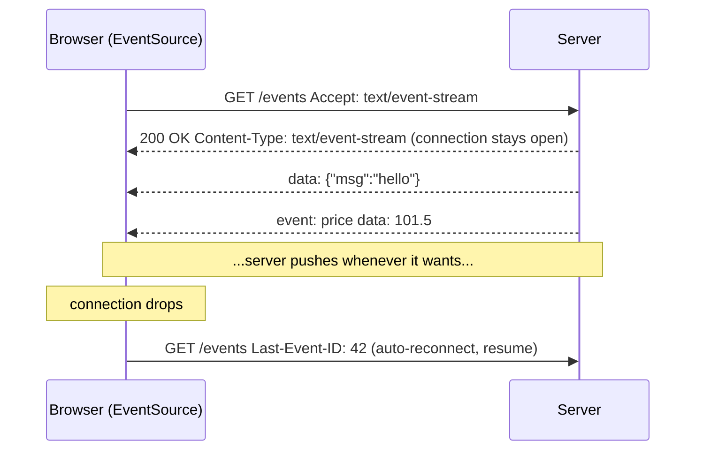
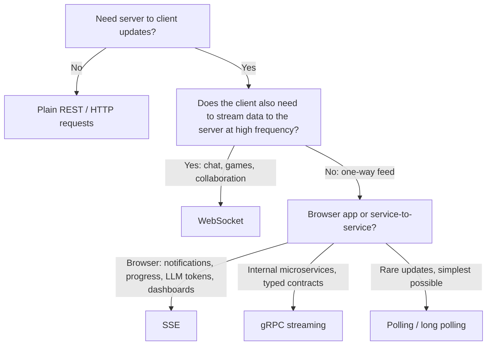

# 📡 Real-Time Communication and Server-Sent Events (SSE)

> Part of [[00 - Networking MOC]] · Previous: [[10 - Proxies, Load Balancers and API Gateways]] · Next: [[12 - Practical Networking Toolkit]]
> Deep dives already in the vault: [[WebSocket]] (full duplex) · [[gRPC]] (HTTP/2 streaming RPC). This note adds **SSE** and a **decision guide** across all options, without repeating those notes.

## The problem

Plain HTTP is **client-initiated**: the server can only answer when asked ([[07 - HTTP Deep Dive]]). But chat messages, notifications, live scores, progress bars, and LLM token streaming need the **server to push** data when *it* has something new.

## Options, from simplest to most capable

| Technique | How it works | Direction | Cost / weakness |
|---|---|---|---|
| **Short polling** | Client asks `GET /updates` every N seconds | Client → server | Wasteful, delay up to N seconds, load grows with users |
| **Long polling** | Client asks; server **holds the request open** until data exists (or timeout), client immediately re-asks | Simulated push | Many open requests, reconnect overhead, ordering/duplicates to handle |
| **SSE** | One long-lived HTTP response; server keeps writing events | **Server → client only** | One-way, text only |
| **WebSocket** | HTTP upgrade → persistent two-way TCP channel | **Both ways** | Own protocol: harder scaling, proxies, auth ([[WebSocket]]) |
| **gRPC streaming** | HTTP/2 streams with Protobuf | Both ways | Needs gRPC-web for browsers ([[gRPC]]) |

## What is SSE?

**Server-Sent Events** let a server **stream events to the browser over a normal HTTP connection** that stays open. The browser provides a built-in API, **`EventSource`**, which handles parsing and **automatic reconnection**.



**Why not WebSocket for everything?** If you only need server → client updates, SSE is **simpler**: it is plain HTTP (works with existing auth, cookies, load balancers, HTTP/2, no upgrade handshake), reconnects automatically, and needs less infrastructure.

### Wire format

Each event is lines of `field: value`, ended by a **blank line**:

```
id: 42
event: price
retry: 5000
data: {"symbol":"AAPL","price":101.5}

: this is a comment, often used as a heartbeat

data: line one
data: line two

```

- `data:`: payload (multiple `data:` lines are joined with `\n`)
- `event:`: custom event name (default is `message`)
- `id:`: sets the "last event ID"; on reconnect the browser sends it in the **`Last-Event-ID`** header so the server can **resume** missed events
- `retry:`: reconnect delay in ms
- lines starting with `:`: comments (ignored; good keep-alive pings)

### Server (Express)

```js
app.get('/events', (req, res) => {
  res.set({
    'Content-Type': 'text/event-stream',
    'Cache-Control': 'no-cache',
    'Connection': 'keep-alive',
    'X-Accel-Buffering': 'no',      // tell Nginx not to buffer this response
  });
  res.flushHeaders();

  let id = Number(req.get('Last-Event-ID')) || 0;
  const timer = setInterval(() => {
    id += 1;
    res.write(`id: ${id}\n`);
    res.write(`data: ${JSON.stringify({ time: Date.now() })}\n\n`); // blank line ends the event
  }, 2000);

  const ping = setInterval(() => res.write(': ping\n\n'), 25000); // heartbeat

  req.on('close', () => {            // client disconnected: ALWAYS clean up
    clearInterval(timer);
    clearInterval(ping);
  });
});
```

### Client

```js
const es = new EventSource('/events', { withCredentials: true }); // cookies for cross-origin
es.onmessage = (e) => console.log('data:', JSON.parse(e.data));
es.addEventListener('price', (e) => console.log('price event', e.data));
es.onerror = () => console.log('connection lost, the browser retries automatically');
// es.close();  // stop for good
```

## SSE limitations and gotchas

- **One direction only.** Client → server data still uses normal `fetch`/`POST` calls.
- **Text only** (UTF-8); binary must be encoded (Base64).
- **`EventSource` cannot set custom headers**, so no `Authorization: Bearer` header. Use cookies (`withCredentials`), a short-lived token in the query string (careful: URLs are logged), or use a `fetch()`-based streaming library to read `text/event-stream`.
- **Browser connection limit on HTTP/1.1:** about **6 connections per origin**; each open SSE stream uses one (opening many tabs can starve other requests). **HTTP/2 removes this** by multiplexing ([[HTTP Versions & the QUERY Method]]).
- **Proxy buffering:** Nginx or CDNs may buffer the response so events arrive in clumps. Disable buffering (`X-Accel-Buffering: no`, `proxy_buffering off`) and check idle timeouts ([[10 - Proxies, Load Balancers and API Gateways]]).
- **Always send heartbeats** so intermediaries and NAT tables don't drop idle connections ([[05 - Link and Network Layer]]).
- **Clean up on disconnect** (`req.on('close')`) or you leak timers and memory.
- **Scaling:** connections are stateful per server; fan events out with Redis pub/sub just like WebSockets.
- Compression and buffering middleware (like some `compression()` setups) can break streaming; test.

## Which one should I use? (decision guide)



| Use case | Best fit |
|---|---|
| Live chat, multiplayer game, collaborative editor | WebSocket |
| Notifications, live scores, order status, build/log streaming, **LLM streaming responses** | **SSE** |
| Service-to-service streaming with strict schemas | gRPC |
| Update every few minutes, low traffic, no infrastructure change | Short polling |

## Common mistakes

- Reaching for WebSocket by default when SSE would be simpler.
- Forgetting the **blank line** terminating each event (the browser never fires the event).
- Not handling reconnection state (`Last-Event-ID`), causing missed or duplicated events.
- Proxy/CDN buffering silently ruining "real-time".
- Leaking intervals/listeners when clients disconnect.
- Sending secrets in the SSE URL query string.

## Check yourself

1. Why can SSE reuse your existing cookie auth but WebSocket needs extra thought?
2. What does the browser send after a dropped SSE connection, and why?
3. Why might SSE events arrive in bursts behind Nginx?
4. Pick the right tool: stock ticker dashboard; multiplayer drawing board.

## Related concepts

- [[WebSocket]] · [[gRPC]] · [[07 - HTTP Deep Dive]] · [[04 - TCP and UDP]]
- [[Asynchronous JavaScript]] · [[Event Loop]]
