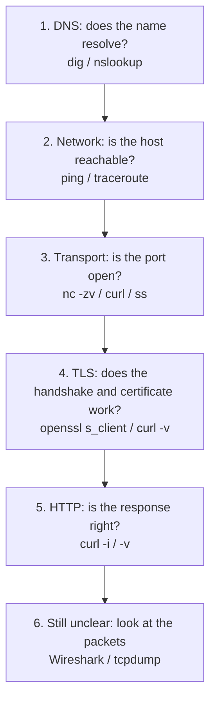

# 🛠️ Practical Networking Toolkit

> Part of [[00 - Networking MOC]] · Previous: [[11 - Real-Time Communication and SSE]]
> These commands run in the [[Linux]] shell (also WSL/macOS; Windows equivalents noted where they differ).

## Debugging mindset: walk up the layers

When "it doesn't work", don't guess; narrow the layer with one tool per question:



| Question | Tool |
|---|---|
| What IP does this name resolve to? | `dig`, `nslookup` |
| Can I reach the machine? Where does the path break? | `ping`, `traceroute`, `mtr` |
| Is anything listening on my port? Who owns it? | `ss`, `lsof` |
| Is the remote port open? | `nc -zv host port`, `curl` |
| Does my API return the right status/headers/body? Where is the time going? | `curl` |
| What exactly is on the wire? | Wireshark, `tcpdump` |

## 1. curl: talk HTTP from the terminal

`curl` is the Swiss-army knife for APIs. Use it to separate "my frontend is broken" from "my API is broken".

```bash
curl https://api.example.com/users             # GET, print body
curl -i https://api.example.com/users          # include response headers
curl -I https://api.example.com/users          # HEAD request: headers only
curl -v https://api.example.com/users          # verbose: DNS, TCP, TLS, request & response headers
curl -s https://api.example.com/users | jq .   # silent + pretty JSON (jq)

# POST JSON
curl -X POST https://api.example.com/users \
  -H "Content-Type: application/json" \
  -H "Authorization: Bearer $TOKEN" \
  -d '{"name":"Aryan","email":"a@example.com"}'

curl -L http://example.com                     # follow redirects
curl -o file.zip https://example.com/file.zip  # save to file (-O keeps remote name)
curl -u user:pass https://example.com          # basic auth
curl -b "sid=abc123" https://example.com       # send a cookie; -c jar.txt saves cookies
curl -k https://self-signed.local              # ignore cert errors (DEV ONLY)
curl -H "Origin: https://app.example.com" -i -X OPTIONS https://api.example.com/orders  # simulate CORS preflight
curl --resolve api.example.com:443:203.0.113.7 https://api.example.com/   # force an IP, bypass DNS
```

Flags: `-X` method, `-H` header, `-d` body (sets POST by default), `-i` show headers, `-v` verbose, `-s` silent, `-L` follow redirects, `-w` custom output.

### Measure where time goes

```bash
curl -s -o /dev/null -w "dns: %{time_namelookup}s\nconnect: %{time_connect}s\ntls: %{time_appconnect}s\nfirst byte (TTFB): %{time_starttransfer}s\ntotal: %{time_total}s\nstatus: %{http_code}\n" https://example.com
```

How to read it: **dns** = name lookup; **connect** minus dns = TCP handshake; **tls** minus connect = TLS handshake; **TTFB** minus tls = the server's processing + network. High `connect` → distance/network. High TTFB → slow backend or database.

### Reading `curl -v`

Lines starting `*` = connection info (resolved IP, TLS version, certificate), `>` = request you sent, `<` = response received. Check the negotiated protocol (`HTTP/2`), cert subject/expiry, status line, and headers like `Set-Cookie` and `Location`.

## 2. DNS tools: dig and nslookup ([[06 - DNS and CDN]])

```bash
dig example.com                    # full answer (A record by default)
dig +short example.com             # just the answer
dig example.com AAAA               # IPv6;  also: MX, TXT, NS, CNAME, SOA
dig @8.8.8.8 example.com           # ask a specific resolver (bypass your local cache)
dig +trace example.com             # walk root → TLD → authoritative yourself
dig -x 8.8.8.8                     # reverse lookup (PTR)
dig example.com +noall +answer     # only the answer section

nslookup example.com               # simpler, also on Windows
nslookup -type=MX example.com
```

**Reading `dig`:** the **ANSWER SECTION** shows `name  TTL  IN  TYPE  value`. The TTL counts down on repeated queries when a resolver is serving from cache, and the footer shows `SERVER:` (which resolver answered) and query time. Compare `dig @8.8.8.8` with `dig @ns1.yourdns.com example.com` (the authoritative server) to tell *stale cache* from *wrong record*.

Useful when: a new subdomain doesn't work (`NXDOMAIN`), email setup (MX/TXT), checking TTLs before migration, verifying a CNAME chain.

## 3. ping and traceroute ([[05 - Link and Network Layer]])

```bash
ping -c 4 example.com          # 4 echo requests (Linux/macOS; Windows: ping -n 4)
```

Read it: `time=` is the **RTT**; `ttl=` the remaining hop budget; `% packet loss` shows reliability. Remember firewalls may drop ICMP, so no reply ≠ down.

```bash
traceroute example.com         # Windows: tracert;  alternative: tracepath
mtr example.com                # live combined ping+traceroute, shows loss per hop
```

How it works: sends probes with TTL 1, 2, 3… and each router that drops one replies "Time Exceeded", revealing itself. Lines of `* * *` mean that hop didn't answer (often just filtered; only worry if **all later hops** also fail). Latency jumping sharply at a hop shows where distance/congestion is (a big jump that doesn't persist in later hops is usually just a slow-responding router, not a real problem).

## 4. ss and netstat: sockets on *this* machine ([[04 - TCP and UDP]])

`ss` (socket statistics) replaces the older `netstat` on modern Linux.

```bash
ss -tulpn                      # listening TCP/UDP sockets + owning process
ss -tulpn | grep :3000         # who is using port 3000?  (fixes EADDRINUSE)
ss -tan                        # all TCP connections, numeric
ss -tan state established      # only established
ss -tan state time-wait | wc -l   # count TIME_WAIT sockets
ss -s                          # summary of socket counts by state
sudo lsof -i :3000             # alternative: process using a port
```

Flags: `-t` TCP, `-u` UDP, `-l` listening, `-p` process (needs sudo for others' processes), `-n` numeric (no DNS/service names), `-a` all.

Reading the **Local Address** column tells you the **bind address** ([[03 - IP Addresses, Ports and Subnetting]]): `127.0.0.1:3000` = local only; `0.0.0.0:3000` or `*:3000` = all interfaces. Great for diagnosing "works on localhost, not from my phone/Docker".

Old style: `netstat -tulpn` (deprecated on Linux; on Windows, `netstat -ano` then `tasklist /fi "pid eq <PID>"`).

Free a stuck port: `ss -tulpn | grep :3000` → note PID → `kill <PID>` (use `kill -9` only as last resort).

## 5. A few extra tools worth knowing

```bash
nc -zv example.com 443         # is TCP port 443 reachable? (netcat; "connection succeeded")
openssl s_client -connect example.com:443 -servername example.com   # inspect TLS: cert chain, protocol, expiry
echo | openssl s_client -connect example.com:443 -servername example.com 2>/dev/null | openssl x509 -noout -dates -subject
ip addr            # my IPs         ip route    # routing table (default gateway)
ip neigh           # ARP cache      resolvectl status   # which DNS servers am I using
```

## 6. Wireshark and tcpdump: see the packets

**Wireshark** is a GUI **packet analyzer**: it captures frames from a network interface and decodes every layer (Ethernet → IP → TCP → HTTP), which makes [[02 - OSI and TCP-IP Models]] encapsulation visible.

**Workflow:**
1. Pick the interface: Wi-Fi/Ethernet for real traffic; **Loopback (`lo` / Adapter for loopback)** to see `localhost` traffic to your dev server.
2. Start capture, reproduce the problem, stop.
3. Filter, then **right-click a packet → Follow → TCP Stream** to read the whole conversation.

**Display filters (the part you'll use daily):**

| Filter | Shows |
|---|---|
| `ip.addr == 203.0.113.7` | Traffic to/from that IP |
| `tcp.port == 3000` | Your dev server traffic |
| `http` | HTTP (plain text only) |
| `dns` | DNS queries and responses |
| `tcp.flags.syn == 1 && tcp.flags.ack == 0` | New connection attempts (SYNs) |
| `tcp.analysis.retransmission` | Retransmitted segments (packet loss!) |
| `tls.handshake` | TLS handshakes (Client Hello shows SNI) |
| `tcp.flags.reset == 1` | Resets |

**Limitations:** HTTPS payloads are encrypted, so you see handshakes and sizes but not content (unless you supply TLS session keys via `SSLKEYLOGFILE`). Capture only networks you own or are authorized to inspect.

**tcpdump** (CLI, good on remote servers):

```bash
sudo tcpdump -i any -nn port 3000                 # watch traffic on port 3000
sudo tcpdump -i any -nn host 203.0.113.7 -w cap.pcap   # save to file, open later in Wireshark
```

### Exercises (do these; reading is not enough)

1. Capture while running `curl http://example.com` and find the **SYN → SYN-ACK → ACK** handshake, then the HTTP request, then the **FIN** exchange ([[04 - TCP and UDP]]).
2. Capture a `dig example.com` and read the DNS query/response packets (UDP 53).
3. Start your Express app on port 3000 and run `ss -tulpn | grep 3000`; then change `listen(3000, '127.0.0.1')` to `'0.0.0.0'` and compare.
4. Run the `curl -w` timing command against your own deployed site and a faraway site; explain the difference.
5. `dig +trace yourdomain.com` and identify root, TLD, and authoritative hops.

## Mini troubleshooting playbook

| Symptom | Check |
|---|---|
| `ENOTFOUND` / "could not resolve host" | `dig +short host`, resolver settings, typo, DNS record missing |
| `ECONNREFUSED` | Nothing listening / wrong port or bind address: `ss -tulpn` |
| `ETIMEDOUT` / hangs | Firewall/security group, wrong IP, routing: `nc -zv`, `traceroute` |
| `ECONNRESET` | Peer/proxy closed abruptly: check proxy timeouts and crashes |
| Cert errors | `openssl s_client`, expiry, hostname, chain ([[08 - HTTPS, TLS and Certificates]]) |
| 502 / 504 from proxy | Is upstream up (`curl localhost:3000`)? Timeouts? ([[10 - Proxies, Load Balancers and API Gateways]]) |
| CORS error in browser only | `curl -i -X OPTIONS` with `Origin` header; inspect `Access-Control-*` ([[09 - Cookies, Sessions and Browser Security]]) |
| Works locally, fails in Docker/remote | Bind to `0.0.0.0`, published ports, firewall |

## Related concepts

- [[Linux]] · [[01 - Networking Fundamentals]] · [[13 - API Testing with Postman]]
