You're right. You want **one complete set of notes covering the entire 36-video Hussein Nasser Backend Engineering (Beginner) playlist**, not notes delivered one video at a time.

I'll organize everything by subject rather than blindly following video order. That way, related concepts stay together and you can actually use the notes for learning, revision and interviews.

The playlist is approximately 14.5 hours and covers networking, databases, web servers, security, messaging, concurrency, performance and practical backend engineering. 

# Backend Engineering — Complete Notes
Hussein Nasser · Backend Engineering (Beginner) · 36-video playlist

## Complete index

| Module | Subject | Coverage |
|---|---|---|
| 01 | Backend Engineering Foundations | Videos 1–2 |
| 02 | Computer Networking & OSI | Videos 3–5, 10 |
| 03 | HTTP & Web Servers | Videos 6–7, 22 |
| 04 | Security & Encryption | Videos 8–9 |
| 05 | Proxies & Load Balancing | Videos 11, 29 |
| 06 | Database Engineering | Videos 14–16, 23, 33 |
| 07 | Messaging Systems | Videos 17, 27 |
| 08 | Concurrency & Async Programming | Videos 20–21, 30 |
| 09 | Backend Performance | Video 28 |
| 10 | Software Engineering Practices | Videos 12–13, 18–19, 24–26 |
| 11 | Practical Backend Development | Videos 31–32 |

Some subjects overlap because the original videos approach them from different angles.

---

# Module 01 — Backend Engineering Foundations

## 1. What is Backend Engineering?

Backend engineering is the development of the server-side systems that power applications.

A backend generally handles:

- Business logic.
- Authentication and authorization.
- Database operations.
- API development.
- Data processing.
- Communication between services.
- Security.
- Performance and scalability.
- Reliability and fault handling.

### Basic architecture

A request travels from the client to the backend over HTTPS. The backend uses storage and services as needed; background work can be handed to a queue and processed by a worker.

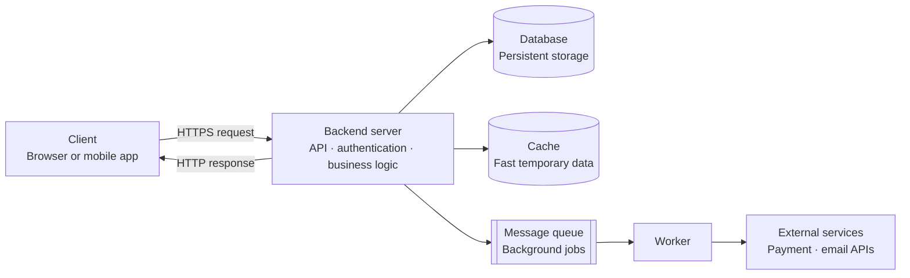

### What makes a good backend engineer?

A good backend engineer understands the underlying concepts rather than only knowing frameworks.

For example:

| Tool | Fundamental knowledge behind it |
|---|---|
| Express | HTTP, routing, middleware |
| PostgreSQL | Transactions, indexing, storage |
| Redis | In-memory storage, caching |
| Kafka | Messaging, event streaming |
| Nginx | Reverse proxy, load balancing |
| Docker | Isolation, containers |
| Node.js | Event loop, asynchronous I/O |

**Important principle:** Learn why a technology exists before learning how to use it.

## 2. Generalist vs Specialist

A generalist understands multiple areas of software engineering.

A specialist develops deep expertise in one area.

Examples:

- Database specialist.
- Networking specialist.
- Security engineer.
- Backend infrastructure engineer.
- Distributed systems engineer.

A beginner should first develop broad fundamentals, then deepen expertise in a selected area.

---

# Module 02 — Computer Networking

## 3. OSI Model

The OSI model is a conceptual framework that divides network communication into seven layers.

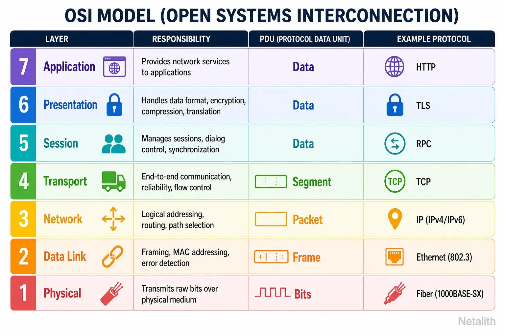

| Layer | Name | Responsibility | Examples |
|---|---|---|---|
| 7 | Application | Network services for applications | HTTP, DNS |
| 6 | Presentation | Data representation, encryption | Encoding, TLS-related functions |
| 5 | Session | Session management | Session establishment |
| 4 | Transport | End-to-end transport | TCP, UDP |
| 3 | Network | Logical addressing and routing | IP |
| 2 | Data Link | Local network delivery | Ethernet, Wi-Fi |
| 1 | Physical | Transmission of raw bits | Cables, radio |

### Encapsulation

When data travels from an application to a network:

1. Application creates data.
2. Transport layer adds TCP/UDP information.
3. Network layer adds IP information.
4. Data link layer adds frame information.
5. Physical layer transmits bits.

At the receiving end, the reverse process occurs: decapsulation.

### TCP/IP model

The practical TCP/IP model is commonly represented using four layers:

| TCP/IP layer | Corresponding OSI layers |
|---|---|
| Application | 5, 6, 7 |
| Transport | 4 |
| Internet | 3 |
| Network Access | 1, 2 |

### Interview question

**Why do we need layers in networking?**

Because layers separate responsibilities, allow independent development and troubleshooting, and provide standard interfaces between different networking technologies.

## 4. TCP vs UDP

TCP and UDP are transport-layer protocols.

| Feature | TCP | UDP |
|---|---|---|
| Connection | Connection-oriented | Connectionless |
| Reliability | Reliable delivery mechanism | No delivery guarantee |
| Ordering | Ordered byte stream | No ordering guarantee |
| Retransmission | Supported | Not built in |
| Flow control | Yes | No |
| Congestion control | Yes | No built-in transport-level mechanism |
| Overhead | Higher | Lower |

### TCP three-way handshake

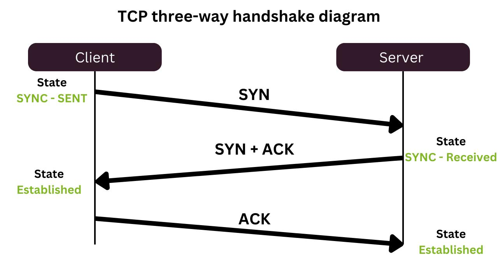

1. Client sends SYN.
2. Server responds SYN-ACK.
3. Client responds ACK.
4. Connection is established.

### TCP reliability mechanisms

- Sequence numbers.
- Acknowledgments.
- Retransmissions.
- Checksums.
- Flow control.
- Congestion control.

### UDP use cases

- Online gaming.
- Live streaming.
- Voice and video communication.
- DNS queries.
- Real-time communication.

### TCP use cases

- Web applications.
- File transfers.
- Database connections.
- Reliable API communication.

### QUIC

QUIC is a modern transport protocol built over UDP.

It provides:

- Reliable streams.
- Encryption integration.
- Faster connection establishment in suitable situations.
- Multiple independent streams.
- Improved handling of packet loss between streams.

HTTP/3 uses QUIC.

**Remember:** UDP itself does not guarantee reliability, but protocols built on UDP can implement reliability.

## 5. Network Address Translation (NAT)

NAT translates IP addresses between networks.

It is commonly used by home and office routers to allow multiple private devices to share a public IPv4 address.

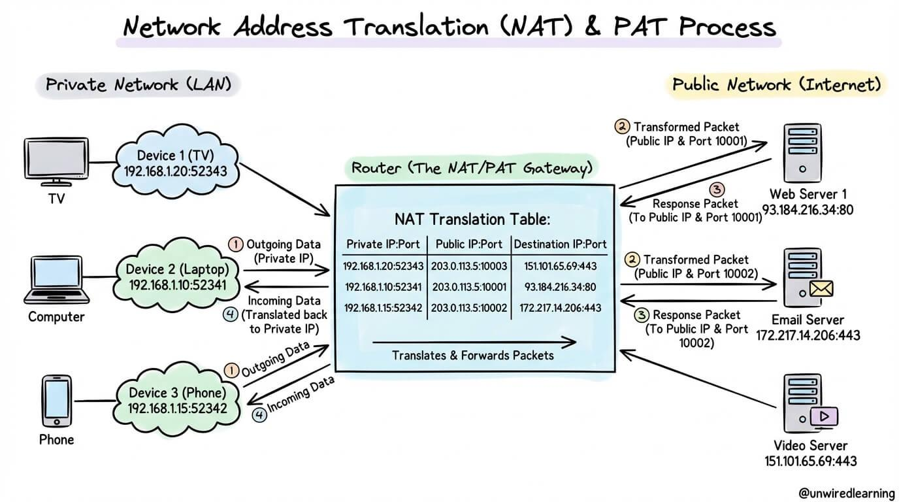

### Types

- Static NAT: One-to-one mapping.
- Dynamic NAT: Mapping from a pool of public IPs.
- PAT/NAPT: Multiple private devices share public IP using port mappings.

### Example

| Device | Private IP |
|---|---|
| Laptop | 192.168.1.10 |
| Phone | 192.168.1.11 |
| Desktop | 192.168.1.12 |

All three devices may communicate with the internet using one public IP address.

The router maintains translation entries to route return traffic to the correct device.

### Important distinction

NAT is not the same as a firewall. NAT changes address/port information; a firewall enforces traffic security policies.

---

# Module 03 — HTTP and Web Servers

## 6. HTTP

HTTP stands for Hypertext Transfer Protocol.

It is an application-layer protocol used for communication between clients and servers.

### HTTP request structure

```http
GET /users/123 HTTP/1.1
Host: example.com
Accept: application/json
Authorization: Bearer token
```

### HTTP response structure

```http
HTTP/1.1 200 OK
Content-Type: application/json

{
  "id": 123,
  "name": "Aryan"
}
```

### HTTP methods

| Method | Purpose |
|---|---|
| GET | Retrieve resource |
| POST | Submit data / create resource |
| PUT | Replace resource |
| PATCH | Partially update resource |
| DELETE | Delete resource |
| HEAD | Retrieve headers |
| OPTIONS | Discover communication options |

### HTTP status codes

| Range | Meaning | Examples |
|---|---|---|
| 1xx | Informational | 100 |
| 2xx | Success | 200, 201, 204 |
| 3xx | Redirection | 301, 302, 304 |
| 4xx | Client error | 400, 401, 403, 404, 429 |
| 5xx | Server error | 500, 502, 503, 504 |

### HTTP versions

| Version | Main characteristics |
|---|---|
| HTTP/1.0 | Basic request-response, commonly one connection per request |
| HTTP/1.1 | Persistent connections, pipelining support |
| HTTP/2 | Binary framing, multiplexing, header compression |
| HTTP/3 | HTTP over QUIC, UDP-based transport |

### Why HTTP/2?

HTTP/1.1 can experience application-level head-of-line blocking when multiple requests compete over limited connections.

HTTP/2 introduces multiplexing, allowing multiple streams over one connection.

However, HTTP/2 over TCP can still experience transport-level head-of-line blocking when TCP packets are lost.

HTTP/3 uses QUIC streams to reduce this cross-stream blocking problem.

### Important HTTP concepts

- Statelessness.
- Cookies.
- Sessions.
- Headers.
- Request body.
- Response body.
- Persistent connections.
- Keep-alive.
- Idempotency.
- Content negotiation.
- Compression.

### Idempotency

An operation is idempotent when repeating it produces the same intended effect as performing it once.

Examples:

- GET: Idempotent.
- PUT: Idempotent by intended semantics.
- DELETE: Idempotent by intended semantics.
- POST: Not generally idempotent.

## 7. Web Servers

A web server receives HTTP requests and sends HTTP responses.

Examples:

- Nginx.
- Apache HTTP Server.
- Node.js HTTP server.
- Caddy.

### Static vs dynamic content

| Static content | Dynamic content |
|---|---|
| Pre-existing files | Generated based on requests |
| HTML, CSS, images | Personalized API responses |
| Can be served directly | Requires application logic |

### How a web server works

1. Client sends request.
2. Server accepts connection.
3. Request is parsed.
4. Routing or file lookup occurs.
5. Application logic executes if required.
6. Response is generated.
7. Response is transmitted.

### ETags

ETag is an HTTP response header that identifies a particular version of a resource.

Example:

```http
ETag: "abc123"
```

Client can send:

```http
If-None-Match: "abc123"
```

If the resource has not changed, the server can respond:

```http
304 Not Modified
```

This reduces unnecessary data transfer.

### Threading models

- Single-threaded event loop.
- Multi-threaded request handling.
- Thread pools.
- Process-based worker models.
- Non-blocking I/O.

Node.js uses an event loop and non-blocking I/O for much of its network activity. Some operations use the libuv thread pool.

## 8. What happens when you type google.com and press Enter?

This is one of the most important backend interview questions.

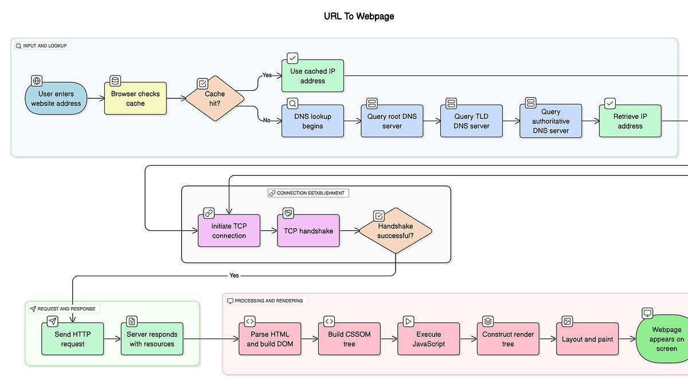

### Complete request journey

1. Browser parses the URL.
2. Browser checks relevant caches.
3. DNS resolves the domain to an IP address.
4. Client establishes a transport connection, such as TCP or QUIC.
5. TLS handshake establishes secure communication for HTTPS where applicable.
6. Browser sends HTTP request.
7. Request reaches the server through network infrastructure.
8. Reverse proxy or load balancer may route the request.
9. Backend application processes it.
10. Database or cache may be accessed.
11. Server generates the response.
12. Browser receives HTML, CSS, JavaScript and other resources.
13. Browser parses, renders and displays the page.

### Interview follow-up questions

- What happens if DNS resolution fails?
- What happens if the server is down?
- What happens if TLS certificate validation fails?
- What happens if the database is slow?
- What happens if the response is cached?
- What is the difference between DNS caching and HTTP caching?

---

# Module 04 — Security and Encryption

## 9. Symmetric vs Asymmetric Encryption

Encryption converts readable plaintext into ciphertext.

### Symmetric encryption

The same secret key is used for encryption and decryption.

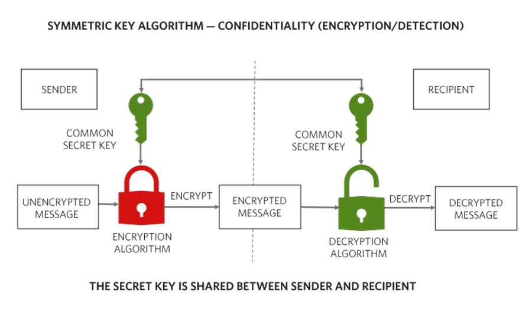

Examples:

- AES.
- ChaCha20.

Advantages:
- Fast.
- Efficient for large amounts of data.

Disadvantage:
- Securely sharing the secret key is difficult.

### Asymmetric encryption

Uses a public key and a private key.

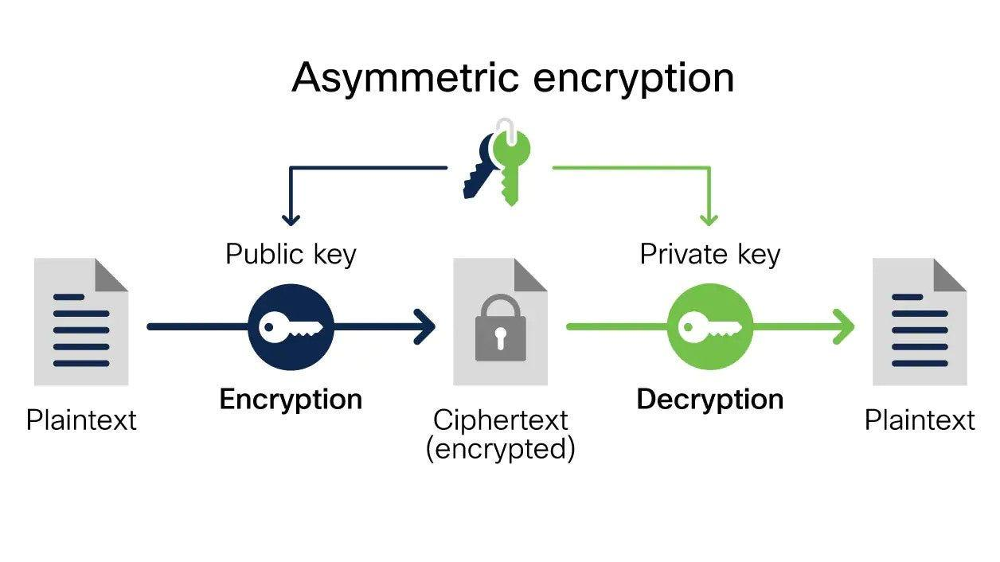

Examples:

- RSA.
- Elliptic-curve cryptography.

Advantages:
- Supports public-key cryptography.
- Enables digital signatures and key establishment.

Disadvantages:
- Computationally more expensive than symmetric encryption for bulk data.

### Comparison

| Property | Symmetric | Asymmetric |
|---|---|---|
| Keys | Shared secret | Public/private pair |
| Speed | Faster | Generally slower |
| Main use | Bulk encryption | Key establishment, signatures |
| Example | AES | RSA, ECC |

## 10. TLS — Transport Layer Security

TLS protects communication between clients and servers.

It provides:

1. Confidentiality.
2. Integrity.
3. Authentication.

### TLS handshake simplified

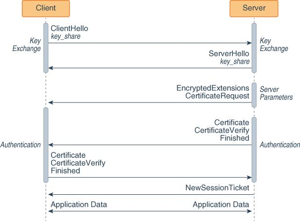

1. Client sends ClientHello.
2. Server responds with ServerHello and selected parameters.
3. Server authenticates using its certificate.
4. Key establishment takes place.
5. Both sides derive session keys.
6. Encrypted application data is exchanged.

TLS 1.3 generally reduces handshake round trips compared with older TLS versions.

### Digital certificates

A certificate binds a public key to an identity, typically a domain.

Certificate authorities issue certificates after validating the relevant identity.

### Common attacks

- Man-in-the-middle.
- Replay attacks.
- Downgrade attacks.
- Certificate spoofing.
- Weak cryptographic configurations.

### Backend security checklist

- Use HTTPS.
- Store passwords using secure password hashing such as Argon2id or bcrypt.
- Never commit credentials.
- Validate user input.
- Apply authorization checks.
- Use parameterized SQL queries.
- Apply rate limiting.
- Protect cookies.
- Rotate secrets appropriately.

---

# Module 05 — Proxies and Load Balancing

## 11. Forward Proxy vs Reverse Proxy

A proxy is an intermediary that handles requests on behalf of another party.

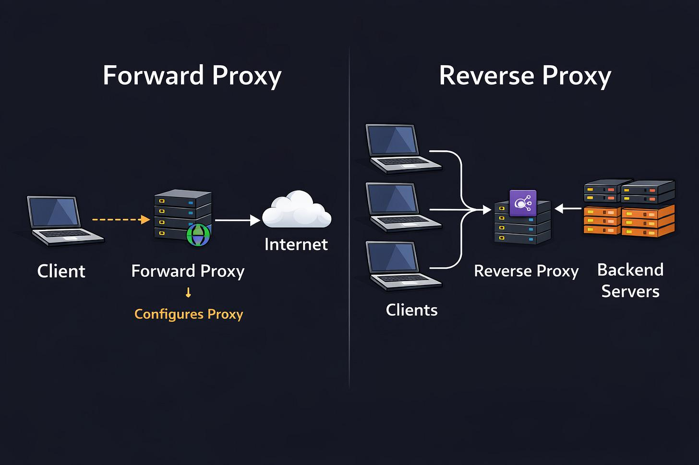

### Forward proxy

Acts on behalf of clients.

```text
Client → Forward Proxy → Internet
```

Uses:

- Access control.
- Content filtering.
- Client anonymity.
- Corporate network policies.

### Reverse proxy

Acts on behalf of backend servers.

```text
Client → Reverse Proxy → Backend Servers
```

Uses:

- Load balancing.
- TLS termination.
- Caching.
- Routing.
- Security.
- Compression.

### Comparison

| Feature | Forward proxy | Reverse proxy |
|---|---|---|
| Represents | Client | Server |
| Located near | Client side | Server side |
| Hides | Client identity from destination | Backend infrastructure |
| Common use | Corporate internet access | Web application infrastructure |

## 12. Layer 4 vs Layer 7 Load Balancing

A load balancer distributes traffic among backend servers.

### Layer 4

Works using transport-layer information.

It can use:

- Source IP.
- Destination IP.
- Source port.
- Destination port.
- TCP/UDP connection information.

### Layer 7

Works using application-layer information.

It can route using:

- URL path.
- HTTP headers.
- Hostname.
- Cookies.
- Application-level information.

### Comparison

| Feature | L4 | L7 |
|---|---|---|
| Layer | Transport | Application |
| HTTP awareness | No | Yes |
| Routing | IP/port | URL, headers, host |
| Processing | Generally less application processing | More application processing |

### Load balancing algorithms

1. Round Robin.
2. Weighted Round Robin.
3. Least Connections.
4. Weighted Least Connections.
5. IP Hash.
6. Consistent Hashing.
7. Random Selection.

### Health checks

A load balancer should detect unhealthy backend servers and stop routing new traffic to them until they recover.

### Sticky sessions

A client is repeatedly routed to the same backend server.

Useful in certain session-dependent architectures, but stateless session storage is generally more flexible for horizontal scaling.

---

# Module 06 — Database Engineering

## 13. ACID Transactions

ACID describes four important transaction properties in relational databases.

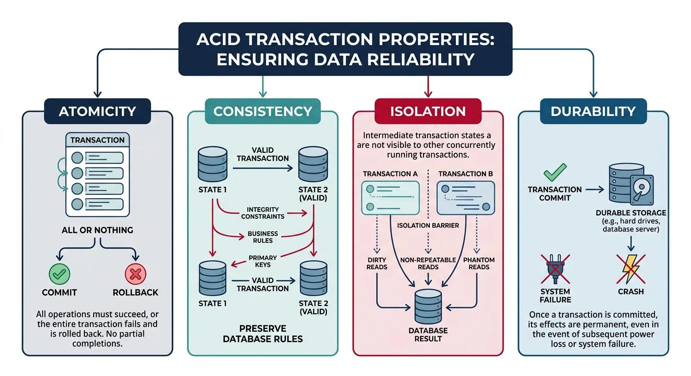

| Property | Meaning |
|---|---|
| Atomicity | All operations succeed or the transaction is rolled back |
| Consistency | Transaction preserves database constraints and invariants |
| Isolation | Concurrent transactions behave according to the selected isolation level |
| Durability | Committed changes survive failures according to durability guarantees |

### Example: Bank transfer

Transfer ₹1,000 from account A to account B.

```sql
BEGIN;

UPDATE accounts
SET balance = balance - 1000
WHERE id = 1;

UPDATE accounts
SET balance = balance + 1000
WHERE id = 2;

COMMIT;
```

If one operation fails, rollback prevents a partial transfer.

### Isolation levels

| Level | Main protection |
|---|---|
| Read Uncommitted | Weakest isolation |
| Read Committed | Prevents dirty reads |
| Repeatable Read | Prevents non-repeatable reads |
| Serializable | Strongest standard isolation behavior |

PostgreSQL implements Read Uncommitted as Read Committed.

Important anomalies:

- Dirty read.
- Non-repeatable read.
- Phantom read.
- Lost update.
- Write skew.

## 14. Primary Key vs Secondary Key

### Primary key

Uniquely identifies a row.

Properties:

- Unique.
- Not NULL.
- One primary key constraint per table.
- Can contain multiple columns.

### Secondary index/key

A secondary index is an additional lookup structure used to locate rows using columns other than the primary key.

Example:

```sql
CREATE TABLE users (
    id BIGINT PRIMARY KEY,
    email VARCHAR(255) UNIQUE,
    name VARCHAR(100)
);

CREATE INDEX idx_users_name
ON users(name);
```

A primary key is a constraint; a secondary index is an additional access path. A unique secondary index can also enforce uniqueness.

## 15. B-Tree vs B+Tree

These are balanced tree data structures used in database indexing.

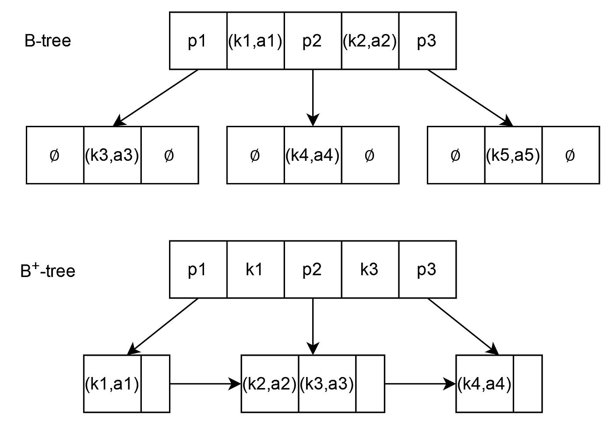

### B-Tree

- Keys and associated records or pointers can exist in internal and leaf nodes.
- Maintains balanced tree structure.
- Supports efficient searching and updates.

### B+Tree

- Internal nodes primarily contain separator keys and child pointers.
- Actual indexed entries are stored in leaf nodes.
- Leaf nodes are commonly linked.
- Efficient for range scans.

### Why databases use B+Trees

- High fan-out.
- Lower tree height.
- Efficient disk page access.
- Excellent range query support.
- Efficient ordered traversal.

## 16. Database Indexing

An index is a data structure that improves data retrieval efficiency.

Without an appropriate index, the database may scan the entire table.

### Example

```sql
SELECT *
FROM users
WHERE email = 'aryan@example.com';
```

Create an index:

```sql
CREATE INDEX idx_users_email
ON users(email);
```

### Common index types in PostgreSQL

| Index type | Typical use |
|---|---|
| B-tree | Equality, ranges, sorting |
| Hash | Equality |
| GIN | JSONB, arrays, full-text search |
| GiST | Geometric and specialized searches |
| BRIN | Very large physically correlated tables |

### Index disadvantages

- Additional disk storage.
- Slower inserts.
- Slower updates to indexed columns.
- Maintenance overhead.

### EXPLAIN and EXPLAIN ANALYZE

```sql
EXPLAIN ANALYZE
SELECT *
FROM users
WHERE email = 'aryan@example.com';
```

Use these tools to understand query execution plans.

Look for:

- Sequential Scan.
- Index Scan.
- Index Only Scan.
- Bitmap Heap Scan.
- Nested Loop.
- Hash Join.
- Sort.

## 17. PostgreSQL Connection Leaks

A database connection is a resource. Applications must release connections when finished.

A connection leak happens when connections are acquired but not properly returned or closed.

### Symptoms

- Connection pool exhaustion.
- Increasing request latency.
- Database connection errors.
- Application failures under load.

### Correct pattern

```javascript
const client = await pool.connect();

try {
  await client.query("BEGIN");

  // Database operations

  await client.query("COMMIT");
} catch (error) {
  await client.query("ROLLBACK");
  throw error;
} finally {
  client.release();
}
```

**Important:** Always release a checked-out connection, including when an error occurs.

For PayRail, this is especially important because payment operations can involve multiple database writes and external service calls.

---

# Module 07 — Messaging Systems

## 18. Publish-Subscribe Architecture

Publish-Subscribe (Pub/Sub) is a messaging pattern in which publishers produce events and subscribers consume events.

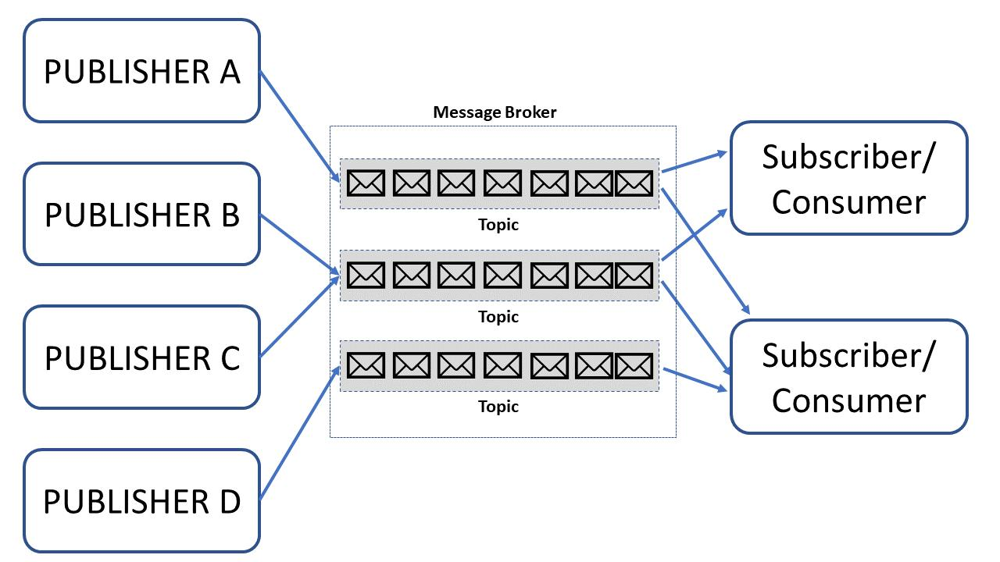

### Components

- Publisher: Produces messages.
- Broker: Receives and distributes messages.
- Topic: Logical category of messages.
- Subscriber: Receives relevant messages.

### Example

An e-commerce application publishes:

`OrderPlaced`

Subscribers:

- Inventory service.
- Email service.
- Analytics service.
- Shipping service.

The publisher does not need to know all subscribers.

### Message queue vs Pub/Sub

| Message queue | Pub/Sub |
|---|---|
| Work distribution | Event distribution |
| Often competing consumers | Multiple independent subscribers |
| Message processed by one consumer in common queue patterns | Multiple subscribers can receive the same event |
| Useful for background jobs | Useful for event-driven systems |

Actual delivery behavior depends on the broker and subscription model.

### Technologies

- RabbitMQ.
- Apache Kafka.
- Redis Pub/Sub.
- NATS.
- Google Pub/Sub.

### Important concepts

- At-most-once delivery.
- At-least-once delivery.
- Exactly-once processing claims.
- Acknowledgments.
- Dead-letter queues.
- Retries.
- Consumer groups.
- Message ordering.
- Idempotent consumers.

**Critical lesson:** A message broker does not automatically guarantee exactly-once business execution. Design consumers to handle duplicate messages safely.

## 19. XMPP

XMPP stands for Extensible Messaging and Presence Protocol.

It is an open protocol for real-time messaging and presence information.

Uses:

- Chat applications.
- Presence status.
- Messaging between clients.
- Federated communication.

### Main concepts

- XML-based stanzas.
- Messages.
- Presence.
- IQ (information/query).
- XMPP servers.
- Client-server communication.

Example architecture:

```text
Client A → XMPP Server → Client B
```

Unlike a simple application-specific chat protocol, XMPP provides standardized extensible communication and federation features.

---

# Module 08 — Concurrency and Asynchronous Programming

## 20. Synchronous vs Asynchronous

### Synchronous

Operations execute in a sequence. A caller generally waits for the current operation to finish.

### Asynchronous

An operation can begin, return control to the caller, and complete later.

| Synchronous | Asynchronous |
|---|---|
| Blocking behavior is common | Can avoid waiting |
| Simple sequential flow | Event/callback-driven flow |
| May waste waiting time | Better resource utilization for I/O workloads |
| Easier to reason about in simple cases | Requires handling concurrency and errors |

### Example in JavaScript

Synchronous:

```javascript
const result = calculate();
console.log(result);
```

Asynchronous:

```javascript
const result = await fetchData();
console.log(result);
```

`await` pauses the surrounding async function until the promise settles. It does not block the entire Node.js event loop.

## 21. Multithreading vs Multiprocessing

### Multithreading

Multiple threads execute within one process.

Characteristics:

- Shared process memory.
- Lower overhead than separate processes in many cases.
- Requires synchronization for shared mutable state.
- Can involve race conditions and deadlocks.

### Multiprocessing

Multiple independent processes execute work.

Characteristics:

- Separate memory spaces.
- Better process isolation.
- Communication requires IPC or other mechanisms.
- Higher overhead in many situations.

### Comparison

| Feature | Threads | Processes |
|---|---|---|
| Memory | Shared within process | Separate |
| Isolation | Lower | Higher |
| Communication | Shared memory / synchronization | IPC |
| Overhead | Often lower | Often higher |
| Failure isolation | Limited | Better |

### Node.js

Node.js uses:

- Event loop.
- Non-blocking I/O.
- libuv.
- Worker threads.
- Child processes.
- Cluster capabilities.

Node.js is not simply "single-threaded" in every aspect.

The JavaScript execution in a typical event loop runs on one main thread, while underlying runtime and OS facilities handle other work.

## 22. Synchronous and Asynchronous Workloads

### CPU-bound workload

Examples:

- Image processing.
- Video encoding.
- Large calculations.
- Cryptographic computation.

### I/O-bound workload

Examples:

- Database queries.
- HTTP requests.
- File operations.
- Network communication.

| Workload | Suitable approach |
|---|---|
| CPU-bound | Worker threads, processes, distributed workers |
| I/O-bound | Async non-blocking I/O |
| Long-running jobs | Background queues |
| Independent tasks | Parallel execution where beneficial |

---

# Module 09 — Backend Performance

## 23. Percentile Tail Latency

Latency is the time taken for a request to complete.

Average latency alone can hide slow requests.

### Example

Imagine 100 requests:

- 95 requests finish within 100 ms.
- 4 requests finish within 300 ms.
- 1 request finishes in 2 seconds.

Then:

- P95 is approximately 100 ms.
- P99 is approximately 300 ms.
- Maximum is 2 seconds.

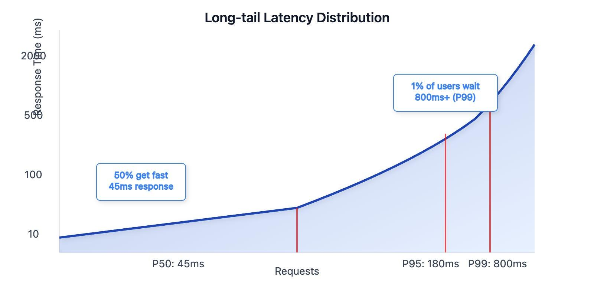

### Common percentiles

| Metric | Meaning |
|---|---|
| P50 | Median latency |
| P90 | 90% of requests complete within this latency |
| P95 | 95% complete within this latency |
| P99 | 99% complete within this latency |
| P99.9 | 99.9% complete within this latency |

### Why tail latency matters

In distributed systems, a single slow dependency can delay the entire request.

For example:

```text
API Request
   ├── Database: 30 ms
   ├── Payment Provider: 2000 ms
   ├── Cache: 5 ms
   └── Inventory: 40 ms
```

The payment provider becomes the bottleneck.

### Techniques to reduce latency

- Caching.
- Connection pooling.
- Query optimization.
- Load balancing.
- Timeouts.
- Parallel requests where safe.
- Avoiding unnecessary network calls.
- Efficient serialization.

### Important distinction

Latency measures time. Throughput measures how much work a system processes over a period.

---

# Module 10 — Software Engineering Practices

## 24. Backend Engineer Interview Fundamentals

An interview question is not just about whether you know a technology.

Interviewers want to understand:

- How you reason.
- Whether you understand trade-offs.
- Whether you can diagnose problems.
- Whether you understand production behavior.
- Whether you can communicate technical decisions.

Example:

**Why is opening 700 TCP connections a bad idea?**

Potential reasons:

- Handshake overhead.
- Connection setup latency.
- File descriptor consumption.
- Server resource consumption.
- Increased memory use.
- Increased database load.
- Potential connection exhaustion.

Better solutions may include:

- Connection reuse.
- Connection pooling.
- Keep-alive.
- Multiplexing where supported.
- Proper concurrency limits.

## 25. What recruiters look for

A strong backend candidate should demonstrate:

1. Programming fundamentals.
2. Data structures and algorithms.
3. Networking fundamentals.
4. Database knowledge.
5. API development.
6. Debugging ability.
7. Testing knowledge.
8. Understanding of production systems.
9. Clear communication.
10. Practical projects.

## 26. What makes a good software tester?

Testing is not simply checking whether an application works under normal conditions.

A good tester attempts to discover how the system fails.

### Testing categories

| Type | Purpose |
|---|---|
| Unit testing | Test individual functions/components |
| Integration testing | Test interaction between components |
| End-to-end testing | Test complete user workflows |
| Load testing | Test behavior under load |
| Stress testing | Find system limits |
| Security testing | Find vulnerabilities |
| Regression testing | Ensure existing behavior remains correct |

### Example: Payment system testing

Test:

- Successful payment.
- Payment timeout.
- Duplicate requests.
- Invalid response.
- Database failure.
- Provider outage.
- Retry behavior.
- Refund handling.

A system that works only when everything succeeds is not production-ready.

## 27. Software Design Process

Before building a system, understand the problem.

### Design workflow


  {#each ["Understand requirements","Identify constraints","Define APIs and data models","Design components","Choose technologies","Implement","Test failure scenarios","Monitor and improve"] as s,i}
    
      {i+1}. {s}
    
    {#if i!==7}
      
    {/if}
  {/each}


### Functional requirements

What should the application do?

Examples:

- Create account.
- Process payment.
- View transaction history.

### Non-functional requirements

How should the application behave?

Examples:

- Availability.
- Scalability.
- Security.
- Reliability.
- Performance.
- Maintainability.

### Engineering trade-offs

There is rarely one perfect design.

You must consider:

- Cost.
- Complexity.
- Latency.
- Consistency.
- Availability.
- Maintainability.

## 28. Software Engineering Is Overwhelming

The central learning principle is to avoid trying to learn everything simultaneously.

A better approach:

1. Learn a concept.
2. Understand the problem it solves.
3. Build a small implementation.
4. Experiment with failures.
5. Read technical documentation.
6. Revisit and deepen understanding.

Do not confuse knowing the names of technologies with understanding their internals.

## 29. Career Path: Network Engineer to Backend Engineer

Networking knowledge is a strong foundation for backend engineering.

Transferable concepts include:

- TCP/IP.
- DNS.
- Routing.
- HTTP.
- TLS.
- Load balancing.
- Proxies.
- Network debugging.

The additional skills needed include programming, databases, API development, data structures and software design.

## 30. Backend Portfolio

A backend portfolio should prove engineering ability rather than simply show a collection of CRUD applications.

A good project demonstrates:

- Authentication.
- Database design.
- Transaction handling.
- API design.
- Error handling.
- Testing.
- Logging.
- Performance.
- Security.
- Deployment.

For every project, document the architectural decisions and trade-offs.

---

# Module 11 — Practical Backend Development

## 31. Building an Upload Backend Service

A file upload service accepts data from a client and stores it safely.

### Basic flow

```text
Client
  |
  | Upload request
  v
Backend API
  |
  | Validate file
  v
Storage
  |
  | Save metadata
  v
Database
  |
  v
Response
```

### Important concepts

- Multipart uploads.
- Content-Type.
- File size limits.
- File validation.
- Storage management.
- Unique file names.
- Authentication.
- Authorization.
- Streaming.
- Upload progress.
- Error handling.

### Security considerations

Never trust the filename or extension supplied by the client.

Validate actual content where possible, limit file sizes, prevent path traversal and avoid serving uploaded executable content unsafely.

### Large file uploads

For large uploads, streaming is often better than buffering the entire file into memory.

## 32. TCP/IP Turns 40

TCP/IP is the foundational networking protocol suite behind the internet.

### Core components

- IP: Addressing and packet routing.
- TCP: Reliable ordered byte-stream transport.
- UDP: Connectionless datagram transport.
- ICMP: Network diagnostic and error messaging.
- DNS: Domain name resolution, implemented at the application layer.

### TCP vs IP

IP handles addressing and routing packets.

TCP provides reliable ordered communication between endpoints using IP as its underlying network service.

They solve different problems and work together.

---

# Complete backend engineering glossary

| Term | Meaning |
|---|---|
| API | Interface for software communication |
| DNS | Domain Name System |
| TCP | Transmission Control Protocol |
| UDP | User Datagram Protocol |
| QUIC | Modern transport protocol over UDP |
| HTTP | Hypertext Transfer Protocol |
| TLS | Transport Layer Security |
| NAT | Network Address Translation |
| Proxy | Intermediary for network requests |
| Reverse proxy | Intermediary representing backend servers |
| Load balancer | Distributes traffic |
| ACID | Database transaction properties |
| Index | Data structure for faster retrieval |
| B-Tree | Balanced search tree |
| Pub/Sub | Publish-subscribe messaging |
| XMPP | Extensible Messaging and Presence Protocol |
| Latency | Time required for an operation |
| Throughput | Work completed per unit of time |
| ETag | HTTP resource validator |
| Connection pool | Reusable collection of connections |
| Event loop | Mechanism for scheduling asynchronous callbacks |
| Idempotency | Repeated operation has the same intended effect |

---

## How this connects to PayRail

These concepts are directly useful when building a payment orchestration platform.

| PayRail component | Concepts to apply |
|---|---|
| API server | HTTP, web servers, Node.js |
| Payment processing | ACID, transactions, idempotency |
| Payment provider integration | TCP, HTTP, TLS |
| Provider routing | Proxies, load balancing |
| Transaction history | Indexing, PostgreSQL |
| Background processing | Queues, Pub/Sub |
| Reliability | Timeouts, retries, tail latency |
| Security | Encryption, TLS, authentication |
| Monitoring | Latency, logging, testing |

## Important: How to study these notes

Don't just memorize definitions.

For each topic, you should be able to answer:

1. What problem does it solve?
2. How does it work internally?
3. Why was it introduced?
4. What are its alternatives?
5. What are its limitations?
6. Where would you use it in a real backend?
7. What happens when it fails?

**One accuracy note:** The playlist is listed as 36 videos, but the accessible course syllabus exposes 33 identifiable video titles. I have covered the identifiable subjects here rather than inventing titles or claiming to have verified three missing videos. 

Playlist: [Hussein Nasser — Backend Engineering (Beginner)](https://www.youtube.com/playlist?list=PLQnljOFTspQUNnO4p00ua_C5mKTfldiYT).

My recommendation: Keep these as your master notes, and later expand individual subjects with practical experiments. Networking, PostgreSQL internals, concurrency, proxies and messaging deserve considerably deeper study than a beginner playlist can provide.


---

Source: [Hussein Nasser — Backend Engineering (Beginner) playlist](https://www.youtube.com/playlist?list=PLQnljOFTspQUNnO4p00ua_C5mKTfldiYT) · [Shared conversation](https://chatgpt.com/share/6af16962-a524-83ec-a330-4f9fa21c6210).
