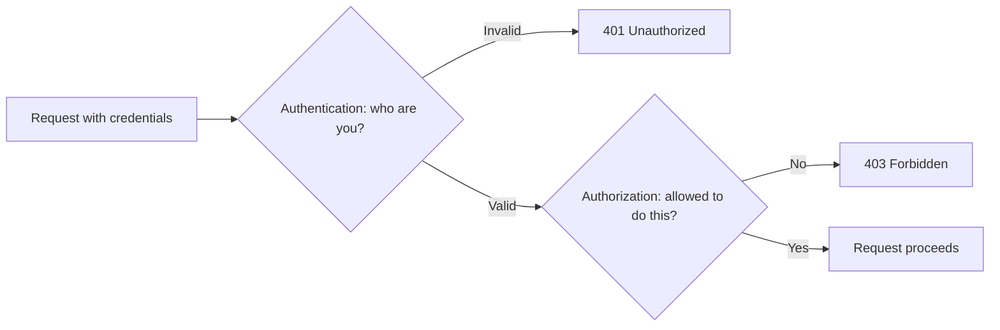
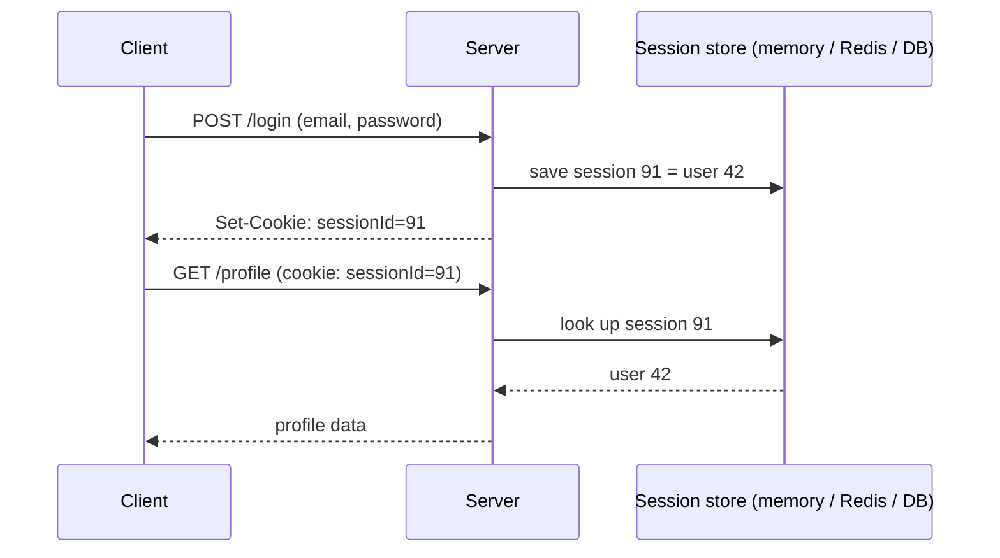
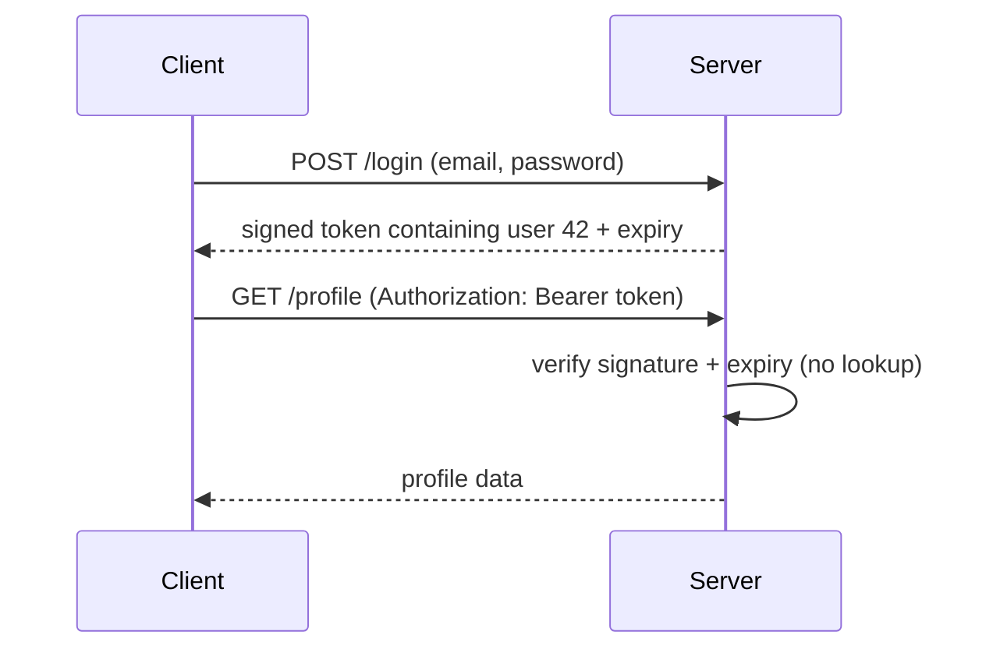

# 17 - Authentication Fundamentals & Password Hashing (bcrypt)

## What is authentication? (vs authorization)
**Authentication** answers *"who are you?"* — verifying identity, usually email + password, before letting someone in. **Authorization** answers *"what are you allowed to do?"* — checked **after** identity is known. This is the same split as `401 Unauthorized` (not authenticated) vs `403 Forbidden` (authenticated, but not allowed) — see [[REST APIs]].



## Why passwords must never be stored in plain text
Databases get breached, even at well-run companies. If raw passwords are stored, every user's password is exposed instantly, and because people reuse passwords, the damage spreads to their other accounts. Even *you* (and your teammates) should never be able to read a user's password.

## Hashing vs encryption
| | Encryption | Hashing |
|---|---|---|
| Reversible? | Yes, with the key | **No** — one-way by design |
| Purpose | Hide data you must read back later | Verify data without storing it |
| For passwords? | ❌ | ✅ |

To verify a login you don't "decrypt" the stored password — you hash the attempt and compare it with the stored hash.

## Why a plain hash (SHA-256, MD5) isn't enough
- **Rainbow tables** — precomputed hash → password lookup tables; a leaked hash is just looked up.
- **Same password → same hash**, so an attacker spots users sharing passwords and cracks them all at once.
- **Too fast** — general-purpose hashes are built for speed; attackers can try billions of guesses per second.

**Salting** fixes the first two: a random **salt**, unique per user, is mixed into the password before hashing, so identical passwords produce different hashes and precomputed tables are useless. A **deliberately slow** algorithm fixes the third.

## bcrypt — purpose-built for passwords
`bcrypt` generates a salt automatically, stores it inside the hash string, and has a tunable **cost factor** (salt rounds) that makes each hash intentionally expensive to compute.

```bash
npm install bcrypt
```
A bcrypt hash looks like `$2b$10$N9qo8uLOickgx2ZMRZoMye...` — algorithm version, cost (`10`), salt, then hash, all in one string. That's why you only need to store that one string.

```js
const bcrypt = require('bcrypt');
const SALT_ROUNDS = 10; // each +1 doubles the work; 10–12 is typical

// Signup: hash before storing
const hash = await bcrypt.hash(plainPassword, SALT_ROUNDS);
// save `hash` in the DB — never the plain password

// Login: compare attempt against stored hash
const ok = await bcrypt.compare(attemptedPassword, user.passwordHash);
// true / false
```
`bcrypt.compare` reads the salt and cost from the stored hash, re-hashes the attempt, and compares. There is **no** decrypt function.

### Always use the async versions
Hashing is CPU-heavy by design. `bcrypt.hashSync` blocks Node's single thread, freezing every other request (see [[05 - Node.js Event Loop Phases & libuv Thread Pool]]). The async `bcrypt.hash`/`compare` run on the libuv thread pool instead.

## Minimal signup/login routes (no tokens yet)
```js
const express = require('express');
const bcrypt = require('bcrypt');
const app = express();
app.use(express.json());

const users = []; // stand-in for a database

app.post('/signup', async (req, res) => {
  const { email, password } = req.body;
  if (users.find(u => u.email === email))
    return res.status(409).json({ error: 'Email already registered' });

  const passwordHash = await bcrypt.hash(password, 10);
  users.push({ id: users.length + 1, email, passwordHash });
  res.status(201).json({ message: 'User created' });
});

app.post('/login', async (req, res) => {
  const { email, password } = req.body;
  const user = users.find(u => u.email === email);
  const ok = user && await bcrypt.compare(password, user.passwordHash);
  if (!ok) return res.status(401).json({ error: 'Invalid email or password' });

  res.json({ message: 'Logged in' }); // next step: give the client proof of login -> JWT
});
```
Problem left: HTTP is stateless (see [[REST APIs]]). After `/login` succeeds, the server has no memory of it on the *next* request. The client needs to carry proof of login — that's what [[18 - JWT (JSON Web Tokens)]] solves.

## Stateful vs stateless (the idea behind sessions vs tokens)

**State** = information the server remembers between requests (e.g. "this client is logged in as Aryan").

- **Stateful** server: remembers each client between requests. The request alone isn't enough; the server must look up stored state to understand it.
- **Stateless** server: remembers nothing between requests. Every request carries everything needed to process it (including proof of identity), so the server treats each one independently.

Analogy: a **stateful** waiter remembers your table and order history, so you can just say "the usual". A **stateless** waiter remembers nothing, so you hand over a signed note with your full order every single time.

### Stateful authentication: server-side sessions

The cookie holds only a meaningless random ID; the real login state lives on the server and must be looked up on **every** request.

### Stateless authentication: tokens (JWT)

The state is **inside the token**, signed so it can't be forged. The server stores nothing about the login; any server holding the secret can verify it. See [[18 - JWT (JSON Web Tokens)]].

### Comparison
| | Stateful (sessions) | Stateless (JWT) |
|---|---|---|
| Where login state lives | Server (memory, Redis, DB) | Inside the token, held by the client |
| What the client sends | Session ID (usually a cookie) | The token itself (header or cookie) |
| Per-request cost | A store lookup | Signature verification (CPU only, no I/O) |
| Scaling to many servers | Needs a shared session store or sticky sessions | Easy: any server can verify |
| **Revoking / logging out** | **Easy:** delete the session | **Hard:** valid until it expires (needs a denylist or short expiry + refresh tokens) |
| Changing a user's role/permissions | Takes effect immediately | Old token keeps the old claims until it expires |
| Server restart | In-memory sessions lost (users logged out) | Tokens keep working |
| Token/cookie size | Tiny ID | Larger (carries claims) |
| Fits REST's stateless constraint | Not purely | Yes |

### Why REST wants stateless
Statelessness is one of REST's core constraints ([[REST APIs]]): each request is self-contained, so requests can be routed to any server instance behind a load balancer, servers can be added or removed freely, and no per-client memory is held. Stateful sessions can still scale, but only by moving the state into a shared store (Redis), which becomes another component that must stay available.

### Which should you use?
- **Sessions** suit traditional server-rendered sites ([[16 - Server-Side Rendering (SSR) & EJS]]) and any app where instant logout / permission changes matter. Both models usually travel in a **cookie**: see [[21 - Cookies in Express]] for working examples of each.
- **JWT** suits APIs consumed by SPAs, mobile apps, and multiple services, where stateless scaling matters.
- **Reality check:** "stateless" JWT auth is rarely 100% stateless in practice. Once you add refresh-token revocation or a logout denylist, you've reintroduced some server-side state. Many teams use short-lived JWT access tokens plus a stateful, revocable refresh token as a hybrid.
- Neither is "more secure" by default; each has its own pitfalls (session fixation/CSRF for cookies, token theft/no revocation for JWT).

### Don't confuse the two meanings of "state"
A **stateless server** (no memory of clients between requests) can still be backed by a database full of application data. "Stateless" only means the server doesn't keep *per-client session state* between requests.

## Common mistakes
- Storing or logging plain passwords anywhere (DB, console, error tracker).
- Using fast hashes (MD5, SHA-256) for passwords — use bcrypt, scrypt or argon2.
- Rolling your own salting — bcrypt already does it correctly.
- Different error messages for "no such email" vs "wrong password" — leaks which emails exist. Use one generic message (as above).
- Using `hashSync`/`compareSync` in request handlers.
- No password rules or length limit. Note bcrypt only uses the first **72 bytes** of input, so cap password length.
- Forgetting HTTPS: hashing protects stored passwords, not passwords travelling over an unencrypted connection.

## Related concepts
- [[18 - JWT (JSON Web Tokens)]] — proof of login after authentication
- [[19 - Zod - Schema Validation]] — validate the signup/login body first
- [[20 - Building Authentication from Scratch]] — everything wired together
- [[11 - Middleware in Express.js (Fundamentals)]] · [[12 - express.urlencoded, express.json & req.body]]
- [[REST APIs]] — 401 vs 403, 409 on duplicate signup
