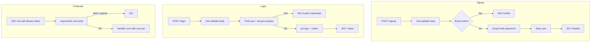

# 20 - Building Authentication from Scratch

An end-to-end build that wires together everything from the auth notes: **Zod** validates input → **bcrypt** hashes/verifies passwords → **JWT** proves identity → **middleware** protects routes. Start from the pieces in [[17 - Authentication Fundamentals & Password Hashing (bcrypt)]], [[18 - JWT (JSON Web Tokens)]] and [[19 - Zod - Schema Validation]].

## The big picture


## Step 1 — Project setup
```bash
mkdir auth-api && cd auth-api
npm init -y
npm install express bcrypt jsonwebtoken zod dotenv
npm install -D nodemon
```
Folder layout (keep each concern separate):
```
auth-api/
├── .env                  # secrets — NEVER commit
├── .gitignore            # node_modules/  .env
├── server.js             # app setup + start
├── schemas.js            # Zod schemas
├── middleware/
│   ├── validate.js
│   └── requireAuth.js
└── routes/
    └── auth.js
```
`.env`:
```
PORT=8000
JWT_SECRET=replace-with-a-long-random-string-32-plus-chars
JWT_EXPIRES_IN=1h
```
`.gitignore`: add `.env` and `node_modules/` before your first commit ([[01 - Git Basics]]). Generate a strong secret with `node -e "console.log(require('crypto').randomBytes(48).toString('hex'))"`.

## Step 2 — Schemas (`schemas.js`)
```js
const { z } = require('zod');

const signupSchema = z.object({
  name: z.string().trim().min(2),
  email: z.string().trim().toLowerCase().email(),
  password: z.string().min(8).max(72),   // bcrypt only uses the first 72 bytes
});

const loginSchema = z.object({
  email: z.string().trim().toLowerCase().email(),
  password: z.string().min(1),
});

module.exports = { signupSchema, loginSchema };
```
Normalising email (trim + lowercase) avoids `A@x.com` and `a@x.com` becoming two accounts.

## Step 3 — Middleware
`middleware/validate.js`:
```js
module.exports = (schema) => (req, res, next) => {
  const result = schema.safeParse(req.body);
  if (!result.success) {
    return res.status(400).json({
      error: 'Validation failed',
      details: result.error.issues.map(i => ({ field: i.path.join('.'), message: i.message })),
    });
  }
  req.body = result.data;
  next();
};
```
`middleware/requireAuth.js`:
```js
const jwt = require('jsonwebtoken');

module.exports = (req, res, next) => {
  const [scheme, token] = (req.get('Authorization') || '').split(' ');
  if (scheme !== 'Bearer' || !token)
    return res.status(401).json({ error: 'Missing or malformed Authorization header' });

  try {
    req.user = jwt.verify(token, process.env.JWT_SECRET, { algorithms: ['HS256'] });
    next();
  } catch (err) {
    const error = err.name === 'TokenExpiredError' ? 'Token expired' : 'Invalid token';
    res.status(401).json({ error });
  }
};
```

## Step 4 — Routes (`routes/auth.js`)
```js
const express = require('express');
const bcrypt = require('bcrypt');
const jwt = require('jsonwebtoken');
const validate = require('../middleware/validate');
const requireAuth = require('../middleware/requireAuth');
const { signupSchema, loginSchema } = require('../schemas');

const router = express.Router();
const users = [];                       // in-memory "database" — replace with a real DB later

// A pre-computed hash so login takes the same time whether or not the email exists
const DUMMY_HASH = bcrypt.hashSync('dummy-password', 10);

router.post('/signup', validate(signupSchema), async (req, res, next) => {
  try {
    const { name, email, password } = req.body;
    if (users.some(u => u.email === email))
      return res.status(409).json({ error: 'Email already registered' });

    const passwordHash = await bcrypt.hash(password, 10);
    const user = { id: users.length + 1, name, email, passwordHash, role: 'user' };
    users.push(user);

    res.status(201).json({ id: user.id, name: user.name, email: user.email }); // never return the hash
  } catch (err) { next(err); }
});

router.post('/login', validate(loginSchema), async (req, res, next) => {
  try {
    const { email, password } = req.body;
    const user = users.find(u => u.email === email);

    const ok = await bcrypt.compare(password, user ? user.passwordHash : DUMMY_HASH);
    if (!user || !ok)
      return res.status(401).json({ error: 'Invalid email or password' }); // same message either way

    const token = jwt.sign(
      { sub: String(user.id), role: user.role },
      process.env.JWT_SECRET,
      { expiresIn: process.env.JWT_EXPIRES_IN || '1h', algorithm: 'HS256' }
    );
    res.json({ token });
  } catch (err) { next(err); }
});

router.get('/me', requireAuth, (req, res) => {
  const user = users.find(u => String(u.id) === req.user.sub);
  if (!user) return res.status(404).json({ error: 'User not found' });
  res.json({ id: user.id, name: user.name, email: user.email, role: user.role });
});

module.exports = router;
```
`express.Router()` groups routes into a mini-app you mount in `server.js`.

## Step 5 — Server (`server.js`)
```js
require('dotenv').config();
const express = require('express');
const authRoutes = require('./routes/auth');

if (!process.env.JWT_SECRET) {            // fail fast instead of running insecurely
  console.error('JWT_SECRET is not set'); process.exit(1);
}

const app = express();
app.use(express.json());                   // must come before routes (see note 11)
app.use('/auth', authRoutes);

// 404 for unknown routes
app.use((req, res) => res.status(404).json({ error: 'Not found' }));

// Error-handling middleware: 4 arguments
app.use((err, req, res, next) => {
  console.error(err);
  res.status(500).json({ error: 'Internal server error' });
});

app.listen(process.env.PORT || 8000, () => console.log('Server started'));
```
Add to `package.json`: `"scripts": { "dev": "nodemon server.js", "start": "node server.js" }`.

## Step 6 — Test it in Postman ([[13 - API Testing with Postman]])
| # | Request | Body / header | Expect |
|---|---|---|---|
| 1 | `POST /auth/signup` | JSON `{ "name":"Aryan","email":"a@x.com","password":"secret123" }` | 201 |
| 2 | same again | same | 409 |
| 3 | `POST /auth/signup` | `{ "email":"nope","password":"1" }` | 400 + details |
| 4 | `POST /auth/login` | `{ "email":"a@x.com","password":"secret123" }` | 200 + `token` |
| 5 | `POST /auth/login` | wrong password | 401 |
| 6 | `GET /auth/me` | no header | 401 |
| 7 | `GET /auth/me` | `Authorization: Bearer <token>` | 200 + profile |

Set the body type to **raw → JSON** in Postman, otherwise `express.json()` won't parse it ([[12 - express.urlencoded, express.json & req.body]]).

## What this build already gets right
- Passwords stored only as bcrypt hashes; the hash is never returned.
- Input validated *before* any logic; unknown fields stripped.
- Identical error for unknown email and wrong password, plus a dummy hash so timing doesn't reveal which emails exist.
- Token expiry, pinned algorithm, secret loaded from the environment, fail-fast if missing.
- Correct status codes: 201, 400, 401, 404, 409, 500.

## Before calling it production-ready
- **Database:** swap the `users` array for MongoDB/PostgreSQL with a unique index on `email` (the in-memory array also resets on every restart, and `length + 1` IDs break after deletes — see [[14 - Data Persistence with fs, Dynamic IDs & Validation]]).
- **HTTPS** everywhere; set secure headers (`helmet`).
- **Rate limiting** on `/login` and `/signup` (`express-rate-limit`) against brute-force.
- **Token storage:** httpOnly + Secure + SameSite cookie for browser clients (full working example in [[21 - Cookies in Express]]), or access/refresh token pair ([[18 - JWT (JSON Web Tokens)]]).
- **CORS** configured to your real frontend origin only.
- Email verification and password reset flow.
- Logging that never records passwords or tokens.

## Common mistakes
- Registering `app.use('/auth', ...)` before `express.json()` — `req.body` undefined.
- Forgetting `next(err)` in async handlers, so errors hang the request or crash the process.
- Returning the user object with `passwordHash` included.
- Committing `.env`.
- Different messages/status for "email not found" and "wrong password".
- Comparing passwords with `===` or hashing with a fast hash.

## Related concepts
[[17 - Authentication Fundamentals & Password Hashing (bcrypt)]] · [[18 - JWT (JSON Web Tokens)]] · [[19 - Zod - Schema Validation]] · [[11 - Middleware in Express.js (Fundamentals)]] · [[REST APIs]]
