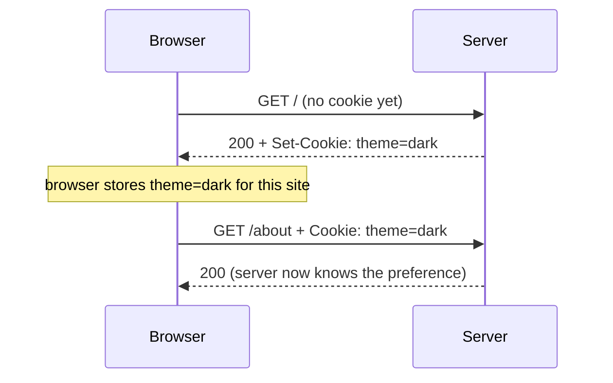

# 21 - Cookies in Express

## What is a cookie?
A **cookie** is a small piece of data (name=value, max ~4 KB) that a server asks the browser to store, and that the browser then **automatically sends back with every later request to that same site**. Cookies are how the web adds memory on top of stateless HTTP ([[17 - Authentication Fundamentals & Password Hashing (bcrypt)]]).

## Why they exist
HTTP forgets every request. To keep a login, a theme preference, or a shopping cart, the server needs the client to carry something back. Cookies do this using plain headers ([[15 - HTTP Headers in Express.js]]) with no JavaScript required.


Two headers do everything:
- **`Set-Cookie`** — response header: server → browser, "store this".
- **`Cookie`** — request header: browser → server, "here's what you gave me".

## A cookie at the raw HTTP level
```
HTTP/1.1 200 OK
Set-Cookie: token=abc123; Max-Age=3600; Path=/; HttpOnly; Secure; SameSite=Lax

GET /profile HTTP/1.1
Cookie: token=abc123; theme=dark
```
Note that the browser sends back **only name=value pairs** — the attributes (`HttpOnly`, `Max-Age`...) are instructions for the browser and never come back to the server.

### Example 1 — with plain Node `http` (no Express)
Connects to [[06 - Building an HTTP Server with the http Module]]:
```js
const http = require('http');

http.createServer((req, res) => {
  const raw = req.headers.cookie || '';             // "theme=dark; lang=en"
  const cookies = Object.fromEntries(
    raw.split('; ').filter(Boolean).map(c => c.split('='))
  );

  res.setHeader('Set-Cookie', 'visited=true; Max-Age=60; HttpOnly');
  res.end(`Your theme: ${cookies.theme || 'none set'}`);
}).listen(8000);
```
You parse the header by hand and set `Set-Cookie` yourself — tedious, which is why Express and `cookie-parser` exist.

## Cookies in Express
`res.cookie()` sets one and `res.clearCookie()` removes one (both built in). Reading them needs `cookie-parser`:
```bash
npm install cookie-parser
```
```js
const express = require('express');
const cookieParser = require('cookie-parser');
const app = express();

app.use(cookieParser());          // must be registered before routes (see note 11)

app.get('/set', (req, res) => {
  res.cookie('theme', 'dark', { maxAge: 7 * 24 * 60 * 60 * 1000 }); // maxAge is in MILLISECONDS
  res.send('Theme saved');
});

app.get('/read', (req, res) => {
  res.json(req.cookies);          // { theme: 'dark' }
});

app.get('/clear', (req, res) => {
  res.clearCookie('theme');
  res.send('Theme removed');
});
```
Try it: open `/set`, then `/read` — the browser sent the cookie back on its own.

## Cookie attributes (the security controls)
| Attribute | What it does | Typical use |
|---|---|---|
| `maxAge` / `expires` | Lifetime. Omit it and it's a **session cookie** (deleted when the browser closes) | Remember-me, preferences |
| `httpOnly` | JavaScript (`document.cookie`) **cannot read it** | Auth tokens, session IDs (blocks XSS theft) |
| `secure` | Sent only over **HTTPS** | Always in production |
| `sameSite` | Controls sending on cross-site requests: `strict` / `lax` / `none` | CSRF protection |
| `path` | URL prefix the cookie applies to (default `/`) | Scope a cookie to `/admin` |
| `domain` | Which host(s) get it (default: only the exact host) | Share across subdomains |
| `signed` | (cookie-parser) tamper-evident signature | Detect edited values |

### `SameSite` explained
- **`Strict`** — never sent on requests started from another site (even clicking a link to you). Safest, can feel like being logged out when arriving from an email link.
- **`Lax`** (Chrome's default when unspecified) — not sent on cross-site subrequests (images, forms POSTed from another site), but sent on top-level navigation (clicking a link). Good balance.
- **`None`** — sent everywhere; requires `Secure`. Needed when your frontend and API are on different sites.

## Example 2 — a visit counter (state in the cookie)
```js
app.get('/', (req, res) => {
  const visits = Number(req.cookies.visits || 0) + 1;     // cookies are always strings -> convert
  res.cookie('visits', visits, { maxAge: 365 * 24 * 60 * 60 * 1000 });
  res.send(`You have visited ${visits} time(s)`);
});
```
Refresh the page and the number climbs. **Lesson:** the client can edit this value (DevTools makes it trivial), so cookie values are never trusted unless signed or verified.

## Example 3 — signed cookies (tamper detection)
```js
app.use(cookieParser('a-long-random-secret'));    // secret enables signing

app.get('/set', (req, res) => {
  res.cookie('plan', 'free', { signed: true, httpOnly: true });
  res.send('ok');
});

app.get('/read', (req, res) => {
  res.json({ plan: req.signedCookies.plan });     // value, or false if it was tampered with
});
```
The cookie is stored as `plan=s%3Afree.<signature>`. If the user changes `free` to `pro`, the signature no longer matches and `req.signedCookies.plan` is `false`. **Signed is not encrypted** — the value is still readable, just not forgeable.

## Example 4 — login with a JWT in an httpOnly cookie
This is the recommended way to store the token for browser apps (compare with note 18's Bearer header). It builds on [[20 - Building Authentication from Scratch]].
```js
// login route: instead of res.json({ token }), set a cookie
const token = jwt.sign({ sub: String(user.id), role: user.role }, process.env.JWT_SECRET, { expiresIn: '1h' });

res.cookie('token', token, {
  httpOnly: true,                                   // JS can't read it -> XSS can't steal it
  secure: process.env.NODE_ENV === 'production',    // HTTPS only in production
  sameSite: 'lax',
  maxAge: 60 * 60 * 1000,                           // 1 hour, matches the JWT expiry
});
res.json({ message: 'Logged in' });
```
```js
// middleware/requireAuth.js — read the cookie instead of the Authorization header
module.exports = (req, res, next) => {
  const token = req.cookies.token;
  if (!token) return res.status(401).json({ error: 'Not logged in' });
  try {
    req.user = jwt.verify(token, process.env.JWT_SECRET, { algorithms: ['HS256'] });
    next();
  } catch {
    res.status(401).json({ error: 'Invalid or expired token' });
  }
};
```
```js
// logout: the server CAN delete a cookie, which a pure Bearer-in-localStorage setup can't
router.post('/logout', (req, res) => {
  res.clearCookie('token', { httpOnly: true, sameSite: 'lax' }); // options must match how it was set
  res.json({ message: 'Logged out' });
});
```
With a frontend on another origin, two more things are required:
```js
// server
const cors = require('cors');
app.use(cors({ origin: 'http://localhost:5173', credentials: true }));  // never origin:'*' with credentials

// client (React etc.)
fetch('http://localhost:8000/auth/me', { credentials: 'include' });    // otherwise the cookie isn't sent
```

## Example 5 — session cookie (stateful login)
`express-session` stores data on the server and puts only a random ID in a cookie — the **stateful** model from note 17:
```js
const session = require('express-session');
app.use(session({
  secret: process.env.SESSION_SECRET,
  resave: false,
  saveUninitialized: false,
  cookie: { httpOnly: true, secure: false, maxAge: 60 * 60 * 1000 },
}));

app.post('/login', (req, res) => {
  // ...verify password...
  req.session.userId = user.id;          // stored on the server, cookie holds only the session ID
  res.json({ message: 'Logged in' });
});

app.get('/me', (req, res) => {
  if (!req.session.userId) return res.status(401).json({ error: 'Not logged in' });
  res.json({ userId: req.session.userId });
});
```
The default session store is **in memory**: it leaks memory and loses everyone on restart, so use Redis or a database store in production.

## Inspecting and testing cookies
- **Browser DevTools → Application → Cookies** (Chrome/Edge) or **Storage → Cookies** (Firefox): see name, value, `HttpOnly`, `Secure`, `SameSite`, expiry. You can edit or delete them — proof the client controls them.
- **Network tab → a request → Headers:** `Set-Cookie` on responses, `Cookie` on requests.
- **curl** (cookie jar saves and replays them):
```bash
curl -i -c jar.txt -X POST http://localhost:8000/auth/login \
  -H "Content-Type: application/json" -d '{"email":"a@x.com","password":"secret123"}'
curl -i -b jar.txt http://localhost:8000/auth/me
```
- **Postman:** the response's *Cookies* tab, and Postman keeps a cookie jar per domain automatically ([[13 - API Testing with Postman]]).

## Cookies vs localStorage vs sessionStorage
| | Cookie | localStorage | sessionStorage |
|---|---|---|---|
| Sent to server automatically | **Yes**, every request | No | No |
| Readable by JS | Not if `HttpOnly` | Always | Always |
| Size | ~4 KB | ~5 MB | ~5 MB |
| Lifetime | Set by you (or session) | Until cleared | Until tab closes |
| XSS-stealable | No (with `HttpOnly`) | **Yes** | **Yes** |
| CSRF risk | **Yes** (auto-sent) → use `SameSite` | No | No |
Rule of thumb: auth credentials → `HttpOnly` cookie; harmless UI preferences → either.

## Security: the two attacks
- **XSS** (injected script reads your data): mitigated by `HttpOnly` plus output escaping ([[16 - Server-Side Rendering (SSR) & EJS]]).
- **CSRF** (another site makes the browser send your cookie to your API): because cookies are attached automatically, `evil.com` can trigger a request to your API with the user's cookie. Mitigated by `SameSite=Lax/Strict`, CSRF tokens for state-changing requests, and never changing state with `GET`.

## Common mistakes
- Auth cookie without `httpOnly`/`secure`.
- Forgetting `cookie-parser` — `req.cookies` is `undefined`.
- Putting `maxAge` in seconds — Express expects **milliseconds**.
- `clearCookie` without the same `path`/`domain` options used to set it — the cookie stays.
- Trusting a plain cookie value (`role=admin`) — users can edit it. Sign it or verify it (JWT / server session).
- Storing sensitive or large data in cookies; they travel on **every** request, bloating traffic.
- Frontend on a different origin but missing `credentials: 'include'` / `cors({ credentials: true })` — cookie is silently not sent.
- `sameSite: 'none'` without `secure: true` — browsers reject it.
- Confusing signed with encrypted.
- Third-party-cookie surprises: browsers increasingly restrict cross-site cookies, so test your real deployment setup.

## Related concepts
- [[17 - Authentication Fundamentals & Password Hashing (bcrypt)]] — stateful vs stateless
- [[18 - JWT (JSON Web Tokens)]] — the token stored in the cookie
- [[20 - Building Authentication from Scratch]]
- [[15 - HTTP Headers in Express.js]] — `Set-Cookie` / `Cookie` are just headers
- [[11 - Middleware in Express.js (Fundamentals)]] · [[REST APIs]]
