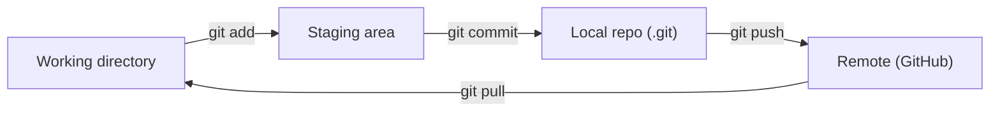

# 00 - Git & GitHub MOC

**Git** is a distributed version control system that tracks changes to files over time. **GitHub** is a cloud hosting service for Git repositories, adding collaboration features (pull requests, issues, Actions) on top of plain Git.

## The core workflow

- **Working directory** — your files as edited on disk.
- **Staging area (index)** — files marked with `git add` for the next commit.
- **Local repo** — committed snapshots (history) on your machine.
- **Remote** — the hosted copy, synced with `push` / `fetch` / `pull`.

## Key concepts
- **Distributed** — every clone has the full history, not just a snapshot.
- **Commit** — an immutable snapshot identified by a hash.
- **Branch** — a movable pointer to a commit; **tag** — a fixed one.
- **HEAD** — pointer to your current position (usually the tip of the active branch).

## Notes in this folder (in learning order)
| # | Note | Covers |
|---|---|---|
| 01 | [[01 - Git Basics\|Git Basics]] | Setup, four areas, daily flow, commit messages, history, remotes, `.gitignore`, internals |
| 02 | [[02 - Git Branching\|Git Branching]] | Branches, switch/merge, fast-forward vs 3-way, remote tracking, detached HEAD |
| 03 | [[03 - Merge Conflicts\|Merge Conflicts]] | Why they happen, resolving step by step, ours/theirs, avoiding them |
| 04 | [[04 - Git Rebase\|Git Rebase]] | Linear history, interactive rebase, golden rule, `--force-with-lease` |
| 05 | [[05 - Git Stash\|Git Stash]] | Shelving uncommitted work, apply vs pop, untracked files |
| 06 | [[06 - Git Undoing Changes\|Git Undoing Changes]] | restore / reset / revert / amend — decision flowchart |
| 07 | [[07 - Git Tags\|Git Tags]] | Release markers, lightweight vs annotated, GitHub Releases |
| 08 | [[08 - GitHub Basics\|GitHub Basics]] | Fork, clone, PRs, merge options, branch protection, Actions |
| 09 | [[09 - Branching Strategies & PR Workflow\|Branching Strategies & PR Workflow]] | GitHub Flow, Git Flow, trunk-based, PR lifecycle |
| 10 | [[10 - Git Reflog, Cherry-pick & Recovery\|Reflog, Cherry-pick & Recovery]] | Recover "lost" commits, copy single commits, bisect |
| 11 | [[11 - SSH Keys & GitHub Authentication\|SSH Keys & GitHub Authentication]] | SSH key setup, HTTPS tokens, security |

## Which note do I need? (quick finder)
| I want to… | Go to |
|---|---|
| Start using Git / commit & push | [[01 - Git Basics\|Git Basics]] |
| Work on a feature without breaking `main` | [[02 - Git Branching\|Branching]] |
| Fix `<<<<<<<` markers | [[03 - Merge Conflicts\|Merge Conflicts]] |
| Tidy my commits before a PR | [[04 - Git Rebase\|Rebase]] |
| Switch branches with unfinished work | [[05 - Git Stash\|Stash]] |
| Undo a mistake | [[06 - Git Undoing Changes\|Undoing Changes]] → [[10 - Git Reflog, Cherry-pick & Recovery\|Reflog]] |
| Mark a release | [[07 - Git Tags\|Tags]] |
| Contribute to open source | [[08 - GitHub Basics\|GitHub Basics]] |
| Choose a team workflow | [[09 - Branching Strategies & PR Workflow\|Strategies]] |
| Stop typing passwords | [[11 - SSH Keys & GitHub Authentication\|SSH Keys]] |

## Best practices
- Commit often; **one logical change per commit**; present-tense messages (`add login form`).
- One feature per branch; pull before you push; keep branches short-lived.
- Review with `git status` and `git diff` before every commit.
- Never commit secrets — if one slips in, **rotate it immediately** (deleting it from history doesn't undo the exposure).
- Never rewrite history that others have pulled (no rebase/`reset --hard`/force-push on shared branches).
- Protect `main` with required reviews and CI checks.

## Related concepts
- [[Linux]] — the command-line environment Git is usually run from
- [[10 - Semantic Versioning & Dependency Management]] — version numbers used with tags
- [[03 - npm, package.json & Node Modules]] — `node_modules` and `.env` belong in `.gitignore`

## Open questions / to explore later
- GitHub Actions / CI pipelines in depth (deployment, secrets, matrices)
- Git hooks (pre-commit linting, Husky)
- Submodules / monorepos
- Signing commits (GPG/SSH signatures)
