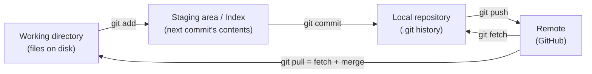

# 01 - Git Basics

## What is Git?
Git is a **distributed version control system (VCS)** — it records changes to files over time so you can save snapshots (commits), return to any earlier state, and collaborate without overwriting each other's work.

**Distributed** means every clone holds the *entire* project history, not just the latest files. Unlike older centralized systems (SVN, CVS), you can commit, branch, and browse history fully offline; the server is just another copy.

## Why version control at all?
Without it, history lives in files like `final_v2_REAL_final.zip`. Git gives you: an exact record of *what* changed, *when*, *who* changed it and (via the commit message) *why*; safe experimentation on branches; and the ability to undo mistakes.

## First-time setup
```bash
git config --global user.name  "Your Name"
git config --global user.email "you@example.com"
git config --global init.defaultBranch main     # new repos start on `main`, not `master`
git config --list                                # verify

git init                    # turn the current folder into a repo (creates .git/)
git clone <url>             # copy an existing remote repo (history included)
```
The name/email are stamped on every commit you make; GitHub uses the email to attribute commits to your account.

## The four areas (the mental model everything else builds on)

- **Working directory** — your files exactly as they sit on disk now.
- **Staging area (index)** — a draft of the *next* commit. `git add` copies the current state of a file into it.
- **Local repository (`.git`)** — the permanent, committed history on your machine.
- **Remote** — a hosted copy (e.g. GitHub), synced with `push`/`fetch`/`pull`.

**Why a staging area exists:** it lets you build a commit out of only *some* of your changes. Fixed two unrelated bugs in one sitting? Stage and commit them separately so each commit is one clean, reviewable, revertable idea.

## Daily flow
```bash
git status                  # what changed? what's staged? which branch am I on?
git add file.js             # stage one file
git add .                   # stage everything in the current directory (check status first!)
git add -p                  # stage interactively, hunk by hunk
git commit -m "add login form validation"
git commit -am "msg"        # stage + commit already-tracked files in one step (does NOT include new files)
git push                    # upload commits to the remote
git pull                    # download + merge remote commits
```

### Writing good commit messages
- One logical change per commit; imperative, present tense: `fix null check in parser`, not `fixed stuff`.
- Short summary line (~50 chars), optional blank line, then a body explaining *why* if it isn't obvious.
- Many teams use **Conventional Commits** prefixes: `feat:`, `fix:`, `docs:`, `refactor:`, `test:`, `chore:` — e.g. `feat: add JWT login route`. These make history scannable and can drive automatic changelogs/versioning (see [[07 - Git Tags]]).

## Viewing history and changes
```bash
git log                          # full history
git log --oneline --graph --all  # compact, visual, all branches
git log -p file.js               # history of one file, with diffs
git diff                         # unstaged changes (working dir vs index)
git diff --staged                # staged changes (index vs last commit)
git show <hash>                  # one commit's message + diff
git blame file.js                # who last changed each line, and in which commit
```

## Remotes
```bash
git remote -v                          # list remotes
git remote add origin <url>            # connect a local repo to a remote
git push -u origin main                # first push; -u sets the upstream so later `git push`/`pull` need no arguments
git fetch                              # download new commits, change nothing locally
git pull                               # fetch + merge
git pull --rebase                      # fetch + rebase (linear history)
```
See [[04 - Git Rebase|Git Rebase]] for what `--rebase` does and when it is safe.
**Fetch vs pull:** `fetch` is safe — it only updates your view of the remote so you can inspect (`git log origin/main`) before combining. `pull` = `fetch` + `merge` immediately, which can surprise you with conflicts.

## Ignoring files: `.gitignore`
A `.gitignore` file in the repo root lists patterns Git should never track:
```gitignore
node_modules/        # dependencies — reinstallable from package.json
.env                 # secrets / local config
dist/                # build output
*.log
.DS_Store
!important.log       # a leading ! re-includes something a broader pattern excluded
```
- Create it **before the first commit** — it only affects *untracked* files.
- If a file is already tracked, adding it to `.gitignore` does nothing; untrack it first: `git rm --cached <file>` (keeps it on disk) then commit.
- Debug a rule with `git check-ignore -v <path>`.
- Typical Node/Express projects ignore `node_modules/` and `.env` (see [[03 - npm, package.json & Node Modules]]); commit `package-lock.json`, not `node_modules`.

## Under the hood (brief)
The `.git/` folder *is* the repository. Key parts: `objects/` (all content, stored by hash), `refs/` (branch and tag pointers), `HEAD` (which branch/commit you're on), `config`.
- Git stores **snapshots**, not diffs: each commit points to a full tree of the project, reusing unchanged files by reference so it stays small.
- Every object is named by a **hash** (SHA-1 today) of its content — change anything and the hash changes, which is why history is tamper-evident and why rewriting history (rebase/reset) produces *new* commits.

## Key terms
- **Commit** — an immutable snapshot with an author, timestamp, message, and pointer(s) to its parent commit(s).
- **Branch** — a movable pointer to a commit (see [[02 - Git Branching|Git Branching]]).
- **HEAD** — pointer to where you are now, normally the tip of the checked-out branch.
- **origin** — the conventional default name for your main remote.

## Common mistakes
- `git add .` without checking `git status` first — accidentally staging build output, secrets, or unrelated edits.
- Vague commit messages ("update", "fix stuff") — makes `git log`/`git blame` useless later.
- Not pulling before starting work — avoidable merge conflicts when your branch has diverged.
- Committing secrets (`.env`, API keys). Removing them in a later commit does **not** remove them from history; treat them as leaked and rotate them.
- Running `git init` inside an existing repo or in the wrong folder (e.g. your home directory) — check `git status`/`pwd` first.

## Related Concepts
- [[00 - Git & GitHub MOC|Git & GitHub MOC]] — overview and full topic index
- [[02 - Git Branching|Git Branching]]
- [[06 - Git Undoing Changes|Git Undoing Changes]]
- [[08 - GitHub Basics|GitHub Basics]]
- [[Linux]] — the command-line environment Git is usually run from
