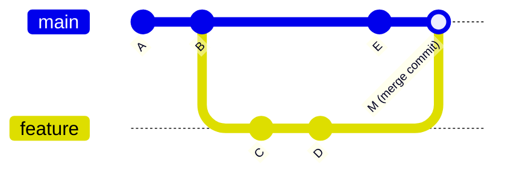

# 02 - Git Branching

## What is a branch?
A **branch** is an independent line of development — technically just a lightweight, movable **pointer to a commit**. Creating one copies nothing; it just adds a new label. That's why branching in Git is nearly instant and cheap.

![[git-feature-branch-workflow.png|860]]

## Why branch instead of committing straight to `main`?
`main` should always be in a working, deployable state. A branch lets you build a feature, fix a bug, or try a risky idea — committing half-finished work in small steps — without destabilising the code everyone else relies on. If the experiment fails, delete the branch; `main` never noticed.

## Commands
```bash
git branch                    # list local branches (* = current)
git branch -a                 # include remote-tracking branches
git branch feature/login      # create (does not switch)
git switch feature/login      # switch to it
git switch -c feature/login   # create + switch in one step
git merge feature/login       # merge it INTO the branch you're currently on
git branch -d feature/login   # delete (safe — refuses if unmerged)
git branch -D feature/login   # force delete, even if unmerged
git branch -m new-name        # rename the current branch
```
`git switch` / `git restore` (Git 2.23+) were split out of the overloaded `git checkout`, which used to both switch branches *and* restore files. `git checkout <branch>` and `git checkout -b <branch>` still work and you'll see them everywhere.

## Merging
```bash
git switch main
git pull                        # make sure main is current first
git merge feature/login
```
Two outcomes:

```
Before:   A──B ← main
              \
               C──D ← feature

After `git merge feature` (on main):
          A──B──C──D ← main, feature   (main's pointer just slides forward)
```
**Fast-forward** — `main` hasn't moved since `feature` branched, so Git simply slides the `main` pointer forward to D. No new commit is created.


**Three-way merge** — both branches gained commits, so Git combines them using the common ancestor (B) and records a **merge commit** M with two parents. If both sides changed the same lines, Git stops and asks you to decide — see [[03 - Merge Conflicts|Merge Conflicts]].

`git merge --no-ff feature` forces a merge commit even when a fast-forward is possible (keeps a visible "this was a feature branch" bubble in history). `git merge --squash feature` collapses the branch into one staged change you commit yourself.

## Remote branches and tracking
```bash
git push -u origin feature/login        # publish the branch and set upstream
git branch -vv                          # which local branch tracks which remote branch
git push origin --delete feature/login  # delete the remote branch
git fetch --prune                       # drop local references to branches deleted on the remote
```
`origin/main` is a **remote-tracking branch** — a read-only bookmark of where `main` was on the remote at your last fetch. It moves only when you `fetch`/`pull`.

## Detached HEAD
Normally `HEAD` points at a branch, which points at a commit. Checking out a commit hash, tag, or `origin/main` directly (`git checkout a1b2c3d`) puts you in **detached HEAD**: you're looking at a commit with no branch following your work. New commits made here are orphaned once you switch away. If you want to keep them: `git switch -c rescue-branch` before leaving. (Lost ones can be dug out via [[10 - Git Reflog, Cherry-pick & Recovery|reflog]].)

## Naming conventions
`feature/login-form`, `fix/null-user-crash`, `hotfix/payment-timeout`, `docs/readme-update`. Lowercase, hyphen-separated, prefixed by type; include a ticket/issue number if your team uses one (`feature/123-login-form`). For how teams organise branches overall, see [[09 - Branching Strategies & PR Workflow|Branching Strategies]].

## Common mistakes
- Committing directly on `main` for anything non-trivial — hard to back out cleanly.
- Not checking which branch you're on before committing (`git status` shows it) — commits land on the wrong branch.
- Long-lived branches that drift far from `main` — the longer they live, the nastier the eventual conflicts. Merge/rebase from `main` often.
- Switching branches with uncommitted changes that conflict — Git refuses; commit them or [[05 - Git Stash|stash]] first.
- Deleting a branch with `-D` without checking it was merged — the commits become unreachable (recoverable via reflog for a while, but don't rely on it).

## Related Concepts
- [[00 - Git & GitHub MOC|Git & GitHub MOC]] — overview and full topic index
- [[01 - Git Basics|Git Basics]]
- [[03 - Merge Conflicts|Merge Conflicts]]
- [[04 - Git Rebase|Git Rebase]] — alternative to merging that produces a linear history
- [[07 - Git Tags|Git Tags]] — fixed points, versus a branch's moving pointer
- [[09 - Branching Strategies & PR Workflow|Branching Strategies & PR Workflow]]
