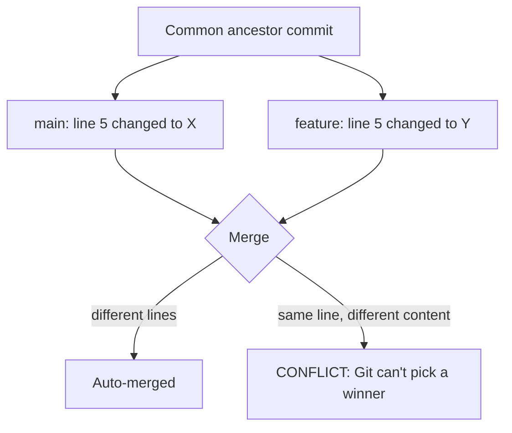

# 03 - Merge Conflicts

## What is a merge conflict?
A **merge conflict** happens when Git cannot automatically combine two sets of changes — usually because both branches edited the **same lines** of the same file (or one deleted a file the other edited). Git stops mid-merge and asks a human to decide.
## Why they happen

Root cause is always the same: both sides diverged from a common ancestor and touched overlapping content, so there's no principled automatic answer. Typical situations:
- Two people edit the same line on different branches.
- You edit locally while a teammate pushes changes to the same lines.
- A merge or [[04 - Git Rebase|rebase]] brings together overlapping edits.
- One side renames/deletes a file the other modified.

## Resolving a conflict, step by step
```bash
git merge feature/search
# Auto-merging app.py
# CONFLICT (content): Merge conflict in app.py
# Automatic merge failed; fix conflicts and then commit the result.
```
1. **Find conflicted files:** `git status` lists them under *Unmerged paths* (`git diff --name-only --diff-filter=U` prints just the names).
2. **Open each file.** Git has inserted markers:
```
<<<<<<< HEAD
your version (current branch)
=======
their version (incoming branch)
>>>>>>> feature/search
```
   - Between `<<<<<<< HEAD` and `=======` → the branch you're **on**.
   - Between `=======` and `>>>>>>> feature/search` → the **incoming** branch.
3. **Edit** to the correct final code — one side, the other, or a hand-written blend — and **delete all three marker lines**.
4. **Test** that it still runs/passes.
5. **Mark resolved and finish:**
```bash
git add app.py
git commit              # Git pre-fills a merge message; or: git merge --continue
```

## Shortcuts and tooling
```bash
git checkout --ours   app.py   # take the current branch's whole file
git checkout --theirs app.py   # take the incoming branch's whole file
git mergetool                  # open a configured visual 3-way merge tool
git merge --abort              # give up; return to the pre-merge state
```
VS Code shows "Accept Current / Accept Incoming / Accept Both" buttons above each conflict block — same markers underneath.

**`ours`/`theirs` flip during a rebase.** While rebasing, "ours" is the branch you're rebasing *onto* and "theirs" is *your own commits being replayed*. This reversal confuses almost everyone — when in doubt, read both sides instead of using the shortcut. In a rebase, finish with `git add <file>` then `git rebase --continue` (not `commit`).

## Avoiding conflicts
- Pull/merge from `main` often so your branch never drifts far.
- Keep branches and PRs small and short-lived.
- Agree on who's touching which files; avoid mass reformatting commits that rewrite every line.
- Use a shared formatter/linter config so whitespace changes don't create phantom conflicts.

## Common mistakes
- Committing with the markers (`<<<<<<<`, `=======`, `>>>>>>>`) still in the file — silently ships broken, unparseable code. Search the project for `<<<<<<<` before committing.
- Blindly accepting "mine" or "theirs" without reading both — the right answer usually needs pieces of each.
- Not running the tests after resolving — a merge can be syntactically clean but logically wrong.
- Panicking and deleting the repo — `git merge --abort` (or `git rebase --abort`) safely undoes the whole attempt.

## Related Concepts
- [[00 - Git & GitHub MOC|Git & GitHub MOC]] — overview and full topic index
- [[02 - Git Branching|Git Branching]] — where merges come from
- [[04 - Git Rebase|Git Rebase]] — can raise the same conflicts, once per replayed commit
- [[05 - Git Stash|Git Stash]] — a stash pop can conflict too
- [[09 - Branching Strategies & PR Workflow|Branching Strategies & PR Workflow]] — short-lived branches reduce conflicts
