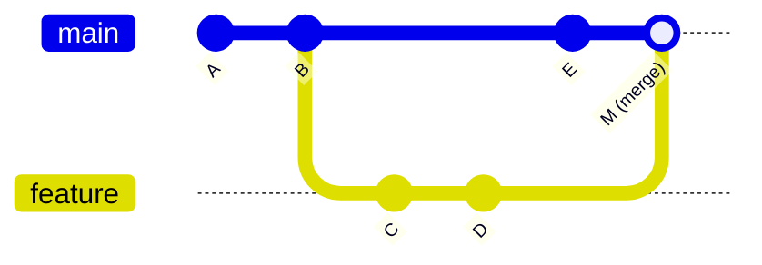
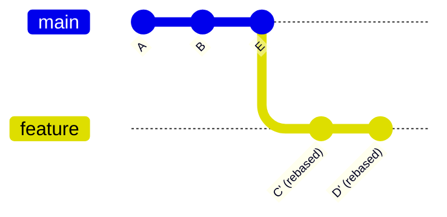

# 04 - Git Rebase

## What is rebase?
**Rebase** takes the commits unique to your branch and **replays them on top of another branch's tip**, producing a **linear history** instead of a merge commit. The content of each commit is the same, but each is re-created with a **new parent and a new hash**.

## Merge vs Rebase
Starting point: `feature` diverged from `main` at commit B. Feature has C, D; `main` moved on to E.

### 1. Merge — preserves history, adds a merge commit


### 2. Rebase — replays commits linearly


| | Merge | Rebase |
|---|---|---|
| History shape | Preserves true branch structure | Linear, tidy |
| Extra commit | Yes (merge commit) | No |
| Rewrites commits | No | Yes — new hashes |
| Safe on shared branches | Yes | **No** |
| Conflicts | Resolved once | May recur once per replayed commit |

## Commands
```bash
git switch feature
git rebase main                 # replay feature's commits on top of main

# keep a feature branch current with the remote main
git fetch origin
git rebase origin/main

git pull --rebase               # fetch + rebase instead of fetch + merge

# resolving a rebase conflict
git add <fixed-file>
git rebase --continue           # go on to the next commit
git rebase --skip               # drop the current commit entirely
git rebase --abort              # cancel; back to how things were before

# after rebasing a branch you had already pushed
git push --force-with-lease origin feature
```

## Interactive rebase: cleaning up your own commits
```bash
git rebase -i HEAD~4            # edit the last 4 commits
```
Git opens a todo list; change the word at the start of each line:

| Keyword | Effect |
|---|---|
| `pick` | keep the commit as-is |
| `reword` | keep it, edit the message |
| `squash` | meld into the previous commit, combining messages |
| `fixup` | meld into the previous commit, discard this message |
| `drop` | delete the commit |
| `edit` | pause so you can amend the commit's contents |

Typical use: before opening a PR, squash noisy "wip", "typo", "fix again" commits into a few meaningful ones. Reordering lines reorders commits.

## The Golden Rule
**Never rebase commits that have already been pushed to a shared branch.** Rebase rewrites history: C and D become C' and D' with *new hashes*. Anyone who already pulled the old commits now holds history that conflicts with yours, forcing a messy manual reconciliation.

- ✅ Safe: local branches only you use, or your own feature branch before anyone else has based work on it.
- ❌ Unsafe: `main`, `develop`, or any branch other people have pulled.

## `--force-with-lease` vs `--force`
After rebasing an already-pushed branch the histories diverge, so a normal push is rejected and you must force it. `--force-with-lease` refuses to overwrite the remote if someone else pushed commits you haven't fetched — a safety check plain `--force` lacks. Default to `--force-with-lease`.

## Rebase vs merge: which when?
- **Rebase** your private feature branch onto the latest `main` to stay current and keep history clean.
- **Merge** (often via a PR) when integrating into shared branches, or when you want an honest record of how work was combined.
- Many teams: rebase locally, then **squash-merge** or merge the PR on GitHub (see [[09 - Branching Strategies & PR Workflow|PR Workflow]]).

## Common mistakes
- Rebasing a shared/public branch — rewrites history others depend on.
- Using plain `--force` — can erase a teammate's pushed work without warning.
- Rebasing without confidence resolving conflicts — you may resolve the same conflict repeatedly, once per commit.
- Mixing up `ours`/`theirs` — reversed during a rebase (see [[03 - Merge Conflicts|Merge Conflicts]]).
- Panicking mid-rebase — `git rebase --abort` restores everything; and [[10 - Git Reflog, Cherry-pick & Recovery|reflog]] can recover even after a finished bad rebase.

## Related Concepts
- [[00 - Git & GitHub MOC|Git & GitHub MOC]] — overview and full topic index
- [[02 - Git Branching|Git Branching]]
- [[03 - Merge Conflicts|Merge Conflicts]]
- [[05 - Git Stash|Git Stash]] — stash uncommitted work before rebasing
- [[06 - Git Undoing Changes|Git Undoing Changes]] — the same "don't rewrite shared history" principle
- [[10 - Git Reflog, Cherry-pick & Recovery|Reflog & Recovery]]
