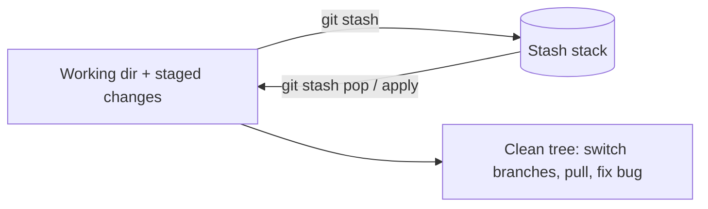

# 05 - Git Stash

## Why it exists
You're mid-feature when an urgent bug lands on `main`. Your changes are half-done, so committing them pollutes history with meaningless "WIP" commits — but Git won't let you switch branches if uncommitted changes would be overwritten. **Stash** shelves your uncommitted work on a stack and gives you a clean working directory; you bring it back later.



## Core commands
```bash
git stash                              # shelve tracked changes (staged + unstaged)
git stash push -m "half-done login"    # same, with a label (recommended)
git stash -u                           # also stash UNTRACKED files
git stash -a                           # also stash ignored files (rarely needed)
git stash list                         # stash@{0} is the newest
git stash show -p stash@{0}            # preview a stash's diff
git stash apply                        # restore newest, KEEP it in the list
git stash apply stash@{1}              # restore a specific one
git stash pop                          # restore newest AND remove it
git stash branch fix-login stash@{0}   # new branch from the stash's base commit, then apply it
git stash drop stash@{0}               # delete one
git stash clear                        # delete all
```
**`apply` vs `pop`:** `apply` leaves the stash in the list (handy if you want it on several branches, or if applying might conflict). `pop` applies then deletes it — use when you're done with it.

## Real-world example
```bash
git stash push -m "half-done login form"
git switch main
git switch -c hotfix/typo
# fix, commit, push, merge...
git switch feature/login
git stash pop
```

## Good to know
- By default stash saves **tracked** files only; brand-new untracked files stay behind unless you add `-u`.
- Stashes are **local** — they are never pushed to a remote.
- Stashes aren't tied to a branch; you can pop one onto a different branch than it came from (which may conflict if the code differs).
- Stash entries aren't permanent: if you drop one by accident, it can sometimes be recovered via `git fsck --unreachable`, but treat stash as temporary storage, not a backup.

## Common mistakes
- Forgetting stashes exist — `git stash list` quietly accumulates old entries; check it periodically.
- Unlabeled stashes (`git stash` repeatedly) — impossible to tell apart later. Use `-m`.
- Expecting new files to be stashed — use `-u`.
- Making conflicting edits on the same lines before popping — pop can conflict, resolved like a [[03 - Merge Conflicts|merge conflict]] (and the stash stays in the list when pop conflicts, so nothing is lost).
- Using stash as long-term storage — if the work matters, put it on a branch and commit it.

## Related Concepts
- [[00 - Git & GitHub MOC|Git & GitHub MOC]] — overview and full topic index
- [[02 - Git Branching|Git Branching]] — switching branches is the main reason to stash
- [[03 - Merge Conflicts|Merge Conflicts]]
- [[04 - Git Rebase|Git Rebase]] — stash first, since rebase needs a clean tree
- [[06 - Git Undoing Changes|Git Undoing Changes]]
