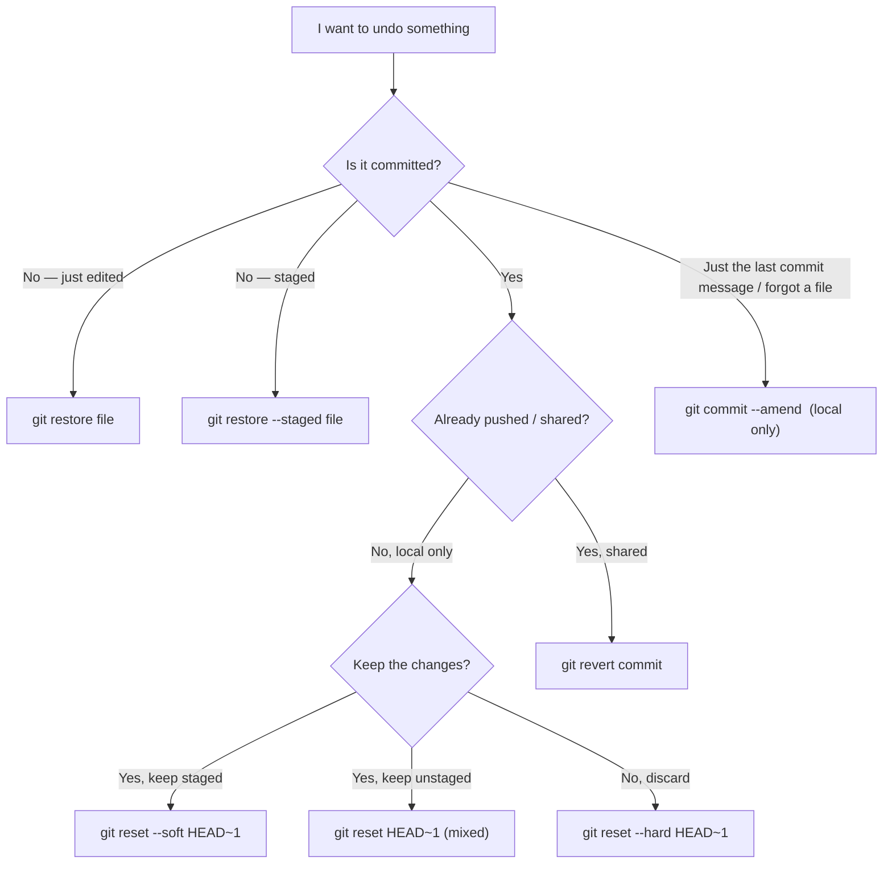

# 06 - Git Undoing Changes

Git has several undo tools because a change can be at different stages — edited, staged, committed locally, or already pushed. The right tool depends on **how far it has travelled** and **whether others have it**. Some tools rewrite history (safe only for private work); others add new commits (safe everywhere).

## Pick the right tool


## Quick reference
```bash
# Working directory / staging area
git restore file                  # discard unstaged edits to a file (cannot be undone!)
git restore .                     # discard ALL unstaged edits
git restore --staged file         # unstage, keep the edits
git clean -n                      # DRY RUN: list untracked files that would be deleted
git clean -fd                     # delete untracked files and folders (irreversible)

# Last commit
git commit --amend                         # edit the last commit's message
git commit --amend --no-edit               # add newly staged changes to the last commit

# Moving back through commits (rewrites history)
git reset --soft  HEAD~1          # undo commit, keep changes STAGED
git reset         HEAD~1          # (--mixed, default) undo commit, keep changes UNSTAGED
git reset --hard  HEAD~1          # undo commit, DISCARD changes

# Shared history (does not rewrite anything)
git revert <hash>                 # new commit that reverses <hash>
git revert -m 1 <merge-hash>      # reverse a merge commit (-m picks which parent is "mainline")
```

## Situation table
| Situation | Command |
|---|---|
| Edited a file, want the old version back | `git restore file` |
| Staged a file by mistake | `git restore --staged file` |
| Typo in last commit message (not pushed) | `git commit --amend` |
| Forgot to include a file in last commit (not pushed) | `git add file` → `git commit --amend --no-edit` |
| Local commit wrong, keep the work | `git reset --soft HEAD~1` |
| Local commit wrong, throw it away | `git reset --hard HEAD~1` |
| Bad commit already pushed / on `main` | `git revert <hash>` |

## `reset`: soft vs mixed vs hard
`reset` moves the current branch pointer back; the flag decides what happens to your files.
| Mode | Branch pointer | Staging area | Working directory |
|---|---|---|---|
| `--soft` | moved back | **kept** (changes staged) | kept |
| `--mixed` (default) | moved back | reset (changes unstaged) | kept |
| `--hard` | moved back | reset | **reset — changes lost** |

## The Rule
`reset --hard`, `commit --amend`, and rebase all **rewrite history**. Do that only to commits **nobody else has pulled**. Once a commit is pushed and shared, use `git revert`: it adds a *new* commit that cancels the old one, leaving everyone's history intact. This is the same principle as the Golden Rule in [[04 - Git Rebase|Git Rebase]].

## Safety net: reflog
Even after `reset --hard`, the old commits usually still exist for a while (Git doesn't delete them immediately). `git reflog` lists where HEAD has been, so you can find the lost hash and recover it — see [[10 - Git Reflog, Cherry-pick & Recovery|Reflog & Recovery]]. The exception: uncommitted edits destroyed by `git restore`/`reset --hard` or `git clean` were never in Git, so they are **not** recoverable.

## Common mistakes
- `reset --hard` out of habit without checking whether the commit was pushed — then force-pushing and breaking teammates' history.
- Confusing `restore` (files/staging) with `reset` (branch pointer/commits) — they act at different stages of the [[01 - Git Basics|four-area flow]].
- Running `git clean -fd` without `-n` first — permanently deletes untracked files.
- Amending a commit that's already pushed — creates a diverged history and forces a force-push.
- Forgetting reflog exists and giving up on "lost" commits.

## Related Concepts
- [[00 - Git & GitHub MOC|Git & GitHub MOC]] — overview and full topic index
- [[01 - Git Basics|Git Basics]]
- [[04 - Git Rebase|Git Rebase]] — shares the "don't rewrite shared history" rule
- [[05 - Git Stash|Git Stash]] — parks work instead of undoing it
- [[10 - Git Reflog, Cherry-pick & Recovery|Reflog & Recovery]]
