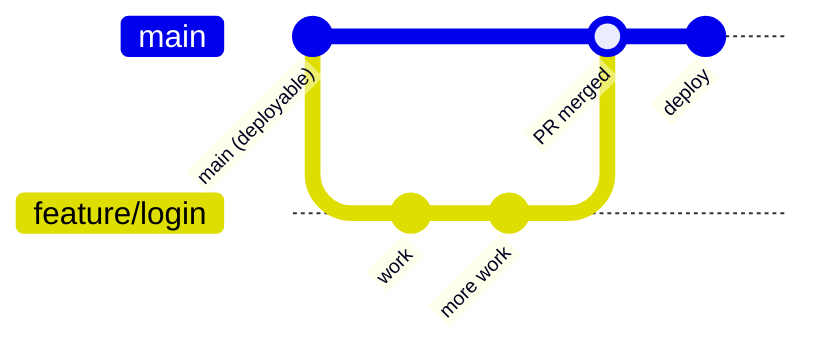
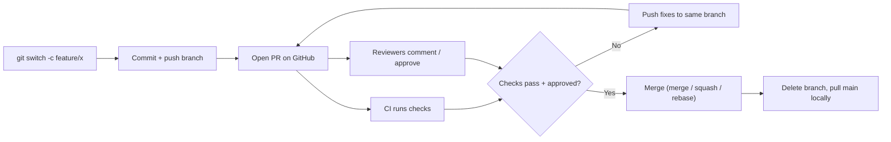

# 09 - Branching Strategies & PR Workflow

## What is a branching strategy?
Git lets you branch any way you like, so teams need an **agreed convention**: which branches exist, what each is for, how work flows into `main`, and how releases happen. A strategy prevents chaos (everyone pushing to `main`), reduces [[03 - Merge Conflicts|conflicts]], and makes releases predictable.

## The three common strategies

### 1. GitHub Flow — simple, continuous delivery (best default)

Rules:
1. `main` is **always deployable**.
2. Branch off `main` for every change, with a descriptive name.
3. Commit and push regularly.
4. Open a **Pull Request**; get review + passing CI.
5. Merge into `main`, then deploy (often automatically).
6. Delete the branch.

Best for: web apps, small/medium teams, continuous deployment. Minimal ceremony — only `main` plus short-lived feature branches.

### 2. Git Flow — structured, scheduled releases
Long-lived branches:
- `main` — production code only (each commit a release, [[07 - Git Tags|tagged]]).
- `develop` — integration branch for the next release.
Supporting branches:
- `feature/*` — branch from `develop`, merge back to `develop`.
- `release/*` — stabilisation before a release; merges into `main` and `develop`.
- `hotfix/*` — urgent production fixes; branch from `main`, merge into `main` and `develop`.

Best for: software with explicit versioned releases and multiple supported versions (installed apps, libraries, embedded). **Trade-off:** more branches, more merging, slower flow; its author later noted it's a poor fit for continuously deployed web apps.

### 3. Trunk-Based Development — fastest integration
Everyone integrates into `main` (the "trunk") at least daily, via very short-lived branches (hours to a day or two) or directly. Unfinished features are hidden behind **feature flags** so incomplete code can ship safely switched off. Requires strong automated testing and CI.

Best for: mature teams with good CI/CD wanting minimal merge pain.

| | GitHub Flow | Git Flow | Trunk-Based |
|---|---|---|---|
| Long-lived branches | `main` | `main` + `develop` | `main` |
| Branch lifetime | days | days–weeks | hours–1 day |
| Release style | continuous | scheduled | continuous |
| Complexity | low | high | low (needs CI discipline) |
| Typical fit | most web projects | versioned products | high-performing CI/CD teams |

For learning projects and most freelance/web work, **GitHub Flow** is the right choice.

## The Pull Request workflow, end to end

Practical habits:
- Branch from an up-to-date `main`: `git switch main && git pull && git switch -c feature/x`.
- Keep PRs small; review quality drops fast with size.
- Before merging, update from `main` (merge or [[04 - Git Rebase|rebase]]) and resolve conflicts on your branch, not on `main`.
- After merging: `git switch main && git pull && git branch -d feature/x`.
- Pick the merge style per team convention (see merge options in [[08 - GitHub Basics|GitHub Basics]]); **squash merge** is popular because it yields one clean commit per PR.

## Common mistakes
- Letting feature branches live for weeks — big, painful merges.
- Pushing directly to `main` on a shared repo (no review, no CI).
- Adopting Git Flow for a small continuously-deployed app — needless overhead.
- Giant PRs mixing refactors, features, and formatting.
- Not deleting merged branches — clutter makes the branch list unreadable.

## Related Concepts
- [[00 - Git & GitHub MOC|Git & GitHub MOC]]
- [[02 - Git Branching|Git Branching]] — the mechanics these strategies use
- [[03 - Merge Conflicts|Merge Conflicts]]
- [[04 - Git Rebase|Git Rebase]]
- [[07 - Git Tags|Git Tags]] — release marking in Git Flow
- [[08 - GitHub Basics|GitHub Basics]] — PRs, branch protection, Actions
