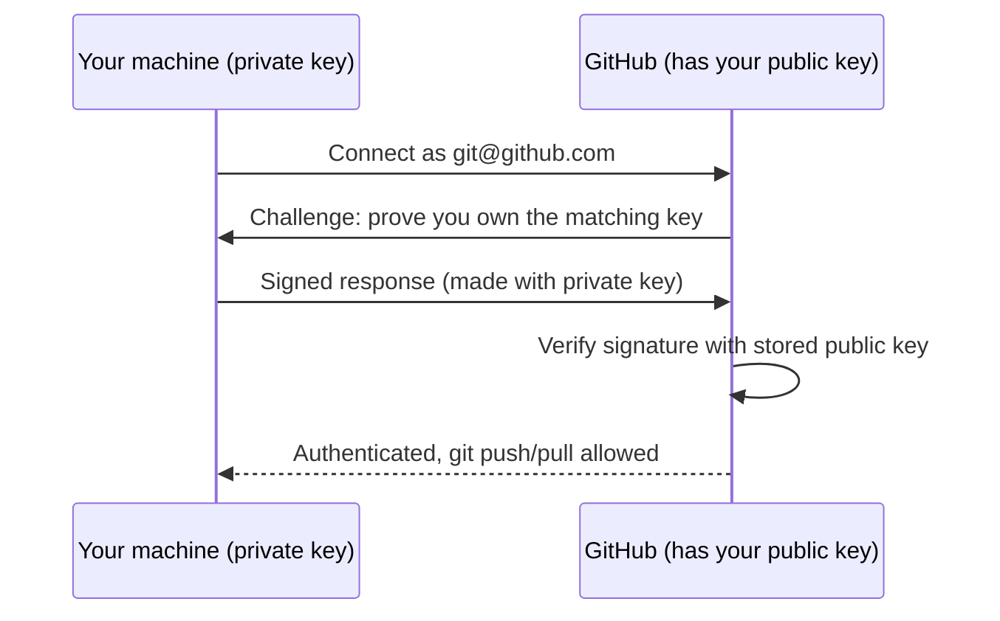

# 11 - SSH Keys & GitHub Authentication

## The problem
Pushing to GitHub requires proving who you are. Typing credentials on every `git push` is tedious and passwords are weak; GitHub also **no longer accepts your account password** for Git over HTTPS. You have two proper options: SSH keys or a Personal Access Token (PAT).

## Two ways to connect
| | HTTPS | SSH |
|---|---|---|
| Remote URL | `https://github.com/user/repo.git` | `git@github.com:user/repo.git` |
| Credential | Personal Access Token (or credential manager / `gh auth login`) | Private/public key pair |
| Setup effort | Low | One-time key setup |
| Prompts | Token stored by a credential helper | None once the key is loaded |
| Works through strict firewalls | Usually | Sometimes blocked (port 22) |

SSH is the common choice for daily development; HTTPS+token is fine for quick or CI use.

## How SSH keys work
SSH uses **public-key cryptography**: you generate a **key pair**.
- **Private key** — stays on your machine, never shared. Whoever has it can act as you.
- **Public key** — safe to share; you upload it to GitHub.

When you connect, GitHub challenges your client to prove it holds the private key matching a registered public key. The private key itself never travels over the network.



## Setup (Linux / macOS / Git Bash on Windows)
**1. Generate a key** (Ed25519 is the modern recommended type):
```bash
ssh-keygen -t ed25519 -C "you@example.com"
# Press Enter to accept the default path (~/.ssh/id_ed25519)
# Set a passphrase (recommended) — it encrypts the private key on disk
```
Creates `~/.ssh/id_ed25519` (private — keep secret) and `~/.ssh/id_ed25519.pub` (public).

**2. Start the agent and load the key** (so you type the passphrase once per session):
```bash
eval "$(ssh-agent -s)"
ssh-add ~/.ssh/id_ed25519
```

**3. Add the public key to GitHub:**
```bash
cat ~/.ssh/id_ed25519.pub     # copy the whole line
```
GitHub → **Settings → SSH and GPG keys → New SSH key** → paste → Save.

**4. Test:**
```bash
ssh -T git@github.com
# Hi <username>! You've successfully authenticated, but GitHub does not provide shell access.
```

**5. Use SSH remotes:**
```bash
git clone git@github.com:user/repo.git
# or switch an existing repo from HTTPS to SSH:
git remote set-url origin git@github.com:user/repo.git
git remote -v
```

## HTTPS with a Personal Access Token (alternative)
1. GitHub → **Settings → Developer settings → Personal access tokens** → generate a token with the minimum scopes needed (prefer fine-grained tokens limited to specific repos).
2. When Git asks for a password, paste the **token** (not your account password).
3. Let a credential helper cache it (`git config --global credential.helper store` or your OS keychain), or use the GitHub CLI: `gh auth login`.

## Security essentials
- **Never share or commit your private key** (`id_ed25519`, no `.pub`). Treat it like a password.
- Use a **passphrase** so a stolen laptop/file isn't instantly usable.
- Treat PATs as passwords too; give them minimal scope and an expiry; never paste them into code or commit them (see [[08 - GitHub Basics|GitHub Basics]] on leaked secrets).
- One key per device so you can revoke a single lost device in GitHub settings.
- If a private key or token leaks: delete it from GitHub immediately and generate a new one.

## Common mistakes
- Uploading the **private** key (or pasting the wrong file) instead of the `.pub` file.
- Cloned via HTTPS but expecting SSH to work — check `git remote -v`; switch with `set-url`.
- `Permission denied (publickey)` — key not added to the agent (`ssh-add -l` to list), public key not uploaded to GitHub, or wrong remote URL.
- Using your account password over HTTPS — rejected; use a token.
- Wrong file permissions on `~/.ssh` (private key must not be readable by others: `chmod 600 ~/.ssh/id_ed25519`).

## Related Concepts
- [[00 - Git & GitHub MOC|Git & GitHub MOC]]
- [[01 - Git Basics|Git Basics]] — remotes and `origin`
- [[08 - GitHub Basics|GitHub Basics]] — authenticating, forks, PRs
- [[Linux]] — the shell environment where these commands run
